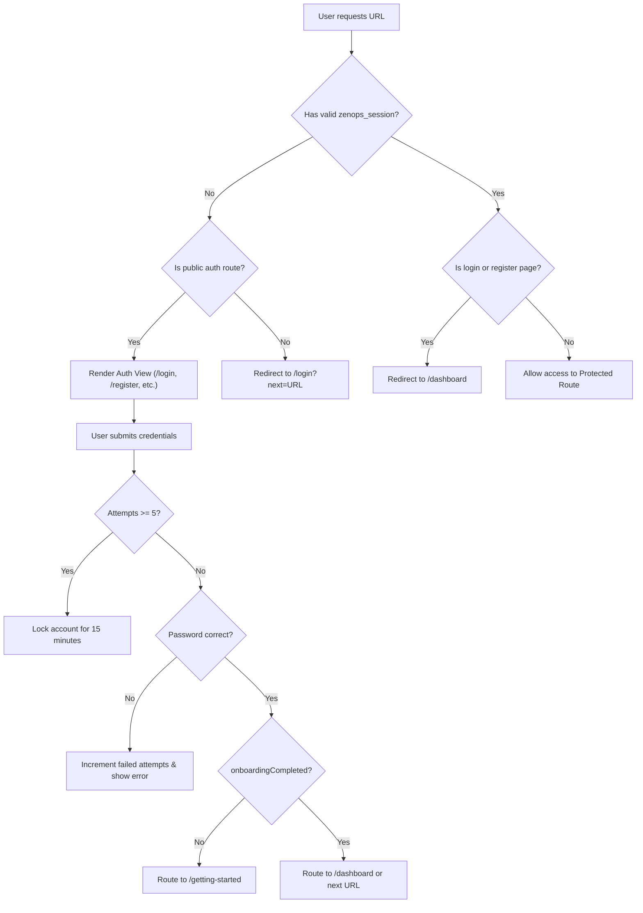
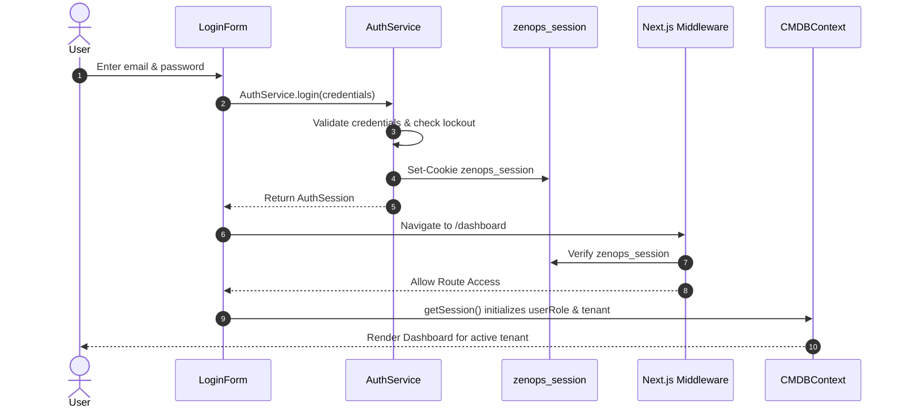

# Module 01: Authentication & Access Management

---

## 1. Purpose in One Paragraph
Authentication & Access Management module-oda mukkiya purpose: ZenOps CMDB platform-ku safe and governed access kudukkuradhu. Yaar login panraanga, avanga entha organization (tenant)-ku uriyavanga, and avangaloda RBAC role (`Admin`, `CMDB Owner`, `Editor`, `Viewer`) enna nu verify panni, multi-tenant isolation-ah zero data leakage-oda guarantee panradhu. Idhu unauthenticated users unauthorized-ah configuration items (CIs), blast radius topology, and financial cost details paakuradha prevent pannum.

---

## 2. Who Uses It (Permission Table)

| Role | Login & Logout | Register New Workspace | OTP Verification | Password Reset | Accept Invitation | Tenant Switcher Access |
| :--- | :---: | :---: | :---: | :---: | :---: | :---: |
| **Anonymous Visitor** | Allowed | Allowed | Allowed | Allowed | Allowed | Denied (Blocked by Middleware) |
| **Viewer** (`Alex Rivera`) | Allowed | Allowed | Allowed | Allowed | Allowed | Restricted to Assigned Tenants |
| **Editor** (`Priya Sharma`)| Allowed | Allowed | Allowed | Allowed | Allowed | Restricted to Assigned Tenants |
| **CMDB Owner** (`David Chen`) | Allowed | Allowed | Allowed | Allowed | Allowed | Restricted to Assigned Tenants |
| **Admin** (`Sarah Jenkins`) | Allowed | Allowed | Allowed | Allowed | Allowed | All Tenant Workspaces (`ZenDev`, `ChooseCy`, `SpaceZen`) |

---

## 3. Entry Points
- **Direct URLs**: `/login`, `/register`, `/verify-otp`, `/forgot-password`, `/reset-password`, `/accept-invite?token=...`, `/logout`.
- **Automatic Interception**: Any protected route (e.g. `/`, `/dashboard`, `/cis`) accessed without a valid `zenops_session` cookie is automatically intercepted by [middleware.ts](file:///d:/zenops/middleware.ts) and redirected to `/login?next=<encoded-path>`.
- **Header Profile Menu**: Top-right user avatar dropdown in [Header.tsx](file:///d:/zenops/components/layout/Header.tsx) contains the "Sign out" button linking to `/logout`.

---

## 4. Preconditions & Required Data
- System starts with pre-seeded demo users configured in [services/auth-service.ts](file:///d:/zenops/services/auth-service.ts#L28) (`sarah.jenkins@zenops.io`, `david.chen@zenops.io`, `priya.sharma@zenops.io`, `alex.rivera@zenops.io`, `founder@startup.io`).
- Standard password for seeded demo accounts: `Password@123`.
- Browser supports `localStorage`, `sessionStorage`, and standard HTTP cookies (`zenops_session`).

---

## 5. Main Flow (Happy Path: Standard User Sign In)

| Step | Actor | Screen / Element Clicked | What System Does Behind Scenes | Data Created or Changed | What User Sees Next |
| :-: | :--- | :--- | :--- | :--- | :--- |
| **1** | User | Browser visits `/dashboard` | `middleware.ts` inspects cookies. `zenops_session` missing. Redirects to `/login?next=%2Fdashboard`. | None | Jira-style split-screen `/login` page with brand gradient hero. |
| **2** | User | Enters `sarah.jenkins@zenops.io`, `Password@123`, checks "Remember me", clicks **Sign In** | `LoginForm.tsx` validates non-empty inputs and calls `AuthService.login({ email, password, rememberMe })`. | Validates credentials against seeded record in [services/auth-service.ts#L201](file:///d:/zenops/services/auth-service.ts#L201). | Loading spinner appears on "Sign In" button. |
| **3** | System | `AuthService.login()` | Generates session token, encodes user profile, resets `failedLoginAttempts: 0`. Sets base64 `zenops_session` cookie and stores session in `localStorage`. | Cookie `zenops_session` created. `localStorage` key `zenops_auth_session` set. | System triggers client-side redirect to `next` target (`/dashboard`). |
| **4** | User | Lands on `/dashboard` | `middleware.ts` allows entry. [cmdb-context.tsx](file:///d:/zenops/context/cmdb-context.tsx#L135) reads `AuthService.getSession()`, initializes `activeTenant: "ZenDev Software Technologies"`, `userRole: "Admin"`. | Global session synchronized into React state. | Executive Dashboard displays with Sarah Jenkins avatar and tenant lock badge. |

---

## 6. Alternate Flows

### 6.1 New Account Registration (`/register`)
- **Step 1 (Account)**: User enters Full Name, Work Email, Job Title, Password, Confirm Password. Real-time checklist evaluates 8+ characters, uppercase, lowercase, numbers, and symbols.
- **Step 2 (Workspace)**: User clicks "Continue", enters Company Name (e.g. "Acme Cloud"), domain (`acme.io`), and industry. Workspace URL slug `acme.zenops.io` is generated automatically.
- **Completion**: `AuthService.register()` stores pending user in `localStorage`, saves registration email to `sessionStorage`, and forwards user to `/verify-otp`.

### 6.2 6-Digit Email OTP Verification (`/verify-otp`)
- User inputs 6 numeric digits into auto-advancing boxes or clicks "Use Demo Code (123456)".
- `AuthService.verifyOtp({ email, otp: "123456" })` validates the code, flips `emailVerified: true`, clears pending registration, and forwards user to `/login?banner=verified`.
- Green banner appears on login: *"Email verified successfully. Please sign in to access your workspace."*

### 6.3 Self-Service Password Reset (`/forgot-password` -> `/verify-otp?flow=reset` -> `/reset-password`)
- User submits work email at `/forgot-password`. `AuthService.requestPasswordReset(email)` generates a reset challenge and redirects to `/verify-otp?flow=reset`.
- User inputs 6-digit OTP (`123456`). System redirects to `/reset-password?token=...`.
- User configures new password satisfying complexity requirements. `AuthService.resetPassword()` updates credentials and redirects to `/login?banner=password-updated`.

### 6.4 First-Time Login Onboarding Redirect (`onboardingCompleted = false`)
- When logging in as `founder@startup.io`, `user.onboardingCompleted` is `false`.
- `LoginForm.tsx` detects `onboardingCompleted === false` and routes user immediately to `/getting-started` instead of `/dashboard`.

---

## 7. Error & Edge Flows

| Scenario | Trigger / Condition | What System Does | User Experience / Alert |
| :--- | :--- | :--- | :--- |
| **Invalid Password** | Incorrect password entered. | `AuthService.login()` increments `user.failedLoginAttempts += 1`. | Red alert banner: *"Invalid email or password. Attempt 1 of 5 before account lockout."* |
| **5-Attempt Account Lockout** | 5 consecutive failed login attempts. | `AuthService.login()` sets `user.lockedUntil = now + 15 minutes`. | Inputs disabled. Warning banner displays live 15-minute countdown timer: *"Account locked due to multiple failed attempts. Try again in 14m 58s."* |
| **Caps Lock Active** | User types password with Caps Lock on. | Keyboard event `e.getModifierState("CapsLock")` detects status. | Amber warning badge appears below password input: *"Caps Lock is on"*. |
| **Invalid OTP** | Entered OTP &ne; `123456`. | `AuthService.verifyOtp()` rejects code. | Error banner: *"Invalid or expired verification code. Use demo code 123456."* Inputs shake and clear. |
| **Session Expired in Flight** | Cookie deleted or expired while navigating. | [AppLayout.tsx](file:///d:/zenops/components/layout/AppLayout.tsx) detects missing session. | Accessible modal opens: *"Your session has expired. Please sign in again."* Clicking "Sign In" retains current page as `?next=`. |

---

## 8. Business Rules Applied Here

| Rule Code | Rule Condition | System Enforcement | Enforcement File |
| :--- | :--- | :--- | :--- |
| **SEC-01** | Account Lockout Threshold | 5 consecutive failed attempts lock user for 900 seconds (15 mins). | [services/auth-service.ts#L225](file:///d:/zenops/services/auth-service.ts#L225) |
| **SEC-02** | Password Complexity | Minimum 8 chars, 1 uppercase, 1 lowercase, 1 number, 1 special character. | [RegisterStepper.tsx#L52](file:///d:/zenops/components/auth/RegisterStepper.tsx#L52) |
| **SEC-03** | Route Protection | All non-auth paths require valid `zenops_session` cookie. | [middleware.ts#L36](file:///d:/zenops/middleware.ts#L36) |
| **SEC-04** | Tenant Scoping | User can only switch between workspaces in their `user.availableTenants` list. | [cmdb-context.tsx#L145](file:///d:/zenops/context/cmdb-context.tsx#L145) |

---

## 9. Side Effects
- **Session Cookie Creation**: Writes `zenops_session` with base64 encoded payload and 7-day max-age (`rememberMe ? 30 days : 1 day`).
- **Context Synchronization**: Updates `CMDBContext` with user's role (`Admin`, `Editor`, etc.) and active tenant.
- **Tenant Scope Enforcement**: Header workspace dropdown limits selection to authorized tenant IDs.
- **Audit Logging**: Authentication events log in browser console; ready for `/api/v1/audit/auth` ingestion in production.

---

## 10. Inputs, Outputs & Service Contracts

### Key Function Signatures ([services/auth-service.ts](file:///d:/zenops/services/auth-service.ts))
```typescript
static async login(credentials: LoginCredentials): Promise<AuthResponse>;
static async register(data: RegisterData): Promise<AuthResponse>;
static async verifyOtp(data: VerifyOtpData): Promise<AuthResponse>;
static async requestPasswordReset(email: string): Promise<AuthResponse>;
static async resetPassword(data: ResetPasswordData): Promise<AuthResponse>;
static getSession(): AuthSession | null;
static clearSession(): void;
```
*Note on Real Backend*: In production, client-side cookie storage and mock OTP will be replaced by HTTP-only secure cookies issued by an OAuth2/OIDC identity provider or JWT authentication endpoint (`POST /api/auth/login`).

---

## 11. Mermaid Diagrams

### 11.1 Authentication & Route Guard Flowchart


### 11.2 Sequence Diagram: Sign In & Session Bootstrapping


---

## 12. Worked Example with Real Seed Data

1. **Before Action**:
   - Browser has no cookies.
   - User targets `http://localhost:3000/cis/CI-000492`.
2. **Execution**:
   - `middleware.ts` intercepts request and rewrites to `/login?next=%2Fcis%2FCI-000492`.
   - User clicks **"Fill Demo Account"** &rarr; selects **`Sarah Jenkins (Admin)`**.
   - Input fields auto-populate: `sarah.jenkins@zenops.io` / `Password@123`.
   - User clicks **Sign In**.
3. **After Action**:
   - `zenops_session` cookie created with payload `{ userId: "USR-1001", role: "Admin", tenantId: "CMP_1001_ZENDEV" }`.
   - Browser immediately redirects to `/cis/CI-000492`.
   - CI 360 profile for `PROD-DB-MUMBAI-01` displays with Admin capabilities (Inline edit, Retire button enabled).

---

## 13. How to Demo This Flow in 2 Minutes (Tanglish Script)

> "Hi team, first namma ZenOps CMDB-oda **Authentication and Enterprise Access** path-ah paakalaam.
> 1. Naan ipo sign out pannittu `/dashboard`-ku direct-ah poga try panren. Paatheengana, Next.js Edge Middleware namma request-ah intercept panni auto-redirect to `/login?next=/dashboard` panniduchu.
> 2. Screen-la Jira-inspired split layout iruku: left side-la namma ZenOps value propositions and SVG topology diagram, right side-la accessible login card.
> 3. Security testing-kaaga Caps Lock press panna live badge kaatum. Thappana password 5 vaati potta automatic-ah 15 minutes account lock aaidum with live countdown.
> 4. Eval ease-kaaga 'Demo Accounts' dropdown vechirukom. Naan 'Sarah Jenkins (Admin)' select panni Sign In click panren.
> 5. Instant-ah token set aagi, Sarah-oda role and 'ZenDev Software Technologies' tenant isolate aagi dashboard open aaidum. Zero friction, enterprise security!"

---

## 14. Test Scenarios (Manual Acceptance Tests)

- **Scenario 1 (Valid Admin Login)**:
  - *Given*: User on `/login`.
  - *When*: Enters `sarah.jenkins@zenops.io` and `Password@123` and clicks Sign In.
  - *Then*: Redirects to `/dashboard` with Admin role and ZenDev workspace active.
- **Scenario 2 (Invalid Password Counter)**:
  - *Given*: User on `/login`.
  - *When*: Enters valid email with wrong password `WrongPass1`.
  - *Then*: Shows red banner stating attempt 1 of 5.
- **Scenario 3 (Account Lockout)**:
  - *Given*: User has failed 4 times.
  - *When*: Submits wrong password the 5th time.
  - *Then*: Account locks; inputs disable; 15-minute countdown starts.
- **Scenario 4 (OTP Verification)**:
  - *Given*: User on `/verify-otp`.
  - *When*: Clicks "Use Demo Code (123456)" and submits.
  - *Then*: Redirects to `/login?banner=verified`.
- **Scenario 5 (Password Reset Flow)**:
  - *Given*: User on `/forgot-password`.
  - *When*: Enters email, verifies OTP, and enters new valid password.
  - *Then*: Redirects to `/login?banner=password-updated`.
- **Scenario 6 (Unauthenticated Redirect)**:
  - *Given*: User with no session cookie.
  - *When*: Browses directly to `/relationships`.
  - *Then*: URL changes to `/login?next=%2Frelationships`.

---

## 15. Gaps & Next Steps
- **SSO Integration**: "Continue with Google" and "Continue with Microsoft" are visually styled and marked with "Coming soon"; requires SAML/OIDC provider backend integration.
- **Email Delivery**: OTP delivery is simulated via console logging and instant demo button; production requires an SMTP or AWS SES email gateway.
- **Server-Side Session Revocation**: Current tokens are client-decoded; production should validate against a Redis token blacklist on `/logout`.
