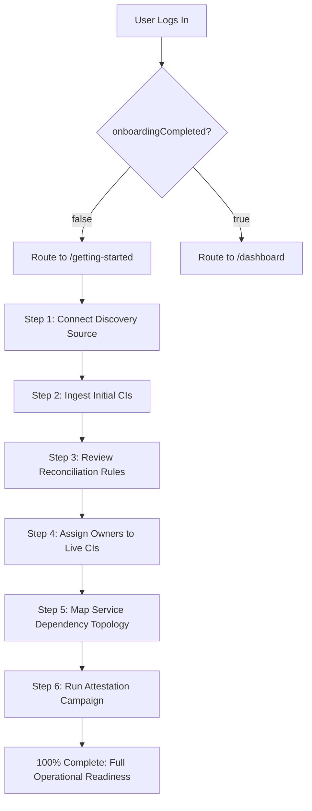
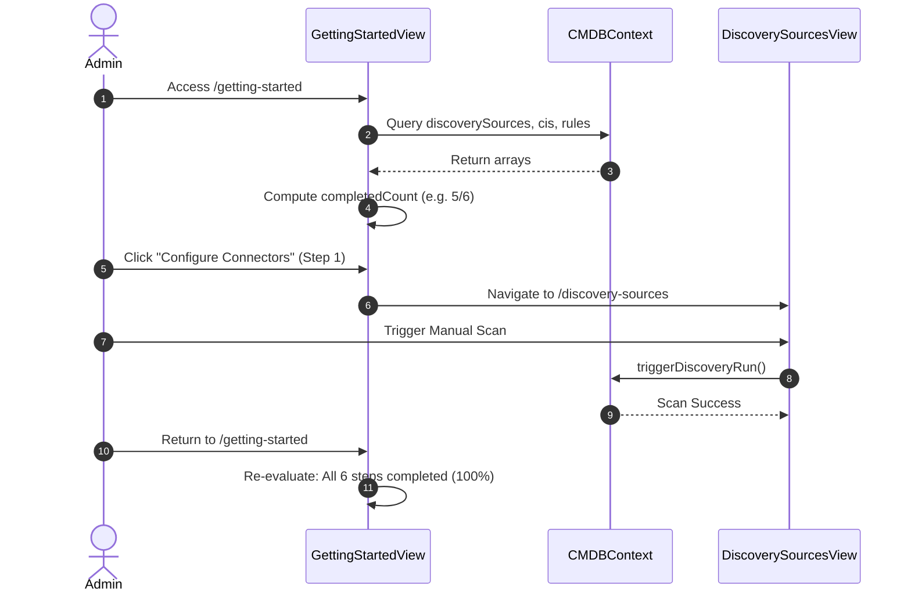

# Module 02: Getting Started & Setup Onboarding

---

## 1. Purpose in One Paragraph
Getting Started & Onboarding module-oda mukkiya purpose: Oru pudhu company or startup team ZenOps CMDB platform-ku vandhavudan, manuals padika theva-illama, step-by-step guided checklist moolama avanga CMDB foundation-ah build panradhu. Discovery connect panradhu-la irundhu, first CI create panni, rules set panni, attestation campaign mudikkura varaikum 6 key steps-la avangala guide pannum. Idhu product adoption-ah fast aakum and initial Data Trust score-ah maintain panna udhavum.

---

## 2. Who Uses It (Permission Table)

| Role | View Onboarding Checklist | Click Action Buttons | Mark Steps Completed | Dismiss Top Banner |
| :--- | :---: | :---: | :---: | :---: |
| **Viewer** | View Only | View / Browse Only | Read-only Evaluation | Allowed |
| **Editor** | Allowed | Can create non-prod CIs | Evaluates dynamically | Allowed |
| **CMDB Owner** | Allowed | Full Configuration | Evaluates dynamically | Allowed |
| **Admin** (`Sarah Jenkins`) | Allowed | Full Configuration & Connectors | Evaluates dynamically | Allowed |

---

## 3. Entry Points
- **First Login Redirect**: When a newly registered user or un-onboarded admin (`founder@startup.io`) signs in, `onboardingCompleted: false` triggers an automatic route push to `/getting-started`.
- **Top Banner on Dashboard**: [GettingStartedBanner.tsx](file:///d:/zenops/components/cmdb/GettingStartedBanner.tsx) sits at the very top of `/dashboard` showing progress with brand-gradient bar.
- **Sidebar Navigation**: Direct menu item "Getting Started" in [Sidebar.tsx](file:///d:/zenops/components/layout/Sidebar.tsx).
- **Direct Route**: `/getting-started`.

---

## 4. Preconditions & Required Data
- Authenticated session with an active tenant (`ZenDev Software Technologies`, `Startup AI Inc`, etc.).
- Active CMDB context providing live arrays for `cis`, `discoverySources`, `reconciliationRules`, and `attestationCampaigns`.

---

## 5. Main Flow (Happy Path: Guided Setup Progress)

| Step | Actor | Screen / Element Clicked | What System Does Behind Scenes | Data Created or Changed | What User Sees Next |
| :-: | :--- | :--- | :--- | :--- | :--- |
| **1** | Admin | Signs in as `founder@startup.io` | `LoginForm.tsx` checks `session.onboardingCompleted`. It is `false`. | Redirects to `/getting-started`. | Dedicated Getting Started page with 6-step checklist card grid. |
| **2** | Admin | Clicks **Configure Connectors** on Step 1 | Routes to `/discovery-sources`. | Navigates route. | Discovery Sources management screen. |
| **3** | Admin | Clicks **Trigger Manual Scan** on AWS connector | `triggerDiscoveryRun("DSC-01")` executes scan simulation. | Increases `cisDiscovered` and `cisUpdated`. | Status changes to "In Progress" then "Success". Step 1 completes. |
| **4** | Admin | Clicks **Open Inventory** on Step 2 | Routes to `/cis`. CIs populated from discovery. | Evaluates `cis.length > 0`. | Inventory shows newly indexed CIs. Step 2 marked complete. |
| **5** | Admin | Clicks **Review Rules** on Step 3 | Routes to `/reconciliation-rules`. | Evaluates `reconciliationRules.length > 0`. | Step 3 checks off automatically. |
| **6** | Admin | Returns to `/getting-started` | `GettingStartedView.tsx` re-evaluates all 6 conditions. | Dynamically increments progress percentage. | Progress bar fills with brand gradient (#1F6BFF &rarr; #19C8F0 &rarr; #3EF2B5). |

---

## 6. Alternate Flows
- **Dashboard Banner Interaction**: Instead of using `/getting-started`, users can track progress directly from `/dashboard` via [GettingStartedBanner.tsx](file:///d:/zenops/components/cmdb/GettingStartedBanner.tsx).
- **Dismissing the Banner**: Users can click the "Dismiss" (X) icon on the dashboard banner. The preference is stored in `localStorage` (`zenops_hide_onboarding_banner: true`), hiding it from future dashboard views.

---

## 7. Error & Edge Flows

| Scenario | Trigger / Condition | What System Does | User Experience / Alert |
| :--- | :--- | :--- | :--- |
| **Empty Tenant Catalog** | New tenant has 0 CIs and 0 connectors. | `completedCount = 0`. | Progress bar shows 0%. Step 1 & 2 show pending state with actionable links. |
| **Live CIs without Owners** | Step 4 detects CIs with `owner === 'Unassigned'`. | Step 4 displays warning badge: *"Live CIs without owners drop Trust Score by 30 pts."* | "Remediate Ownership" button routes directly to `/data-quality?tab=missing-owner`. |

---

## 8. Business Rules Applied Here

| Rule Code | Rule Condition | System Enforcement | Enforcement File |
| :--- | :--- | :--- | :--- |
| **ONB-01** | Step 1 Completion | Active discovery connector exists: `discoverySources.some(s => s.status === 'Active')`. | [GettingStartedView.tsx#L30](file:///d:/zenops/components/cmdb/GettingStartedView.tsx#L30) |
| **ONB-02** | Step 2 Completion | At least 1 CI exists: `cis.length > 0`. | [GettingStartedView.tsx#L31](file:///d:/zenops/components/cmdb/GettingStartedView.tsx#L31) |
| **ONB-03** | Step 4 Completion | At least 5 live CIs have assigned owners: `cis.filter(c => c.owner !== 'Unassigned').length >= 5`. | [GettingStartedView.tsx#L33](file:///d:/zenops/components/cmdb/GettingStartedView.tsx#L33) |
| **ONB-04** | Step 6 Completion | At least 1 attestation verified: `attestationCampaigns.some(c => c.certifiedCIs > 0)`. | [GettingStartedView.tsx#L35](file:///d:/zenops/components/cmdb/GettingStartedView.tsx#L35) |

---

## 9. Side Effects
- Progress calculation dynamically drives the completion percentage displayed on both the banner and the dedicated view.
- Encourages initial discovery configuration and data quality remediation to ensure healthy initial Trust Scores.

---

## 10. Inputs, Outputs & Service Contracts
- **Inputs**: Live arrays from `CMDBContext` (`cis`, `discoverySources`, `reconciliationRules`, `attestationCampaigns`).
- **Outputs**: Computed `completedCount` (0-6) and completion percentage (`Math.round((completedCount / 6) * 100)`).
- **Functions Called**:
  - `useCMDB()` hook reading state.

---

## 11. Mermaid Diagrams

### 11.1 Onboarding Progression Flowchart

### 11.2 Sequence Diagram: Automated Step Evaluation

---

## 12. Worked Example with Real Seed Data
1. **Initial State (Startup AI Inc - CMP_9001_STARTUP)**:
   - `cis.length = 0`, `discoverySources = []`.
   - `completedCount = 0/6` (0%).
2. **Action**:
   - Founder connects AWS connector and triggers discovery run.
   - 14 initial CIs ingested.
3. **Outcome**:
   - Step 1 (Discovery) & Step 2 (Ingest CIs) mark as complete.
   - Getting Started progress updates to **33% (2 of 6 completed)**.
   - Dashboard banner updates in real time with brand gradient.

---

## 13. How to Demo This Flow in 2 Minutes (Tanglish Script)

> "Ipo namma **Getting Started and Guided Onboarding** flow-ah paakalaam.
> 1. Oru startup engineer first time login panna udaney, avangalukku enna pannanum nu theriyaama iruka koodadhu. Adhanaala namma 6-step guided checklist provide panrom.
> 2. Screen-la paatheengana: Connect Discovery, Ingest CIs, Review Rules, Assign Owners, Map Topology, and Attestation.
> 3. Each step live system data-va inspect pannum. For example, AWS discovery run aana udaney Step 1 and Step 2 automatic-ah tick aaidum.
> 4. Top progress bar-la namma ZenOps brand gradient (#1F6BFF to #19C8F0 to #3EF2B5) visually progress-ah highlight pannum.
> 5. Dashboard-la kooda idhu oru compact banner-ah irukum; vendam-na 1-click-la dismiss pannikalam."

---

## 14. Test Scenarios (Manual Acceptance Tests)
- **Scenario 1 (New User Redirect)**:
  - *Given*: User logs in with `founder@startup.io`.
  - *When*: Login succeeds.
  - *Then*: Redirects to `/getting-started` instead of `/dashboard`.
- **Scenario 2 (Dynamic Step Evaluation)**:
  - *Given*: Active tenant with 6 discovery sources and 21 CIs.
  - *When*: User views `/getting-started`.
  - *Then*: Steps 1, 2, 3, 5 are marked complete automatically.
- **Scenario 3 (Step Action Link)**:
  - *Given*: Step 4 ("Assign Technical Owners") is pending.
  - *When*: User clicks "Remediate Ownership".
  - *Then*: Directly routes to `/data-quality`.
- **Scenario 4 (Banner Dismissal)**:
  - *Given*: Getting started banner visible on `/dashboard`.
  - *When*: User clicks the dismiss button.
  - *Then*: Banner disappears and stays hidden on page refresh.

---

## 15. Gaps & Next Steps
- **Permanent Dismissal Sync**: Banner dismissal currently relies on client-side state/localStorage; in production, this should persist to `user.onboardingCompleted` on the backend profile.
