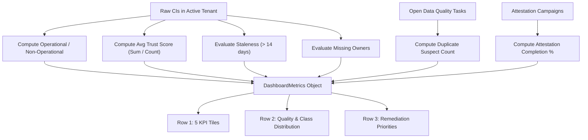
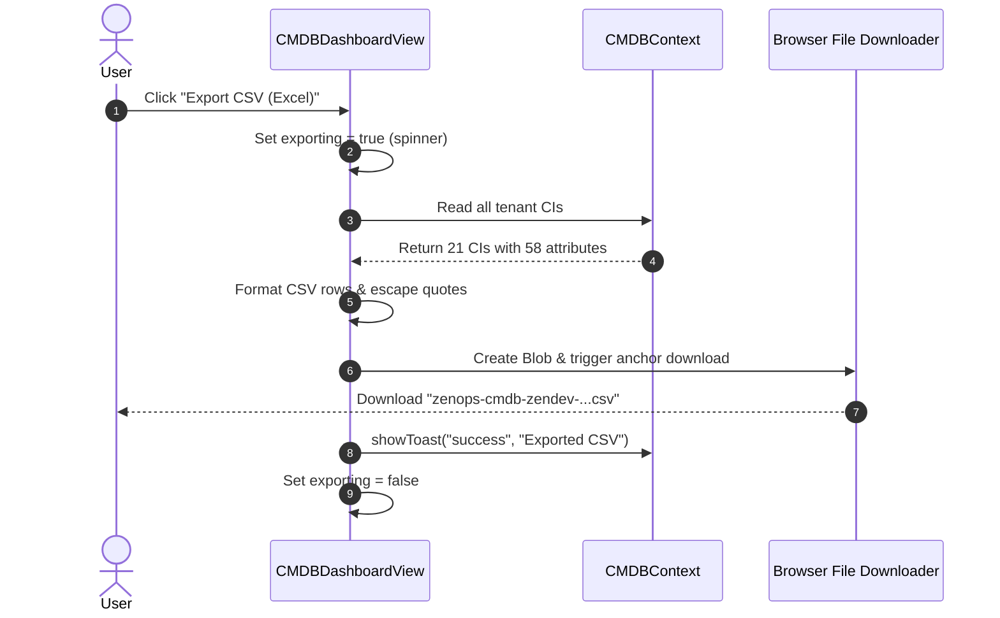

# Module 03: Executive CMDB Health Dashboard

---

## 1. Purpose in One Paragraph
CMDB Health Dashboard (`/dashboard`) module-oda primary purpose: IT leadership, infrastructure directors, and DevOps engineers-ku complete configuration estate-oda single-pane-of-glass health view tharuvadhu. Idhu inventory volume, algorithmic Trust Score, staleness velocity, missing ownership, duplicate collisions, discovery health, and business service SLA exposure ellathaiyum real-time-la aggregate panni kaattum. Idhu "Can we trust our CMDB data before a major change?" endra critical business question-ku instant answer tharum.

---

## 2. Who Uses It (Permission Table)

| Capability | Viewer | Editor | CMDB Owner | Admin |
| :--- | :---: | :---: | :---: | :---: |
| **View Health Metrics & Charts** | Allowed | Allowed | Allowed | Allowed |
| **Hover InfoHint Concepts** | Allowed | Allowed | Allowed | Allowed |
| **Toggle "More / Fewer Metrics"** | Allowed | Allowed | Allowed | Allowed |
| **Export CSV (Excel) & JSON** | Allowed | Allowed | Allowed | Allowed |
| **Import CSV (Bulk Upload)** | Denied (Hidden) | Allowed | Allowed | Allowed |
| **Create CI Button** | Denied (Hidden) | Allowed | Allowed | Allowed |
| **Click-Through to Remediations** | Allowed | Allowed | Allowed | Allowed |

---

## 3. Entry Points
- **Default Application Landing**: `/dashboard` (default destination after successful login).
- **Sidebar Navigation**: Topmost item "Dashboard" in [Sidebar.tsx](file:///d:/zenops/components/layout/Sidebar.tsx).
- **Header Breadcrumb**: Root home breadcrumb.

---

## 4. Preconditions & Required Data
- Authenticated user with an assigned tenant.
- Populated `cis` array, `dataQualityTasks`, `discoverySources`, `attestationCampaigns`, and `auditHistory` in `CMDBContext`.

---

## 5. Main Flow (Happy Path: Executive Health Inspection)

| Step | Actor | Screen / Element Clicked | What System Does Behind Scenes | Data Created or Changed | What User Sees Next |
| :-: | :--- | :--- | :--- | :--- | :--- |
| **1** | User | Opens `/dashboard` | [cmdb-context.tsx#L237](file:///d:/zenops/context/cmdb-context.tsx#L237) computes `metrics` useMemo hook across all tenant CIs. | Dynamic aggregation of 12 KPI variables. | Top getting started banner + 5 primary KPI cards render. |
| **2** | User | Hovers over InfoHint (`i`) on **Avg Trust Score** | [InfoHint.tsx](file:///d:/zenops/components/ui/InfoHint.tsx) opens accessible popover. | None | Reads plain-English explanation: "What it measures", "Why it matters", and "Target: 80%+". |
| **3** | User | Clicks **More Metrics** | Toggles `showSecondaryMetrics: true`. | Client UI state toggled. | 4 secondary cards appear: Operational CIs, Non-Operational CIs, Attestation %, Completeness %. |
| **4** | User | Inspects Section 2 (Quality & Spread) | [DashboardCharts.tsx](file:///d:/zenops/components/cmdb/DashboardCharts.tsx) renders Trust Score distribution bands and horizontal CIs by Class bars. | None | Identifies that Database & Server classes form 65% of catalog. |
| **5** | User | Clicks on **Missing Owner** tile in Remediation Priorities | Routes to `/data-quality` with filter preset. | Navigates route. | Directly opens Data Quality view filtered to ownership anomalies. |
| **6** | User | Clicks **Export CSV (Excel)** | [CMDBDashboardView.tsx#L64](file:///d:/zenops/components/cmdb/CMDBDashboardView.tsx#L64) serializes all tenant CIs into CSV format and triggers browser download. | CSV file downloaded: `zenops-cmdb-zendev-...csv`. | Success toast: *"Exported catalog snapshot as CSV."* |

---

## 6. How the Dashboard Reads: Structure, Formulas & Targets

The dashboard is structured in **3 hierarchical rows** reading from top to bottom and left to right:

### Row 1: Primary Health KPIs & Baselines
1. **Total CIs**: `cis.length` (ZenDev: 21 CIs). Baseline managed volume. Target: 100% discovered.
2. **Avg Trust Score**: `Math.round(totalTrust / total)` (ZenDev: 85%). Weighted composite reliability. Target: &ge; 80%.
3. **Stale CIs**: `cis.filter(c => (now - c.lastDiscovered) > 14 days).length` (ZenDev: 4 CIs / 19%). Target: &lt; 5%.
4. **Missing Owner**: `cis.filter(c => !c.owner || c.owner === 'Unassigned').length` (ZenDev: 2 CIs / 10%). Target: &lt; 5%.
5. **Duplicate Suspects**: Count of open DQ tasks with `issueType === 'Duplicate Suspect'`. Target: 0.

### Secondary Metrics Drawer (Revealed via "More Metrics")
- **Operational CIs**: `cis.filter(c => c.operationalStatus === "Operational").length`.
- **Non-Operational CIs**: `cis.filter(c => c.operationalStatus !== "Operational").length`.
- **Attestation Completion %**: Average of `attestationCampaigns.completionPercentage`. Target: &ge; 80%.
- **Completeness Score %**: Percentage of CIs having Owner, Support Group, Environment, and Criticality.

### Row 2: Quality & Architectural Distribution
- **Trust Score Distribution**: 5 health bands (80-100 Optimal, 60-79 Adequate, 40-59 At Risk, 20-39 Critical, 0-19 Untrusted). Bands below 60 show red "Needs Attention" badge.
- **CIs by Class**: Horizontal breakdown across Servers, Containers, Cloud Resources, Applications, Databases, Networks, and SaaS.

### Row 3: Actionable Remediation & Service Exposure
- **Open Data Quality Remediation**: Interactive category links jumping to filtered DQ tasks.
- **Discovery Sources Health**: Connectors with status lozenges (`OK`, `LATE`, `FAILED`) and live manual scan triggers.
- **Services by Trust Score**: Business services SLA monitor highlighting critical services below 70% Trust.
- **Recent Audit Stream**: Real-time ticker of last 5 configuration changes with actor and before/after diffs.

---

## 7. Error & Edge Flows

| Scenario | Trigger / Condition | What System Does | User Experience / Alert |
| :--- | :--- | :--- | :--- |
| **Zero CIs in Tenant** | Tenant has no registered items. | `metrics` returns safe zeros for all counts. | KpiCards display "0". Charts display empty state message: *"No Configuration Items found for this tenant."* |
| **Trust Score SLA Breach** | Any Business Service has Trust Score &lt; 70%. | Card border shifts to danger red; warning icon pulses. | Banner warning: *"Legacy HR System has breached 70% critical SLA threshold."* |
| **CSV Export Lock** | User triggers export while previous download is preparing. | `exporting: true` disables export button and shows spinner. | Prevents double-submission and memory spikes. |

---

## 8. Business Rules Applied Here

| Rule Code | Rule Condition | System Enforcement | Enforcement File |
| :--- | :--- | :--- | :--- |
| **DSH-01** | Staleness Threshold | CI is flagged as stale if `lastDiscovered` was > 14 days ago. | [cmdb-context.tsx#L268](file:///d:/zenops/context/cmdb-context.tsx#L268) |
| **DSH-02** | Missing Owner Detection | Blank owner or `"Unassigned"` triggers Missing Owner count. | [cmdb-context.tsx#L274](file:///d:/zenops/context/cmdb-context.tsx#L274) |
| **DSH-03** | Service SLA Breach Warning | Service Trust Score &lt; 70% triggers critical alert styling. | [CMDBDashboardView.tsx#L415](file:///d:/zenops/components/cmdb/CMDBDashboardView.tsx#L415) |

---

## 9. Side Effects
- Exporting CSV creates formatted Excel-compatible CSV file containing 22 standard CI columns.
- Exporting JSON generates formatted snapshot payload with timestamp and tenant slug.
- Clicking any category navigates to `/data-quality` with preserved filter context.

---

## 10. Inputs, Outputs & Service Contracts
- **Inputs**: `cis`, `dataQualityTasks`, `attestationCampaigns`, `discoverySources`, `auditHistory` from `CMDBContext`.
- **Outputs**: Calculated `metrics: DashboardMetrics` object consumed across all child tiles.
- **Export Contract**: Generates `text/csv` and `application/json` download blobs entirely in the browser.

---

## 11. Mermaid Diagrams

### 11.1 Metrics Aggregation Pipeline

### 11.2 Sequence Diagram: CSV Export Flow

---

## 12. Worked Example with Real Seed Data
- **Tenant**: `ZenDev Software Technologies` (`CMP_1001_ZENDEV`).
- **Input Records**: 21 CIs (including `CI-000492 PROD-DB-MUMBAI-01` [Trust 96], `CI-1010 staging-legacy-billing` [Trust 45]).
- **Calculated Dashboard Output**:
  - Total CIs: **21**
  - Average Trust Score: **85%**
  - Stale CIs: **4 (19%)**
  - Missing Owner: **2 (10%)**
  - Duplicate Suspects: **1**
  - Services by SLA: `Payments API` (94, Optimal), `Legacy HR System` (42, Breached).

---

## 13. How to Demo This Flow in 2 Minutes (Tanglish Script)

> "Manager-kitta namma **CMDB Health Dashboard** kaatum bodhu:
> 1. Dashboard top-la iruka 5 KPI tiles-ah highlight pannunga: Total CIs (21), Avg Trust Score (85%), Stale CIs (19%), Missing Owner (10%), Duplicate Suspects (1).
> 2. InfoHint icon moolama 'What it measures' and 'Target: 80%+' plain English-la reveal aagura convenience-ah kaatunga.
> 3. 'More Metrics' toggle click panni Operational vs Non-operational split and Attestation % kaatunga.
> 4. Section 2-la Trust Score Distribution bar-la 80-100 green optimal bands and 60-kku keezha irukura red 'Needs Attention' category-ah show pannunga.
> 5. 'Export CSV (Excel)' click panni single click-la entire 58-column dataset Excel spreadsheet-ah download aaguradha demo pannunga!"

---

## 14. Test Scenarios (Manual Acceptance Tests)
- **Scenario 1 (KPI Card Values)**:
  - *Given*: ZenDev tenant with 21 CIs.
  - *When*: Dashboard loads.
  - *Then*: Total CIs card displays "21" and Avg Trust Score displays "85%".
- **Scenario 2 (InfoHint Popover)**:
  - *Given*: User on `/dashboard`.
  - *When*: Clicks info icon on "Avg Trust Score".
  - *Then*: Popover displays SLA target: "Target: 80%+ Avg Trust".
- **Scenario 3 (CSV Export)**:
  - *Given*: User clicks "Export CSV (Excel)".
  - *When*: Processing completes.
  - *Then*: CSV file downloads with standard 22 header columns.
- **Scenario 4 (Remediation Linkage)**:
  - *Given*: User on dashboard.
  - *When*: Clicks "Missing Owner" category link.
  - *Then*: Navigates directly to `/data-quality` with ownership filter active.

---

## 15. Gaps & Next Steps
- **Customizable Dashboard Layout**: Current KPI card order is fixed; future release could allow drag-and-drop widget arrangement per user preference.
- **Scheduled Email Digests**: Automatic weekly PDF/email summaries of dashboard health to leadership.
