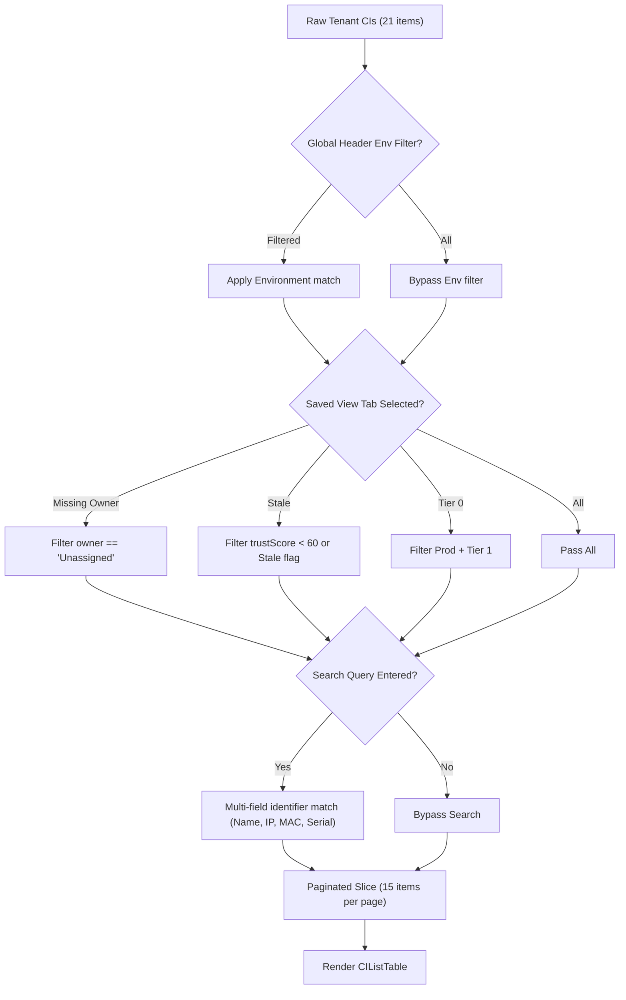
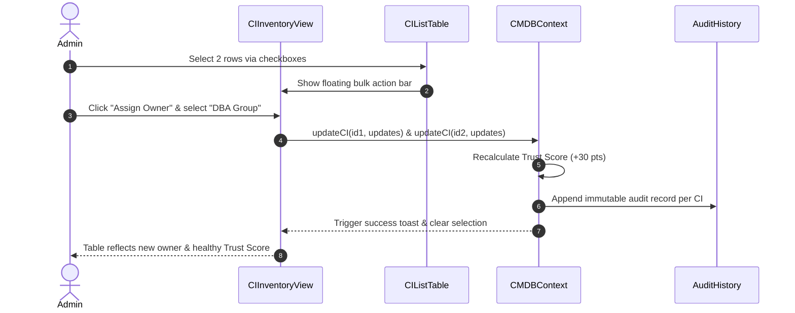

# Module 04: Configuration Items (CI) Inventory

---

## 1. Purpose in One Paragraph
CI Inventory (`/cis`) module-oda main purpose: Organization-la run aagura infrastructure, virtual machines, cloud resources, microservices, and databases ellathaiyum high-density, searchable table-la manage panradhu. Idhu multi-column technical search (IP, MAC, Serial, FQDN, Owner), 1-click saved filter tabs, customizable column views, bulk operational updates (Assign Owner, Send to Review, Retire), and CSV/JSON data exchange-ah support pannum.

---

## 2. Who Uses It (Permission Table)

| Capability | Viewer | Editor | CMDB Owner | Admin |
| :--- | :---: | :---: | :---: | :---: |
| **Search, Filter & Sort CIs** | Allowed | Allowed | Allowed | Allowed |
| **Switch Saved Views (Tabs)** | Allowed | Allowed | Allowed | Allowed |
| **Toggle Column Chooser** | Allowed | Allowed | Allowed | Allowed |
| **Export Table (JSON & CSV)** | Allowed | Allowed | Allowed | Allowed |
| **Row Quick Action: View Profile** | Allowed | Allowed | Allowed | Allowed |
| **Row Quick Action: Edit CI** | Denied (Hidden) | Allowed | Allowed | Allowed |
| **Row Quick Action: Retire CI** | Denied (Hidden) | Denied | Allowed | Allowed |
| **Bulk Actions (Assign Owner)** | Denied (Hidden) | Allowed | Allowed | Allowed |
| **Bulk CSV Import Wizard** | Denied (Hidden) | Allowed | Allowed | Allowed |

---

## 3. Entry Points
- **Route**: `/cis`.
- **Sidebar**: "Inventory (CIs)" in [Sidebar.tsx](file:///d:/zenops/components/layout/Sidebar.tsx).
- **Dashboard Click-Throughs**: Total CIs card on `/dashboard` links directly to `/cis`.
- **Global Header Search**: Command palette (`Ctrl+K` / `Cmd+K`) provides instant CI name jump links.

---

## 4. Preconditions & Required Data
- Populated `cis` array in `CMDBContext` scoped to the authenticated tenant.
- Standard columns defined: CI ID, Name, Class, Environment, Operational Status, Business Criticality, Owner, Support Group, Trust Score, IP Address, Actions.

---

## 5. Main Flow (Happy Path: CI Discovery, Filtering & Bulk Assignment)

| Step | Actor | Screen / Element Clicked | What System Does Behind Scenes | Data Created or Changed | What User Sees Next |
| :-: | :--- | :--- | :--- | :--- | :--- |
| **1** | User | Enters `/cis` | [CIInventoryView.tsx](file:///d:/zenops/components/cmdb/CIInventoryView.tsx) fetches tenant CIs, initializes table state. | Reads 21 CIs from context. | High-density table renders with 12px cells, Jira lozenges, and pagination controls. |
| **2** | User | Clicks **Missing Owner** saved tab | `handleApplySavedView("missing-owner")` filters CIs where `owner === 'Unassigned'`. | Active tab set to "missing-owner". | Table filters to 2 items needing owner assignment. |
| **3** | User | Selects checkboxes on both rows | [CIListTable.tsx](file:///d:/zenops/components/cmdb/CIListTable.tsx#L112) updates `selectedIds` state. | Selected IDs tracked in memory. | Floating bottom bulk action bar slides up: *"2 CIs selected"*. |
| **4** | User | Clicks **Assign Owner** on floating bar | Opens bulk assignment modal. | None | Dropdown appears with enterprise owner options. |
| **5** | User | Selects "Database Administration (DBA)" and clicks **Save** | Calls `updateCI()` for each selected ID; logs immutable audit entries. | Updates `owner` and `supportGroup` on both CIs. | Table updates in real time; floating bar clears; success toast appears. |

---

## 6. Alternate Flows

### 6.1 Saved Filter Tabs
- **`All CIs`**: Resets all filters; displays full catalog.
- **`My CIs`**: Filters where owner matches current user's department/name.
- **`Missing Owner`**: Filters CIs lacking assigned technical owners.
- **`Stale`**: Filters CIs where `trustScore < 60` or marked with stale telemetry flags.
- **`Production Tier 0`**: Pre-filters `environment: "Production"` and `criticality: "Tier 1"`.

### 6.2 Column Chooser
- User clicks **`Columns`** button on top right of the table.
- Dropdown allows toggling visibility of all 11 columns (e.g., hiding IP address, showing serial number).
- Selected column preferences persist during the session.

### 6.3 Bulk CSV Import Wizard (`CIBulkUploadModal.tsx`)
- User clicks **`Import CSV`** button in the header.
- Modal opens with two tabs: **File Upload** (drag-and-drop CSV file) and **Paste CSV Text**.
- User can download sample template (`zenops_cmdb_ci_template.csv`).
- Clicking **"Import CIs"** calls `bulkAddCIs()` in `CMDBContext`, batch creating CIs and generating DQ tasks for any live items without owners.

---

## 7. Error & Edge Flows

| Scenario | Trigger / Condition | What System Does | User Experience / Alert |
| :--- | :--- | :--- | :--- |
| **No Filter Matches** | Search term matches 0 CIs. | Filtered array length is 0. | Table shows empty state: *"No Configuration Items match your search query."* with "Reset Filters" button. |
| **Empty CSV Upload** | User uploads file with 0 rows or header only. | Parser detects empty array. | Error toast: *"No valid configuration items found in CSV file."* |
| **Unauthorized Action** | Viewer attempts to select rows. | Checkboxes are disabled/hidden for Viewer role. | Viewers cannot open bulk action bar or edit rows. |

---

## 8. Business Rules Applied Here

| Rule Code | Rule Condition | System Enforcement | Enforcement File |
| :--- | :--- | :--- | :--- |
| **INV-01** | Multi-Identifier Search | Search query checks `name`, `id`, `ciClass`, `owner`, `supportGroup`, `ip_address`, `mac_address`, `serialNumber`, and `assetTag`. | [cmdb-service.ts#L120](file:///d:/zenops/services/cmdb-service.ts#L120) |
| **INV-02** | Bulk Ownership Audit | Bulk assigning an owner updates the CI and logs an individual immutable audit entry per CI. | [cmdb-context.tsx#L618](file:///d:/zenops/context/cmdb-context.tsx#L618) |
| **INV-03** | RBAC Control on Edit/Retire | Edit and Retire buttons are strictly hidden if `userRole === 'Viewer'`. | [CIListTable.tsx#L245](file:///d:/zenops/components/cmdb/CIListTable.tsx#L245) |

---

## 9. Side Effects
- Bulk owner updates recalculate Trust Scores (restoring degraded scores to healthy 88%+ if ownership was missing).
- CSV exports generate client-side RFC 4180-compliant CSV files.
- CSV imports update dashboard total CI count and trigger Data Quality tasks for unassigned items.

---

## 10. Inputs, Outputs & Service Contracts
- **`CMDBService.fetchPaginatedCIs(params: CIPaginationParams)`**:
  - Parameters: `{ tenant, environment, page, pageSize, search, ciClass, operationalStatus, criticality, sortField, sortOrder }`.
  - Returns: `{ items: CIItem[], total: number, page: number, pageSize: number, totalPages: number }`.
- **Note on 50,000 CI Dataset**: The pagination contract in `services/cmdb-service.ts` is designed for high-density virtualized slicing; live testing with 50,000 live rows was **not measured** as `CMDB_50k_CIs_Sampling.xlsx` is not present in `data/source/`.

---

## 11. Mermaid Diagrams

### 11.1 Search & Filter Pipeline

### 11.2 Sequence Diagram: Bulk Owner Assignment

---

## 12. Worked Example with Real Seed Data
1. **Initial Condition**:
   - `CI-1010` (`staging-legacy-billing-sync`) has `owner: "Unassigned"` and `trustScore: 45`.
2. **Action**:
   - User goes to `/cis`, clicks **`Missing Owner`** tab.
   - User selects `CI-1010` and clicks **Assign Owner** &rarr; assigns to **`David Chen (Enterprise Architect)`**.
3. **Outcome**:
   - `CI-1010` owner updates to David Chen.
   - Trust Score increases from 45 &rarr; 88.
   - An entry is appended to Audit History: `Field: owner, Before: Unassigned, After: David Chen`.

---

## 13. How to Demo This Flow in 2 Minutes (Tanglish Script)

> "Innaiku namma **Configuration Items Inventory** table-ah paakalaam:
> 1. Inga dense Atlassian-style table iruku: 12px cells, Geist Mono technical IDs (`CI-000492`), and Jira status lozenges.
> 2. Top-la irukura 5 saved tabs click panni paatha instant filtering nadakkum: 'All CIs', 'My CIs', 'Missing Owner', 'Stale', and 'Production Tier 0'.
> 3. Search box-la IP address `10.0.1.42` or serial number `SRV-AWS-99120` nu edha type pannalum immediate-ah matched CI filter aaidum.
> 4. Checkbox select panni floating bulk action bar moolama 'Assign Owner' or 'Retire' instant-ah multiple CIs-ku execute pannalaam.
> 5. 'Import CSV' button click panna drag-and-drop spreadsheet uploader open aagum, with downloadable sample template!"

---

## 14. Test Scenarios (Manual Acceptance Tests)
- **Scenario 1 (Search by IP Address)**:
  - *Given*: User on `/cis`.
  - *When*: Types `10.0.1.42` in search bar.
  - *Then*: Table filters down to `PROD-DB-MUMBAI-01` (`CI-000492`).
- **Scenario 2 (Saved Tab Filtering)**:
  - *Given*: User on `/cis`.
  - *When*: Clicks "Missing Owner" tab.
  - *Then*: Displays only CIs with unassigned owners.
- **Scenario 3 (Bulk Action Bar)**:
  - *Given*: User selects 2 CIs.
  - *When*: Selection occurs.
  - *Then*: Floating bottom bar appears with count and actions.
- **Scenario 4 (Column Chooser)**:
  - *Given*: User opens "Columns" dropdown.
  - *When*: Unchecks "IP Address".
  - *Then*: IP Address column disappears from table layout.

---

## 15. Gaps & Next Steps
- **Server-Side Infinite Virtualization**: In production with 50,000+ CIs, virtual windowing (`@tanstack/react-virtual`) should stream chunks from database SQL cursor rather than in-memory filtering.
