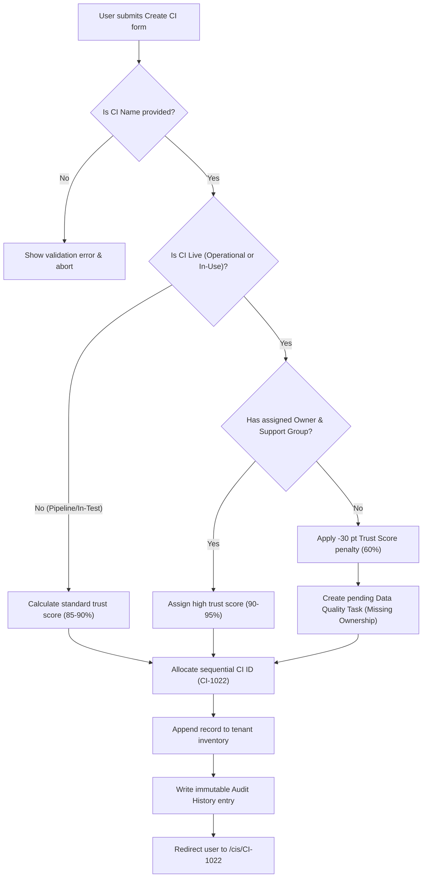
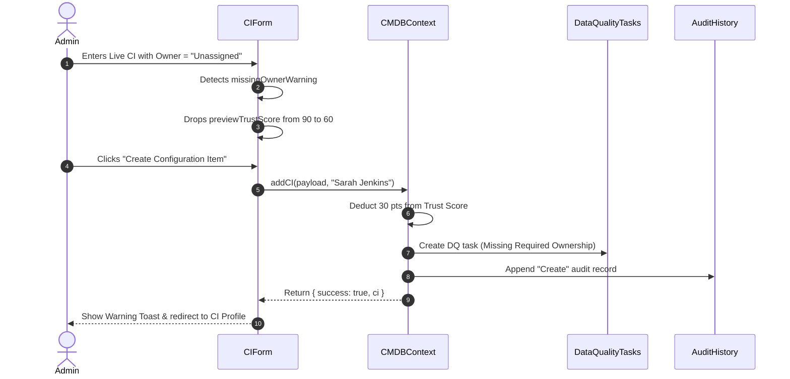

# Module 05: CI Creation & Attribute Editing

---

## 1. Purpose in One Paragraph
Create and Edit CI module-oda main objective: Engeyum untracked infrastructure create aagaama, strict governance rules-oda configuration assets-ah CMDB-la register panradhu. Idhu ServiceNow-compatible class inheritance path (`cmdb_ci > cmdb_ci_hardware > cmdb_ci_server`), dynamic technical attributes per class (CPU, RAM, DB Engine, Port), identification keys (MAC, IP, Serial, FQDN), and live Trust Score preview calculation-oda operational ownership-ah enforce pannum.

---

## 2. Who Uses It (Permission Table)

| Capability | Viewer | Editor | CMDB Owner | Admin |
| :--- | :---: | :---: | :---: | :---: |
| **Open Create Form (`/cis/new`)** | Denied (Redirected) | Allowed | Allowed | Allowed |
| **Edit Existing CI (`/cis/[id]/edit`)**| Denied (Redirected) | Allowed | Allowed | Allowed |
| **Create Non-Production CI** | Denied | Allowed | Allowed | Allowed |
| **Create Live Production CI** | Denied | Allowed (Must have Owner) | Allowed | Allowed |
| **Override Identification Keys** | Denied | Allowed | Allowed | Allowed |

---

## 3. Entry Points
- **Create CI Route**: `/cis/new` (accessible via "Create CI" button on Header, Dashboard, or Inventory).
- **Edit CI Route**: `/cis/[id]/edit` (accessible from CI 360 profile header or inventory row quick actions).
- **Mode Switcher**: `/cis/new` contains a toggle between **Single CI Form** and **Bulk Upload CSV**.

---

## 4. Preconditions & Required Data
- Active user session with `Editor`, `CMDB Owner`, or `Admin` role.
- Tenant context initialized (`ZenDev Software Technologies`, etc.).
- Dropdown options available: 9 CI Classes, 8 Lifecycle statuses, 5 Operational statuses, 5 Environments, 8 Support Groups, 7 Common Owners.

---

## 5. Main Flow (Happy Path: Registering a Managed Production Server)

| Step | Actor | Screen / Element Clicked | What System Does Behind Scenes | Data Created or Changed | What User Sees Next |
| :-: | :--- | :--- | :--- | :--- | :--- |
| **1** | Admin | Clicks **Create CI** button | Navigates to `/cis/new`. [CIForm.tsx](file:///d:/zenops/components/cmdb/CIForm.tsx) mounts in create mode. | Pre-populates defaults (Class: Server/VM, Status: In Use). | 7-section form displays with dynamic class breadcrumb and Live Trust Score Preview Gauge. |
| **2** | Admin | Types Name: `prod-auth-broker-01`, Class: `Server/VM` | Updates state; computes inheritance breadcrumb: `cmdb_ci > cmdb_ci_hardware > cmdb_ci_server`. | Dynamic attributes update to server fields (OS, CPU, RAM). | Inheritance badge reflects hardware server tree. |
| **3** | Admin | Selects Owner: `Sarah Jenkins (Platform Eng)` and Support: `Core Infrastructure & Cloud Ops` | Validates `hasOwner = true`, `hasSupport = true`. | Governance rule satisfied. | Trust Score Preview Gauge shows healthy **90%** (Optimal green). |
| **4** | Admin | Enters Technical Specs: IP `10.0.1.88`, MAC `02:42:0a:f0:00:88`, Serial `SRV-AWS-1049` | Populates `identificationKeys` object. | Technical identification keys stored. | Green checkmark confirms identification keys. |
| **5** | Admin | Clicks **Create Configuration Item** | [CIForm.tsx#L211](file:///d:/zenops/components/cmdb/CIForm.tsx#L211) validates required fields and calls `addCI()`. | Allocates ID `CI-1022`, timestamps, and appends to tenant dataset. | Toast confirms creation; system redirects to `/cis/CI-1022`. |
| **6** | System | `addCI()` execution | [cmdb-context.tsx#L412](file:///d:/zenops/context/cmdb-context.tsx#L412) logs immutable audit record (`Action: Create, Field: lifecycleStatus, Value: In Use`). | Record created in `auditHistory`. | System routes to `/cis/CI-1022` displaying new CI 360 profile. |

---

## 6. Alternate Flows & Governance Enforcement

### 6.1 Governance Rule 1: Live CI Missing Owner & Support Group
- **Trigger**: User sets Operational Status to `Operational` or Lifecycle to `In Use`, but sets Owner to `"Unassigned"` or leaves it blank.
- **Immediate UI Feedback**:
  - Live Trust Score Preview drops by **-30 points** (from 90% down to 60%).
  - Prominent danger banner appears: *"Operational/In-Use CIs must have a designated Owner and Support Group. Leaving them unassigned drops the Trust Score by 30 points and automatically opens a Data Quality task."*
- **Outcome on Submit**:
  - CI is created with degraded Trust Score (60%).
  - System automatically injects a `DataQualityTask` (`Missing Required Ownership`) into `dataQualityTasks` assigned to Platform Governance Team.
  - Warning toast alerts the user of the governance violation.

### 6.2 Dynamic Class Specification Tabs (9 Classes)
Selecting a CI Class in Section 1 dynamically mounts class-specific technical inputs:
- **`Server/VM`**: OS Kernel, CPU Count, CPU Cores, RAM, Disk Space, FQDN.
- **`Container/Pod`**: Container Image, Image Tag, Namespace, Cluster Name, Restart Count.
- **`Database`**: Engine (PostgreSQL, MySQL, Redis, MongoDB), Engine Version, Port, Storage Size GB.
- **`Application`**: App Version, Runtime Stack (Go, Node.js, Python, Java), API Endpoint, SLA Tier.
- **`Network Device`**: Port Count, Management IP, Firmware Version, Default Gateway.
- **`Cloud Resource`**: Cloud Provider, Resource ARN, Region, Instance Type.
- **`SaaS Subscription`**: License Type, Total Seats, Assigned Seats, Renewal Date.
- **`Business Service`**: Service Tier, Business SLA, Downtime Cost/Hour.

---

## 7. Error & Edge Flows

| Scenario | Trigger / Condition | What System Does | User Experience / Alert |
| :--- | :--- | :--- | :--- |
| **Missing CI Name** | User leaves Name field blank. | `validate()` returns false; sets `errors.name`. | Name input outlined in red; error message: *"CI Name is required"*. Form does not submit. |
| **No Identification Keys** | No IP, FQDN, or MAC address provided. | Live trust preview calculation penalizes score. | Trust score drops by 15 points; helper tooltip warns: *"Missing network identification keys decreases IRE confidence."* |
| **Viewer Attempting Direct Edit** | Viewer navigates to `/cis/CI-000492/edit`. | Next.js checks `userRole`. | Viewer is redirected back to `/cis/CI-000492` with warning toast: *"Viewers are not permitted to edit configuration items."* |

---

## 8. Business Rules Applied Here

| Rule Code | Rule Condition | System Enforcement | Enforcement File |
| :--- | :--- | :--- | :--- |
| **GOV-01** | Live CI Ownership Mandate | Operational or In-Use CIs must have an assigned Owner and Support Group. | [CIForm.tsx#L144](file:///d:/zenops/components/cmdb/CIForm.tsx#L144) |
| **GOV-02** | Automatic Data Quality Task Creation | Live CI without ownership automatically generates a pending DQ Task on creation. | [cmdb-context.tsx#L416](file:///d:/zenops/context/cmdb-context.tsx#L416) |
| **GOV-03** | Immutable Creation Audit | Every created CI appends an immutable audit entry with actor and timestamp. | [cmdb-context.tsx#L412](file:///d:/zenops/context/cmdb-context.tsx#L412) |

---

## 9. Side Effects
- **Trust Score Calculation**: Automatically sets initial score based on completeness and ownership penalties.
- **Data Quality Ingestion**: Automatically enqueues ownership tasks for non-compliant live assets.
- **Audit Logging**: Appends creation record to `/audit-history`.
- **Dashboard Synchronization**: Increments Total CIs count on `/dashboard`.

---

## 10. Inputs, Outputs & Service Contracts
- **`addCI(newCI: Omit<CIItem, 'id' | 'createdAt' | 'updatedAt'>, actor?: string)`**:
  - Validates and returns `{ success: boolean, ci?: CIItem, error?: string }`.
- **`updateCI(id: string, updates: Partial<CIItem>, actor?: string, changeRecord?: string)`**:
  - Compares before/after values, records audit diffs, and updates item.

---

## 11. Mermaid Diagrams

### 11.1 CI Creation & Governance Evaluation Flowchart

### 11.2 Sequence Diagram: Form Submission with Ownership Penalty

---

## 12. Worked Example with Real Seed Data
1. **Creation Input**:
   - Name: `prod-auth-broker-01`
   - Class: `Application`
   - Lifecycle: `In Use`, Operational: `Operational`
   - Owner: `Unassigned`, Support Group: `Unassigned`
2. **System Evaluation**:
   - Rule 1 triggered: Live CI lacking technical owner.
   - Trust Score calculated: `90 - 30 = 60%`.
3. **Persisted Record**:
   - `id: "CI-1022"`, `trustScore: 60`, `qualityFlags: ["Missing Required Owner", "Missing Support Group"]`.
   - New Data Quality Task created: `DQ-8819` assigned to Platform Governance Team.
   - Audit Record: `AUD-1022-1`, `Action: Create`, `Actor: Sarah Jenkins`.

---

## 13. How to Demo This Flow in 2 Minutes (Tanglish Script)

> "Innaiku namma **CI Creation and Governance Rules** enforce aagura vidhatha paakalaam:
> 1. Naan `/cis/new` page open panren. Header-la live Trust Score preview ring iruku (default 90%).
> 2. CI Class dropdown-la 'Database' select panna, class breadcrumb automatic-ah `cmdb_ci > cmdb_ci_appl > cmdb_ci_database` nu maaridum and database engine/port fields load aagum.
> 3. Ipo Rule #1 demo: Operational status-ah 'Operational' nu vechittu, Owner-ah 'Unassigned' nu maathren.
> 4. Notice pannunga: Live Trust Score instant-ah 30 points drop aagi 60% aaidum, and red warning banner pop-up aagum.
> 5. Thirumba naan owner-ah 'Sarah Jenkins' nu assign panna udaney, score thirumba 90% bounce back aagidum. Governance at the point of entry!"

---

## 14. Test Scenarios (Manual Acceptance Tests)
- **Scenario 1 (Valid CI Creation)**:
  - *Given*: User on `/cis/new`.
  - *When*: Enters all required fields with owner and clicks Create.
  - *Then*: CI created with Trust Score &ge; 90% and redirects to CI 360 profile.
- **Scenario 2 (Live CI Ownership Warning)**:
  - *Given*: Operational CI in create form.
  - *When*: Owner is set to "Unassigned".
  - *Then*: Trust Score drops by 30 points and warning banner appears.
- **Scenario 3 (Dynamic Class Attributes)**:
  - *Given*: Form open.
  - *When*: User switches class from `Server/VM` to `Database`.
  - *Then*: Hardware fields disappear; Database engine, port, and storage fields appear.
- **Scenario 4 (Audit Entry Verification)**:
  - *Given*: A CI is created.
  - *When*: User checks `/audit-history`.
  - *Then*: A new entry with Action "Create" appears at the top.

---

## 15. Gaps & Next Steps
- **Custom Dynamic Attribute Schemas**: Currently, class fields are hardcoded to the 9 supported classes; future releases will allow admins to add custom JSON schema attributes per class in `/settings/classes`.
