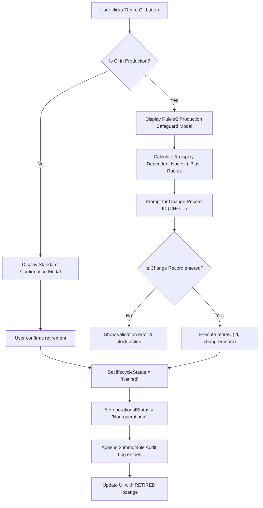
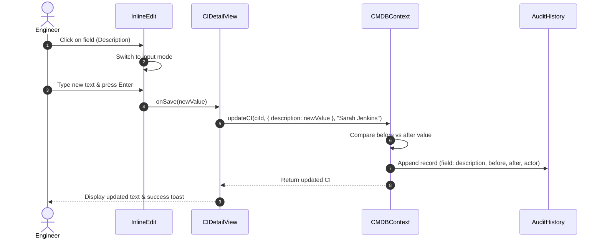

# Module 06: Jira-Style CI 360 Deep Profile

---

## 1. Purpose in One Paragraph
CI 360 Deep Profile (`/cis/[id]`) module-oda main goal: Oru individual configuration item-oda complete lifecycle, architecture, financial cost, upstream/downstream dependencies, related ITSM tickets, and immutable audit history ellathaiyum single, Jira-inspired issue view-la render panradhu. Engineers and change managers oru infrastructure component-ah touch panradhuku munnadi, adhodha blast radius risk, winning discovery source, and ownership-ah instant-ah verify panna idhu mudiyum.

---

## 2. Who Uses It (Permission Table)

| Capability | Viewer | Editor | CMDB Owner | Admin |
| :--- | :---: | :---: | :---: | :---: |
| **View Profile, Tabs & Graph** | Allowed | Allowed | Allowed | Allowed |
| **Inspect Trust Score Breakdown**| Allowed | Allowed | Allowed | Allowed |
| **Copy Technical Keys (IP/MAC/FQDN)**| Allowed | Allowed | Allowed | Allowed |
| **Inline Edit Name/Description** | Denied (Read-only) | Allowed | Allowed | Allowed |
| **Retire Non-Production CI** | Denied (Hidden) | Denied | Allowed | Allowed |
| **Retire Production CI (Rule 2)**| Denied (Hidden) | Denied | Allowed (Must have CHG) | Allowed (Must have CHG) |

---

## 3. Entry Points
- **Route**: `/cis/[id]` (e.g. `/cis/CI-000492`).
- **Inventory Row Click**: Clicking any CI row in `/cis` opens its deep profile.
- **Topology Graph Node Click**: Clicking a node in `/relationships` drawer links directly to `/cis/[id]`.
- **Search Palette**: Selecting a CI from `Ctrl+K` palette.

---

## 4. Preconditions & Required Data
- CI record must exist in the active tenant dataset.
- Seed item: `CI-000492` (`PROD-DB-MUMBAI-01`).
- Connected relationship edges in `relationships` array.

---

## 5. Main Flow (Happy Path: 360 Inspection & Inline Attribute Edit)

| Step | Actor | Screen / Element Clicked | What System Does Behind Scenes | Data Created or Changed | What User Sees Next |
| :-: | :--- | :--- | :--- | :--- | :--- |
| **1** | User | Navigates to `/cis/CI-000492` | [CIDetailPageView.tsx](file:///d:/zenops/components/cmdb/CIDetailPageView.tsx) calls `getCIById("CI-000492")`. | Loads CI 360 profile into state. | Jira-style 2-column layout loads: technical tabs (left) and Details side panel (right). |
| **2** | User | Clicks the radial **Trust Score Ring** (96%) | [TrustScoreRing.tsx](file:///d:/zenops/components/ui/TrustScoreRing.tsx) opens 5-pillar popover. | None | Reads 5-pillar breakdown: Freshness (95%), Completeness (98%), Consistency (96%), Relationships (95%), Ownership (100%). |
| **3** | User | Clicks on CI Description text | [InlineEdit.tsx](file:///d:/zenops/components/ui/InlineEdit.tsx) converts static text to input field with Save and Cancel buttons. | Switches UI to edit mode. | Inline text input appears with focus. |
| **4** | User | Types new description and presses `Enter` | [CIDetailView.tsx#L103](file:///d:/zenops/components/cmdb/CIDetailView.tsx#L103) calls `updateCI()`. | Updates description in `cis` state. Logs an immutable audit record in `auditHistory`. | Text field commits instantly; green toast confirms update. |
| **5** | User | Clicks **Audit Trail** tab | Filters `auditHistory` by `ciId === "CI-000492"`. | Reads audit logs. | Tab reveals chronological diff showing previous value vs new value with timestamp. |

---

## 6. Alternate Flows

### 6.1 Browsing the 6 Technical Tabs
1. **`Technical Specs`**: CPU (AMD EPYC 9654 Zen4, 64 cores), RAM (128GB DDR5), OS (Amazon Linux 2023 Nitro), FQDN, IP, MAC address with 1-click clipboard copy buttons.
2. **`Dependency Topology`**: Visualizes upstream parents (e.g. `Payments API`) and downstream children. Shows **Blast Radius Score: 82/100 (Severe Risk)**.
3. **`Related ITSM`**: Embedded active incident and change records:
   - `INC-1042`: P1 - Critical (Database Replica Lag & Connection Pool Saturation)
   - `PRB-0089`: P2 - Major (Intermittent I/O Throttle on EBS gp3 Volumes)
   - `CHG-2001`: P3 - Normal (Minor PostgreSQL 16.2 Security Patch Upgrade - CAB Approved)
   - `REQ-5512`: P4 - Low (Provision Read-Replica for Reporting Warehouse)
4. **`Asset & Financial`**: Cost ($1,200/mo), PO Number (`PO-2023-8812`), Warranty Expiration (2028-04-12), Cost Center (`CC-INFRA-FIN-01`), and direct link to AWS Billing Console.
5. **`IRE Reconciliation`**: Displays active matching rule: *"Rule 1: Exact MAC Address Match"* and winning source authority (`AWS CloudTrail` with weight 90).
6. **`Audit Trail`**: Full immutable chronological history of all updates and field changes.

### 6.2 Governance Rule 2: Decommissioning / Retiring a Production CI
- User clicks the red **`Retire CI`** button in the header.
- [CIRetireModal.tsx](file:///d:/zenops/components/cmdb/CIRetireModal.tsx) opens.
- System evaluates `ci.environment === "Production"`.
- Modal displays a prominent red warning banner: *"Production CI Decommissioning Safeguard (Rule #2). Enterprise governance policy mandates an authorized Change Record (CHG-...) before retirement."*
- Modal renders **Impacted Dependent Nodes** count and **Blast Radius: Severe (82%)**.
- If user clicks "Retire CI" without entering a Change ID: error appears: *"Production CI retirement strictly requires an authorized Change Record (e.g. CHG-008912)."*
- User enters `CHG-008912` and confirms:
  - CI `lifecycleStatus` transitions to `Retired`.
  - CI `operationalStatus` transitions to `Non-operational`.
  - Two immutable audit records logged (`lifecycleStatus` & `operationalStatus`).
  - Modal closes; profile updates with red `RETIRED` lozenge.

---

## 7. Error & Edge Flows

| Scenario | Trigger / Condition | What System Does | User Experience / Alert |
| :--- | :--- | :--- | :--- |
| **CI Not Found** | Invalid ID entered in URL (e.g. `/cis/CI-999999`). | `getCIById()` returns `undefined`. | Clean empty state card: *"Configuration Item not found or has been removed."* with button to return to `/cis`. |
| **Unapproved Change Record** | Empty or whitespace Change ID submitted on Production retire. | `CIRetireModal.tsx` blocks submission. | Red validation error displayed directly in modal. Submission blocked. |
| **Inline Edit Cancelled** | User presses `Escape` key while editing text. | `InlineEdit.tsx` reverts input to initial value. | Input reverts to text mode with zero changes and zero audit records written. |

---

## 8. Business Rules Applied Here

| Rule Code | Rule Condition | System Enforcement | Enforcement File |
| :--- | :--- | :--- | :--- |
| **PRF-01** | Production Retirement CAB Mandate | Retiring a Production CI strictly requires a valid `CHG-...` Change Record ID. | [CIRetireModal.tsx#L36](file:///d:/zenops/components/cmdb/CIRetireModal.tsx#L36) |
| **PRF-02** | Blast Radius Pre-Check | Modal must compute and display affected dependent nodes before retirement. | [CIRetireModal.tsx#L93](file:///d:/zenops/components/cmdb/CIRetireModal.tsx#L93) |
| **PRF-03** | Inline Edit Audit Tracking | Every committed inline edit must record before/after values and actor name. | [cmdb-context.tsx#L569](file:///d:/zenops/context/cmdb-context.tsx#L569) |

---

## 9. Side Effects
- Modifying fields updates the CI record and instantly writes to `/audit-history`.
- Retiring a CI marks operational status as `Non-operational`, affecting dashboard KPI counts.
- Recalculates relationship impact and dependencies.

---

## 10. Inputs, Outputs & Service Contracts
- **`getCIById(id: string): CIItem | undefined`**
- **`getCIRelationships(ciId: string): { parents: CIRelationship[]; children: CIRelationship[] }`**
- **`getImpactAnalysis(ciId: string): ImpactAnalysisResult | null`**
- **`retireCI(id: string, changeRecord?: string, reason?: string, actor?: string)`**

---

## 11. Mermaid Diagrams

### 11.1 Production Retirement Safeguard Flowchart

### 11.2 Sequence Diagram: Inline Field Editing & Audit Logging

---

## 12. Worked Example with Real Seed Data
1. **Target Asset**: `CI-000492` (`PROD-DB-MUMBAI-01`).
   - Class: `Database` (PostgreSQL Aurora Enterprise)
   - Environment: `Production`
   - Trust Score: `96%`
   - Linked Incidents: `INC-1042` (P1 - Critical)
2. **Retirement Attempt**:
   - Operator clicks **Retire CI**.
   - Safeguard modal alerts: **Blast Radius: Severe (82%)** affecting `Payments API`.
   - Operator inputs `CHG-2024-9912` and reason *"Migrating database to Aurora Serverless v2"*.
   - Operator clicks **Confirm Decommission**.
3. **State Change**:
   - `lifecycleStatus` becomes `Retired`.
   - `operationalStatus` becomes `Non-operational`.
   - `changeRecord` recorded as `CHG-2024-9912`.
   - Audit trail appends 2 records verifying decommission actor.

---

## 13. How to Demo This Flow in 2 Minutes (Tanglish Script)

> "Innaiku namma **CI 360 Deep Profile** and **Production Governance Safeguard** demo paakalaam:
> 1. Naan `/cis/CI-000492` (`PROD-DB-MUMBAI-01`) open panren. Screen-la Jira issue 2-column layout iruku.
> 2. Top-la radial Trust Score ring (96%) click panna, 5-pillar mathematical breakdown popover open aagum.
> 3. Description field-la click panni inline edit panni `Enter` press panren. Instant-ah save aagi **Audit Trail** tab-la before/after diff record aaidum.
> 4. Left tabs-la: Technical specs, Dependency Topology, Related ITSM records (`INC-1042` P1), and Financial tabs explore pannalam.
> 5. Most critical: Ipo top-la irukura red **'Retire CI'** button click panren.
> 6. Idhu Production CI ngrdhala, system Change Record `CHG-...` illama retire panna vidaadhu! And 82% severe blast radius dependency list-ah modal-la calculate panni kaatum. Absolute safety!"

---

## 14. Test Scenarios (Manual Acceptance Tests)
- **Scenario 1 (Radial Trust Score Popover)**:
  - *Given*: User on `/cis/CI-000492`.
  - *When*: Clicks Trust Score gauge.
  - *Then*: Popover shows 5-pillar breakdown with percentages summing to composite score.
- **Scenario 2 (Inline Edit)**:
  - *Given*: User clicks CI Name or Description.
  - *When*: Types new value and presses Enter.
  - *Then*: Saves instantly and writes an entry in the Audit Trail tab.
- **Scenario 3 (Production Retirement Blocked)**:
  - *Given*: Production CI retire modal open.
  - *When*: User clicks Confirm without entering Change Record ID.
  - *Then*: Error message appears and retirement is blocked.
- **Scenario 4 (Successful Retirement)**:
  - *Given*: User enters `CHG-2024-001` in modal and confirms.
  - *Then*: Lifecycle changes to "Retired" and operational status to "Non-operational".

---

## 15. Gaps & Next Steps
- **Live ITSM Bi-Directional Webhook**: Related ITSM records (`INC-1042`, `CHG-2001`) are currently populated via seed data; production will wire a live webhook to Jira Service Management.
