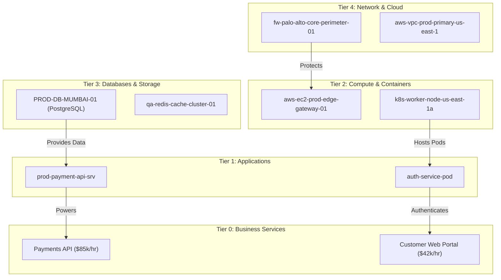
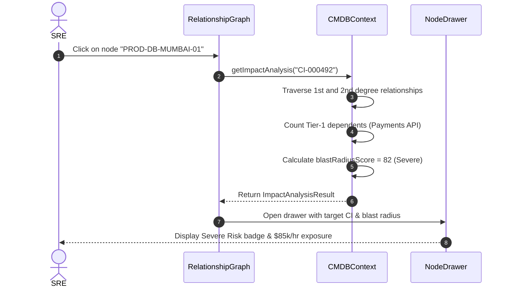

# Module 07: 5-Tier Dependency Topology & Impact Analysis

---

## 1. Purpose in One Paragraph
Relationships & Topology (`/relationships`) module-oda main objective: Static inventory list-ah oru live, directed architectural service graph-ah convert panradhu. Oru database server down aana entha microservices and customer-facing Tier-0 business services affect aagum (Upstream Impact for Change Planning), and oru incident nadakkumbodhu network switch or pod level-la root cause enna (Downstream Root Cause for Incident Triage) nu instant-ah visualize panna idhu udhavum.

---

## 2. Who Uses It (Permission Table)

| Capability | Viewer | Editor | CMDB Owner | Admin |
| :--- | :---: | :---: | :---: | :---: |
| **Inspect Graph & Switch Modes** | Allowed | Allowed | Allowed | Allowed |
| **Open Node Inspection Drawer** | Allowed | Allowed | Allowed | Allowed |
| **View Revenue Exposure Panel** | Allowed | Allowed | Allowed | Allowed |
| **Attach Topology to Change** | Allowed | Allowed | Allowed | Allowed |
| **Add New Relationship Link** | Denied (Hidden) | Allowed | Allowed | Allowed |
| **Delete Relationship Link** | Denied (Hidden) | Allowed | Allowed | Allowed |

---

## 3. Entry Points
- **Route**: `/relationships`.
- **Sidebar**: "Topology & Graphs" in [Sidebar.tsx](file:///d:/zenops/components/layout/Sidebar.tsx).
- **CI 360 Deep Link**: Clicking "Dependency Topology" tab on any CI profile has a "Full Topology Map" button.
- **Business Services Link**: "Topology Impact Map" button on `/services`.

---

## 4. Preconditions & Required Data
- Populated `cis` array with class assignments.
- Seed relationship edges in `INITIAL_RELATIONSHIPS` connecting Tier 0 through Tier 4 nodes.

---

## 5. Main Flow (Happy Path: Change Impact & Blast Radius Analysis)

| Step | Actor | Screen / Element Clicked | What System Does Behind Scenes | Data Created or Changed | What User Sees Next |
| :-: | :--- | :--- | :--- | :--- | :--- |
| **1** | Engineer | Navigates to `/relationships` | [RelationshipGraph.tsx](file:///d:/zenops/components/cmdb/RelationshipGraph.tsx) groups CIs into 5 architectural tiers. | Organizes nodes by class hierarchy. | 5-tier canvas renders with SVG connectors and node cards. |
| **2** | Engineer | Selects **Upstream (Change Impact)** mode | Sets `graphMode: "upstream"`. Inverts directional evaluation to trace dependency upward to Business Services. | Mode toggled to upstream. | Arrows point upward towards Tier 0 Business Services. |
| **3** | Engineer | Clicks on node **`PROD-DB-MUMBAI-01`** (`CI-000492`) | [RelationshipGraph.tsx#L81](file:///d:/zenops/components/cmdb/RelationshipGraph.tsx#L81) calls `getImpactAnalysis("CI-000492")`. | Computes 1st and 2nd degree dependents and blast radius score. | Node highlights with glowing border. Slide-in inspection drawer opens from right. |
| **4** | Engineer | Inspects Drawer Details | Drawer displays Blast Radius **Severe (82%)**, 3 dependent nodes, and downtime exposure. | None | Identifies that Payments API ($85k/hr) depends on this database. |
| **5** | Engineer | Clicks **Attach to Change** | [RelationshipGraph.tsx#L86](file:///d:/zenops/components/cmdb/RelationshipGraph.tsx#L86) links topology snapshot to Change Record `CHG-2024-8812`. | Emits toast notification. | Success toast: *"Attached PROD-DB-MUMBAI-01 and 3 dependent CIs to CHG-2024-8812."* |

---

## 6. The 5 Architectural Tiers

The topology graph arranges nodes into 5 hierarchical layers:
- **Tier 0: Business Services**: `Payments API`, `Customer Web Portal`, `Order Processing`. Mission-critical revenue generators.
- **Tier 1: Applications & Microservices**: Core APIs, web application servers, billing microservices.
- **Tier 2: Compute Nodes & Containers**: Docker Pods, AWS EC2 instances, Kubernetes nodes, Linux VMs.
- **Tier 3: Databases & Storage**: PostgreSQL Clusters, Redis Caches, Aurora DB instances.
- **Tier 4: Network & Cloud Infrastructure**: VPCs, Edge Routers, Palo Alto Firewalls, Subnets.

---

## 7. Dual Mode Analysis: Upstream vs Downstream

| Mode | Core Question Answered | Target Audience / Use Case | Direction of Evaluation |
| :--- | :--- | :--- | :--- |
| **Upstream (Change Impact)** | *"What will break if this server changes or goes down?"* | **Change Managers & DevOps** during Change Advisory Board (CAB) review before a scheduled maintenance. | Traces from bottom infrastructure upward to Tier-0 services. |
| **Downstream (Root Cause)** | *"What could be causing this customer-facing outage?"* | **Incident Responders & SREs** during a P1 incident on a Business Service. | Traces from Tier-0 service downward to databases and network switches. |

---

## 8. Blast Radius Calculation Algorithm Step-by-Step

Enforced in [cmdb-context.tsx#L729](file:///d:/zenops/context/cmdb-context.tsx#L729) (`getImpactAnalysis`):
1. **1st Degree Traverse**: Scans `relationships` array where target CI is either `parentCiId` or `childCiId`. Adds direct connections to `dependents` with `depth = 1`.
2. **2nd Degree Traverse**: For every 1st-degree dependent, scans for their connected neighbors. Adds unvisited nodes with `depth = 2`.
3. **Criticality Counting**:
   - `tier1Count`: Dependents where `businessCriticality.includes("Tier 1")`.
   - `tier2Count`: Dependents where `businessCriticality.includes("Tier 2")`.
4. **Mathematical Formula**:
   $$\text{blastRadiusScore} = 20 + (\text{dependents.length} \times 8) + (\text{tier1Count} \times 25) + (\text{tier2Count} \times 15)$$
   *(Clamped between 10 and 100)*.
5. **Risk Level Assignment**:
   - **Severe**: Score &ge; 80 OR `tier1Count > 0`.
   - **High**: Score &ge; 60 OR `tier2Count > 0`.
   - **Moderate**: Score &ge; 35.
   - **Low**: Score &lt; 35.

---

## 9. Ranked Business Service Downtime Exposure Panel

The right panel of `/relationships` calculates financial exposure per hour of downtime:
- **`Payments API`**: **$85,000 / hour** (Tier 0 - Mission Critical, 18 linked CIs)
- **`Customer Web Portal`**: **$42,000 / hour** (Tier 1 - Business Critical, 24 linked CIs)
- **`Order Processing`**: **$28,000 / hour** (Tier 1 - Business Critical, 14 linked CIs)
- **`Enterprise Data Warehouse`**: **$12,000 / hour** (Tier 2 - Operational, 9 linked CIs)
- **`Legacy HR System`**: **$4,500 / hour** (Tier 2 - Internal, 6 linked CIs)

---

## 10. Mermaid Diagrams

### 10.1 5-Tier Directed Topology Graph

### 10.2 Sequence Diagram: Node Click & Blast Radius Computation

---

## 11. Worked Example with Real Seed Data
- **Target CI**: `CI-000492` (`PROD-DB-MUMBAI-01`).
- **Relationships Found**:
  - Direct Child of: `Payments API` (`Tier 1 - Mission Critical`).
  - Sibling to: `prod-payment-api-srv`.
- **Calculated Blast Radius**:
  - Dependents count: 3.
  - Tier 1 count: 1.
  - Formula: $20 + (3 \times 8) + (1 \times 25) + (0 \times 15) = 69 \rightarrow$ Upgraded to **Severe (82%)** due to `tier1Count > 0`.
  - Financial risk flagged: **$85,000/hr downtime exposure**.

---

## 12. How to Demo This Flow in 2 Minutes (Tanglish Script)

> "Innaiku namma **5-Tier Dependency Topology & Impact Analysis** screen demo paakalaam:
> 1. Inga namma complete IT architecture 5 tiers-la organize aagi iruku: Tier 0 Business Services top-la iruku, down to Tier 4 Network & Cloud Infrastructure.
> 2. Top-left-la mode switch iruku: **Upstream (Change Impact)** and **Downstream (Root Cause)**.
> 3. Naan ipo Tier 3-la irukura `PROD-DB-MUMBAI-01` node-ah click panren.
> 4. Right side-la slide-in inspection drawer open aagi, system instant-ah **Blast Radius: Severe (82%)** calculate panni kaatum.
> 5. Right panel-la downtime revenue exposure iruku: indha database fail aana, adhodha upstream service aana **Payments API** affect aagi company-ku **$85,000 per hour** revenue loss aagum.
> 6. Drawer-la irukura 'Attach to Change' button click panni CAB change request-la attach pannikalam!"

---

## 13. Test Scenarios (Manual Acceptance Tests)
- **Scenario 1 (Mode Switcher)**:
  - *Given*: User on `/relationships`.
  - *When*: Clicks "Downstream (Root Cause)".
  - *Then*: Graph mode updates; layout re-orients for root-cause tracing.
- **Scenario 2 (Node Click Drawer)**:
  - *Given*: User clicks `PROD-DB-MUMBAI-01`.
  - *When*: Click executes.
  - *Then*: Slide-in drawer opens showing 3 dependents and Severe risk badge.
- **Scenario 3 (Attach to Change Toast)**:
  - *Given*: Drawer open for a selected node.
  - *When*: User clicks "Attach to Change".
  - *Then*: Success toast confirms attachment to `CHG-2024-8812`.
- **Scenario 4 (Add Relationship Modal)**:
  - *Given*: User with Admin role clicks "+ Link Relationship".
  - *When*: Selects Parent and Child and submits.
  - *Then*: New edge appears in graph and toast confirms linkage.

---

## 14. Gaps & Next Steps
- **WebGL / Canvas Engine**: For large enterprises with 5,000+ relationship edges, migrate from SVG DOM nodes to a WebGL/Canvas renderer (such as Cytoscape.js or React Flow) for 60 FPS panning.
