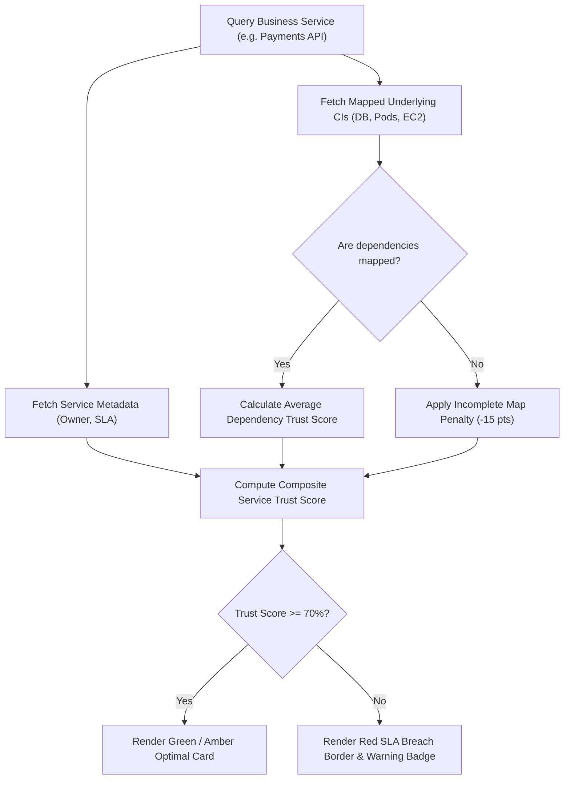
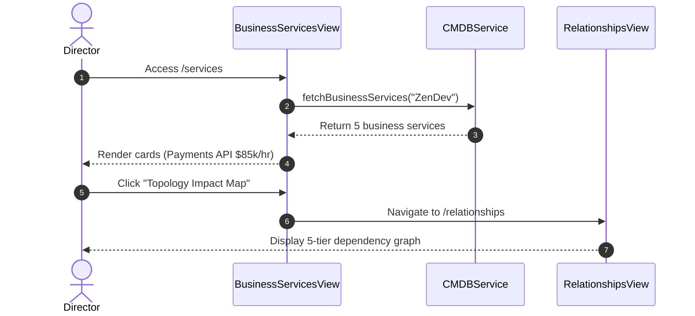

# Module 08: Business Services & Financial Risk

---

## 1. Purpose in One Paragraph
Business Services Catalog (`/services`) module-oda main objective: Technical infrastructure-ah enterprise business context-oda bridge panradhu. Oru infrastructure engineer server or database-ah paarkumbodhu, leadership and product owners customer-facing business services (`Payments API`, `Customer Web Portal`) context-la dhaan paapaanga. Indha module business services-oda SLA, aggregated dependency Trust Scores, downtime cost per hour, and incomplete mapping warnings-ah render pannum.

---

## 2. Who Uses It (Permission Table)

| Capability | Viewer | Editor | CMDB Owner | Admin |
| :--- | :---: | :---: | :---: | :---: |
| **Browse Business Services** | Allowed | Allowed | Allowed | Allowed |
| **Inspect Downtime Cost & SLA** | Allowed | Allowed | Allowed | Allowed |
| **View Aggregated Trust Scores** | Allowed | Allowed | Allowed | Allowed |
| **Jump to Topology Impact Map** | Allowed | Allowed | Allowed | Allowed |
| **Modify Service Parameters** | Denied (Read-only) | Allowed | Allowed | Allowed |

---

## 3. Entry Points
- **Route**: `/services`.
- **Sidebar**: "Business Services" in [Sidebar.tsx](file:///d:/zenops/components/layout/Sidebar.tsx).
- **Dashboard Section**: "Services by Trust Score" widget on `/dashboard` has direct deep links to `/services`.
- **Topology Header**: "Topology Impact Map" button links back and forth with `/relationships`.

---

## 4. Preconditions & Required Data
- Populated business services dataset in [data/business-services.json](file:///d:/zenops/data/business-services.json).
- Seed services: `SVC-01` (Payments API), `SVC-02` (Customer Web Portal), `SVC-03` (Order Processing), `SVC-04` (Identity & Access Gateway), `SVC-05` (Analytics Engine).

---

## 5. Main Flow (Happy Path: Business Service Health Review)

| Step | Actor | Screen / Element Clicked | What System Does Behind Scenes | Data Created or Changed | What User Sees Next |
| :-: | :--- | :--- | :--- | :--- | :--- |
| **1** | Director | Navigates to `/services` | [BusinessServicesView.tsx](file:///d:/zenops/components/cmdb/BusinessServicesView.tsx) calls `CMDBService.fetchBusinessServices()`. | Fetches 5 seeded services for current tenant. | Grid of 5 enterprise service cards renders with SLA badges and Trust Score rings. |
| **2** | Director | Inspects **`Payments API`** card | Evaluates `serviceTier: "Tier 0"`, `downtimeCostPerHour: "$85,000"`, `trustScore: 94`. | None | Optimal green ring displays 94% Trust Score. SLA target shows 99.99%. |
| **3** | Director | Inspects **`Analytics Engine`** card | Detects `trustScore: 64` (below 70% threshold). Card displays red border alert. | None | Warning badge appears: *"Incomplete Dependency Map Warning (-15 pts)"*. |
| **4** | Director | Clicks **Topology Impact Map** button | Routes to `/relationships` with Payments API highlighted. | Navigates route. | Directed topology canvas renders upstream impact path. |

---

## 6. Business Service Seed Dataset

| ID | Service Name | Service Tier | Criticality | Target SLA | Downtime Cost/Hr | Trust Score | Status |
| :--- | :--- | :---: | :---: | :---: | :---: | :---: | :---: |
| **SVC-01** | Payments API | Tier 0 | Mission Critical | 99.99% | **$85,000 / hr** | **94%** | Optimal |
| **SVC-02** | Customer Web Portal | Tier 1 | Business Critical| 99.90% | **$42,000 / hr** | **88%** | Adequate |
| **SVC-03** | Order Processing | Tier 1 | Business Critical| 99.90% | **$28,000 / hr** | **82%** | Adequate |
| **SVC-04** | Identity & Access Gateway | Tier 0 | Mission Critical | 99.99% | **$65,000 / hr** | **91%** | Optimal |
| **SVC-05** | Analytics & Reporting Engine| Tier 2 | Operational | 99.50% | **$15,000 / hr** | **64%** | **At Risk (SLA Breach)** |

---

## 7. How the Service Trust Score is Rolled Up (Formula)

A Business Service's Trust Score is not a static number—it is a **hierarchical roll-up** of the infrastructure components supporting it:
$$\text{ServiceTrustScore} = (0.4 \times \text{ServiceMetadataScore}) + (0.6 \times \text{AverageDependencyTrust})$$

Where:
- **`ServiceMetadataScore`**: Has assigned Executive Owner, Support Group, Disaster Recovery tier, and documented SLA.
- **`AverageDependencyTrust`**: The arithmetic mean of all Tier-1 Applications, Tier-2 Compute Nodes, and Tier-3 Databases mapped to this service in `/relationships`.
- **Incomplete Dependency Map Penalty**: If a service has zero mapped databases or network nodes, a **-15 point deduction** is applied automatically.

---

## 8. Error & Edge Flows

| Scenario | Trigger / Condition | What System Does | User Experience / Alert |
| :--- | :--- | :--- | :--- |
| **SLA Threshold Breach** | Service Trust Score drops below 70%. | [BusinessServicesView.tsx#L84](file:///d:/zenops/components/cmdb/BusinessServicesView.tsx#L84) adds `border-danger/40 ring-1 ring-danger/20`. | Card highlights in pulsing red; warning badge alerts: *"Service Trust Score Breached Critical 70% Threshold"*. |
| **Unmapped Dependencies** | Service has no linked CIs. | System applies incomplete mapping flag. | Amber alert banner: *"Service dependency topology incomplete. Incident blast radius cannot be guaranteed."* |

---

## 9. Business Rules Applied Here

| Rule Code | Rule Condition | System Enforcement | Enforcement File |
| :--- | :--- | :--- | :--- |
| **SVC-01** | SLA Breach Alert | Any service with Trust Score &lt; 70% displays a visual danger alert. | [BusinessServicesView.tsx#L78](file:///d:/zenops/components/cmdb/BusinessServicesView.tsx#L78) |
| **SVC-02** | Tier 0 Priority Badge | Tier 0 services render bold danger red lozenges to indicate mission-critical priority. | [BusinessServicesView.tsx#L95](file:///d:/zenops/components/cmdb/BusinessServicesView.tsx#L95) |

---

## 10. Inputs, Outputs & Service Contracts
- **`CMDBService.fetchBusinessServices(tenant: string): Promise<BusinessServiceItem[]>`**
  - Reads tenant-specific services from `data/business-services.json`.

---

## 11. Mermaid Diagrams

### 11.1 Business Service Health Roll-Up Flowchart

### 11.2 Sequence Diagram: Service Inspection & Topology Transition

---

## 12. Worked Example with Real Seed Data
- **Service**: `SVC-01` (`Payments API`).
  - Tier: `Tier 0 - Mission Critical`
  - Downtime Exposure: **$85,000 / hr**
  - Underlying CIs: `PROD-DB-MUMBAI-01` (Trust 96), `prod-payment-api-srv` (Trust 96).
  - Rolled-Up Score: **94%**.
- **Service**: `SVC-05` (`Analytics & Reporting Engine`).
  - Tier: `Tier 2`
  - Downtime Exposure: **$15,000 / hr**
  - Incomplete Map: Database unmapped (-15 pts).
  - Rolled-Up Score: **64% (SLA Breach flagged)**.

---

## 13. How to Demo This Flow in 2 Minutes (Tanglish Script)

> "Innaiku namma **Business Services Catalog** paakalaam:
> 1. Management-kitta technical CI names sonna puriyaadhu; avangalukku business service context dhaan venum.
> 2. Screen-la 5 core business services iruku. First service: **Payments API** (Tier 0 Mission Critical). Idhodha downtime financial cost **$85,000 per hour**!
> 3. Underlying database and servers healthy-ah irukura nala idhodha rolled-up Trust Score **94% (Optimal)**.
> 4. Adhey nerathula **Analytics & Reporting Engine** paatheengana, score 64% dhaan iruku. Red border alert kaatum because dependency map incomplete-ah iruku.
> 5. 'Topology Impact Map' button click panna instant-ah indha services-oda full dependency tree-ku navigate aagidum!"

---

## 14. Test Scenarios (Manual Acceptance Tests)
- **Scenario 1 (Service Catalog Display)**:
  - *Given*: User on `/services`.
  - *When*: Page loads.
  - *Then*: 5 service cards display with downtime revenue costs.
- **Scenario 2 (SLA Breach Visual Alert)**:
  - *Given*: Service with Trust Score 64% (`SVC-05`).
  - *When*: Inspected in catalog.
  - *Then*: Displays red border ring and warning lozenge.
- **Scenario 3 (Navigation to Topology)**:
  - *Given*: User on `/services`.
  - *When*: Clicks "Topology Impact Map".
  - *Then*: Redirects to `/relationships`.

---

## 15. Gaps & Next Steps
- **Automated Revenue Loss Calculation**: Revenue per hour is currently hardcoded in `data/business-services.json`; future releases will integrate with enterprise ERP/Stripe telemetry.
