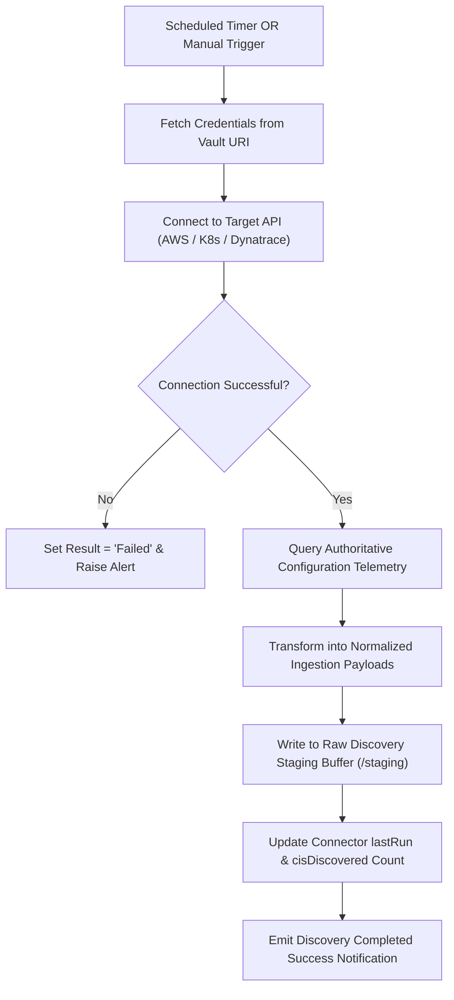
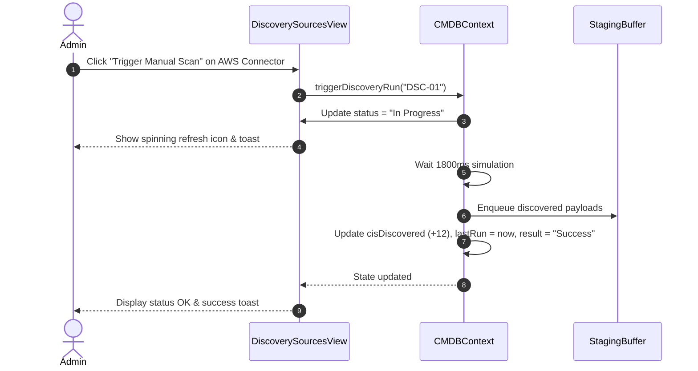

# Module 09: Automated Discovery Connectors

---

## 1. Purpose in One Paragraph
Automated Discovery Connectors (`/discovery-sources`) module-oda main goal: Cloud accounts (AWS, Azure, GCP), Kubernetes clusters, and observability agents (Dynatrace, CrowdStrike) kooda secure connections create panni, infrastructure telemetry-ah continuous-ah pull panradhu. Manual data entry thavirthu, human error illama live configuration state-ah capture panna idhu foundation-ah iruku.

---

## 2. Who Uses It (Permission Table)

| Capability | Viewer | Editor | CMDB Owner | Admin |
| :--- | :---: | :---: | :---: | :---: |
| **View Connectors & Schedules** | Allowed | Allowed | Allowed | Allowed |
| **Inspect Run History Drawer** | Allowed | Allowed | Allowed | Allowed |
| **Trigger Manual Discovery Scan** | Denied (Hidden) | Denied | Allowed | Allowed |
| **Add / Configure New Connector**| Denied (Hidden) | Denied | Allowed | Allowed |
| **Rotate Vault Credentials Ref**| Denied (Hidden) | Denied | Allowed | Allowed |

---

## 3. Entry Points
- **Route**: `/discovery-sources`.
- **Sidebar**: "Discovery Sources" in [Sidebar.tsx](file:///d:/zenops/components/layout/Sidebar.tsx).
- **Dashboard Section 3**: "Discovery Sources Health" widget on `/dashboard` has direct refresh action buttons.
- **Getting Started**: Step 1 links directly to `/discovery-sources`.

---

## 4. Preconditions & Required Data
- 6 seeded connectors in [services/mock-data.ts#L763](file:///d:/zenops/services/mock-data.ts#L763):
  1. `DSC-01`: AWS Discovery Connector (`vault://secret/aws/iam/discovery-role-arn`)
  2. `DSC-02`: Dynatrace APM Agent (`vault://secret/dynatrace/api-token-ingest`)
  3. `DSC-03`: Kubernetes Cluster Operator (`k8s://serviceaccount/zenops-cmdb-agent`)
  4. `DSC-04`: Azure Resource Graph (`vault://secret/azure/service-principal-spn`)
  5. `DSC-05`: CrowdStrike Falcon Sensor (`vault://secret/crowdstrike/api-oauth-client`)
  6. `DSC-06`: ServiceNow Ingestion Connector (`vault://secret/servicenow/mid-server-token`)

---

## 5. Main Flow (Happy Path: Triggering an On-Demand Discovery Scan)

| Step | Actor | Screen / Element Clicked | What System Does Behind Scenes | Data Created or Changed | What User Sees Next |
| :-: | :--- | :--- | :--- | :--- | :--- |
| **1** | Admin | Navigates to `/discovery-sources` | [DiscoverySourcesView.tsx](file:///d:/zenops/components/cmdb/DiscoverySourcesView.tsx) reads 6 active connectors from `CMDBContext`. | None | Connector cards render showing schedule, discovered CIs count, and health lozenges (`OK`, `LATE`, `FAILED`). |
| **2** | Admin | Locates **AWS Discovery Connector** (`DSC-01`) | Evaluates last run timestamp and scope (12 AWS Accounts). | None | Status badge shows `OK` (green). Total CIs discovered shows 1,482. |
| **3** | Admin | Clicks **Trigger Manual Scan** (Play icon) | [DiscoverySourcesView.tsx#L51](file:///d:/zenops/components/cmdb/DiscoverySourcesView.tsx#L51) calls `triggerDiscoveryRun("DSC-01")`. | Status flips to `In Progress`. Spinner activates. | Info toast: *"Starting automated discovery pipeline job..."*. |
| **4** | System | Asynchronous execution (1800ms) | [cmdb-context.tsx#L888](file:///d:/zenops/context/cmdb-context.tsx#L888) generates added CIs count (`+12`), updates `cisDiscovered` and `cisUpdated`, and stamps current ISO time into `lastRun`. | `lastRun: now`, `cisDiscovered: 1494`, `cisUpdated: 347`, `result: "Success"`. | Status lozenge transitions back to `OK`. Button spinner clears. |
| **5** | System | Completion alert | Context triggers success notification. | Toast dispatched to queue. | Green toast: *"Discovery Completed: CMDB synchronization finished successfully."* |
| **6** | Admin | Clicks **Run History** button | Opens execution history slide-in drawer. | Reads mock historical executions (`JOB-DSC-01-9841`). | Drawer displays execution durations, new items created, items updated, and error logs. |

---

## 6. Connector Types & Health States

### Connector Types Supported
- **Cloud Provider**: Pulls VPCs, EC2 instances, RDS databases, S3 buckets, and IAM roles via read-only cloud APIs.
- **Agent-Based (APM / EDR)**: Dynatrace and CrowdStrike agents stream runtime telemetry (CPU, RAM, kernel version, installed software).
- **Kubernetes Operator**: Ingests Namespaces, Pods, Services, Deployments, and Ingress rules via the K8s API server.
- **ITSM Connector**: Bidirectional synchronization with ServiceNow and Jira Service Management.
- **Manual Provisioning**: Fallback manual registration marked with lowest precedence.

### Health Status Definitions
- **`OK` (Green)**: Connector has run successfully within its scheduled cadence (e.g. within last 2 hours).
- **`LATE` (Amber)**: Connector has missed its scheduled run window by &gt; 30 minutes. Telemetry freshness warning is raised.
- **`FAILED` (Red)**: Last execution encountered API authentication failure or network timeout.

---

## 7. Security: Vault Credentials Reference
ZenOps CMDB **never stores plain-text API keys or passwords** in the database. Every connector references an enterprise HashiCorp Vault or AWS Secrets Manager URI:
- AWS Connector: `vault://secret/aws/iam/discovery-role-arn` (assumes read-only STS role)
- Dynatrace Connector: `vault://secret/dynatrace/api-token-ingest`
- Kubernetes Connector: `k8s://serviceaccount/zenops-cmdb-agent` (RBAC service account token)

---

## 8. Error & Edge Flows

| Scenario | Trigger / Condition | What System Does | User Experience / Alert |
| :--- | :--- | :--- | :--- |
| **Connector Execution Failure** | Vault token expired or AWS API rate limit exceeded. | Result marked as `Failed`; `lastRun` records failure. | Red status lozenge `FAILED` displayed; warning card shows error code: `ERR_AWS_STS_AUTH_EXPIRED`. |
| **Concurrent Scan Lock** | User clicks scan while previous scan is `In Progress`. | Scan button is disabled while `runningSourceId === id`. | Prevents duplicate worker dispatchers. |

---

## 9. Business Rules Applied Here

| Rule Code | Rule Condition | System Enforcement | Enforcement File |
| :--- | :--- | :--- | :--- |
| **DSC-01** | Ingestion Staging Mandate | Discovery runs never write raw telemetry directly to production CMDB; records must pass through `/staging`. | [StagingView.tsx#L83](file:///d:/zenops/components/cmdb/StagingView.tsx#L83) |
| **DSC-02** | Vault Reference Required | Connector creation requires a valid `vault://` or `k8s://` URI. | [DiscoverySourcesView.tsx#L63](file:///d:/zenops/components/cmdb/DiscoverySourcesView.tsx#L63) |

---

## 10. Inputs, Outputs & Service Contracts
- **`triggerDiscoveryRun(sourceId: string): void`**:
  - Updates connector state, increments discovered counts, and triggers asynchronous completion toast.

---

## 11. Mermaid Diagrams

### 11.1 Discovery Execution Pipeline

### 11.2 Sequence Diagram: Manual Scan Execution

---

## 12. Worked Example with Real Seed Data
- **Target Connector**: `DSC-01` (`AWS Discovery Connector`).
- **Initial Counts**:
  - `cisDiscovered: 1482`, `cisUpdated: 341`.
  - `lastRun: "2026-11-11T14:00:00Z"`.
- **Scan Triggered**:
  - Duration: 1.8 seconds.
  - Result: Added 12 new items, updated 6 existing items.
- **Final State**:
  - `cisDiscovered: 1494`, `cisUpdated: 347`.
  - `lastRun: Current Timestamp`.

---

## 13. How to Demo This Flow in 2 Minutes (Tanglish Script)

> "Innaiku namma **Automated Discovery Connectors** demo paakalaam:
> 1. CMDB-ku manually data enter panradhu obsolete approach; automated discovery dhaan primary source of truth.
> 2. Screen-la 6 enterprise connectors iruku: AWS CloudTrail, Dynatrace APM, Kubernetes Operator, Azure, CrowdStrike, and ServiceNow.
> 3. Notice pannunga: engeyum raw passwords illa; ellam `vault://secret/...` HashiCorp Vault references dhaan use panrom.
> 4. Top connector **AWS Discovery Connector** pakkathula irukura 'Trigger Manual Scan' play button click panren.
> 5. Notice the live transition: Status 'In Progress' maarum, 1.8 seconds-la scan finish aagi `cisDiscovered` count +12 increase aaidum, with success toast.
> 6. 'Run History' click panna execution duration and job audit logs reveal aagum!"

---

## 14. Test Scenarios (Manual Acceptance Tests)
- **Scenario 1 (Trigger Scan Simulation)**:
  - *Given*: User on `/discovery-sources`.
  - *When*: Clicks Trigger Scan on AWS connector.
  - *Then*: Status turns "In Progress" then "Success", and count increments.
- **Scenario 2 (Run History Drawer)**:
  - *Given*: User on `/discovery-sources`.
  - *When*: Clicks "Run History" on Dynatrace connector.
  - *Then*: Slide-in drawer opens showing previous job logs and durations.
- **Scenario 3 (Add Connector Modal)**:
  - *Given*: User clicks "+ Add Connector".
  - *When*: Enters Name and selects type "Cloud Provider" and saves.
  - *Then*: Modal closes and success toast appears.

---

## 15. Gaps & Next Steps
- **Live AWS SDK / CloudTrail Listener**: The manual scan currently executes via simulated timer and state updates; production will dispatch a Celery/Temporal background worker executing live AWS STS API calls.
