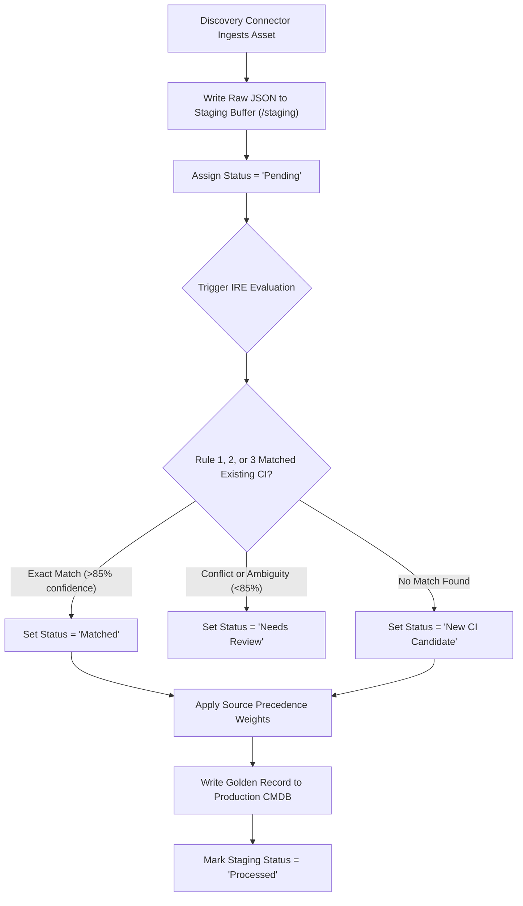
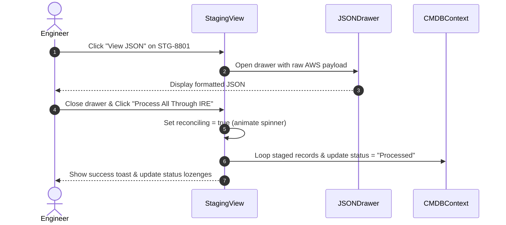

# Module 10: Raw Discovery Staging Pipeline

---

## 1. Purpose in One Paragraph
Raw Discovery Staging (`/staging`) module-oda main objective: Incoming discovery telemetry-ah production CMDB-la direct-ah write aagaama thadukkura oru intelligent ingestion buffer-ah act panradhu. Automated cloud tools seconds-ku seconds ephemeral pods, test VMs, and temporary IPs create pannum. Indha raw data direct-ah CMDB-la vizhundha, duplicate rate skyrocket aagum and trust score drop aaidum. Adhanaala ellam records first `/staging`-la land aagi, validation and IRE rules mudicha piragu dhaan master catalog-ku promote aagum.

---

## 2. Who Uses It (Permission Table)

| Capability | Viewer | Editor | CMDB Owner | Admin |
| :--- | :---: | :---: | :---: | :---: |
| **View Staged Payloads Table** | Allowed | Allowed | Allowed | Allowed |
| **Inspect Raw Discovery JSON** | Allowed | Allowed | Allowed | Allowed |
| **Process Staging via IRE** | Denied (Hidden) | Denied | Allowed | Allowed |
| **Purge Rejected Payloads** | Denied (Hidden) | Denied | Allowed | Allowed |

---

## 3. Entry Points
- **Route**: `/staging`.
- **Sidebar**: "Raw Staging Pipeline" in [Sidebar.tsx](file:///d:/zenops/components/layout/Sidebar.tsx).
- **Discovery Sources Link**: "View Ingested Payloads" button on `/discovery-sources`.
- **IRE Console Link**: Top header navigation links directly between `/staging` and `/ire-console`.

---

## 4. Preconditions & Required Data
- Populated records in [data/staging-records.json](file:///d:/zenops/data/staging-records.json).
- 4 seeded records:
  1. `STG-8801`: AWS EC2 Instance (`i-0a81f82910ba`) from `AWS CloudTrail`
  2. `STG-8802`: Kubernetes Pod (`auth-service-pod-99x`) from `Kubernetes Operator`
  3. `STG-8803`: Edge Router (`cr-edge-01`) from `SolarWinds NCM`
  4. `STG-8804`: Cloud SQL DB (`db-postgres-prod-replica`) from `Google Cloud Asset`

---

## 5. Main Flow (Happy Path: Inspecting Raw Payloads & Batch IRE Processing)

| Step | Actor | Screen / Element Clicked | What System Does Behind Scenes | Data Created or Changed | What User Sees Next |
| :-: | :--- | :--- | :--- | :--- | :--- |
| **1** | Engineer | Navigates to `/staging` | [StagingView.tsx](file:///d:/zenops/components/cmdb/StagingView.tsx) calls `CMDBService.fetchStagingRecords()`. | Loads 4 staged records. | 5-stage ingestion pipeline visual strip + staged payloads table render. |
| **2** | Engineer | Clicks **View JSON** (Eye icon) on `STG-8801` | Sets `selectedRecord: STG-8801` and opens slide-in drawer. | None | Drawer renders syntax-highlighted raw JSON payload directly from AWS CloudTrail. |
| **3** | Engineer | Verifies MAC (`02:42:0a:f0:00:0c`) and IP (`10.0.1.42`) | Identifies that payload matches existing server `PROD-DB-MUMBAI-01`. | None | Confirms rule matching criteria. |
| **4** | Engineer | Closes drawer and clicks **Process All Through IRE** | [StagingView.tsx#L48](file:///d:/zenops/components/cmdb/StagingView.tsx#L48) triggers `handleReconcileAll()`. | Sets `reconciling: true`. Loops through staged records. | Spinner activates on button: *"Processing..."*. |
| **5** | System | IRE Batch Simulation (1200ms) | Updates `status: "Processed"` for all records. Transmits updates to master CMDB catalog. | Status changes from `Pending` &rarr; `Processed`. | Success toast: *"Reconciliation Complete: Processed 4 staged records through the IRE Engine."* |
| **6** | Engineer | Observes Table Status | All status lozenges flip to green **`PROCESSED`**. | UI re-renders with processed state. | All pending records verified and cleared from buffer. |

---

## 6. The 5-Stage Architectural Pipeline Strip

The top of `/staging` renders an interactive, fully clickable visual ingestion strip demonstrating the separation of concerns and enabling direct navigation across the pipeline:
```
[1. Connectors] ──▶ [2. Raw Staging] ──▶ [3. IRE Engine] ──▶ [4. CMDB Master] ──▶ [5. Consumers]
  (AWS / K8s)         (Buffer Area)       (Rules & Merge)       (Golden Record)     (ITSM / Change)
```

1. **Connectors** [Implemented]: Navigates to `/discovery-sources` (Discovery Sources & Connector Management).
2. **Raw Staging** [Implemented]: Active stage (`/staging`), representing the high-throughput ingestion buffer.
3. **IRE Engine** [Implemented]: Navigates to `/reconciliation-rules` (Identification criteria, Reconciliation rules & Merge precedence catalog).
4. **CMDB Master** [Implemented]: Navigates to `/cis` (Authoritative CI inventory and master record management).
5. **Consumers** [Planned]: Interactive stage that opens a modal clearly identifying downstream ITSM, Incident Triage, and Cloud Billing integrations as **Planned / Phase 2**, while guiding operators to existing related ZenOps views (`/relationships` for blast-radius incident triage, `/services` for business SLAs, and `/cis/[id]` for CI 360 ITSM records).

---

## 7. Staging Record Status Lifecycle

- **`New` / `Pending` (Amber)**: Freshly ingested payload awaiting identification evaluation.
- **`Matched` (Blue)**: IRE rule has matched an existing CI (e.g. MAC match with 98% confidence).
- **`Needs Review` (Purple)**: Ambiguous fuzzy match or conflicting source attributes requiring operator approval.
- **`Processed` (Green)**: Successfully merged into production CMDB.
- **`Rejected` (Red)**: Payload discarded due to schema errors, missing required identifiers, or test namespace filters.

---

## 8. Error & Edge Flows

| Scenario | Trigger / Condition | What System Does | User Experience / Alert |
| :--- | :--- | :--- | :--- |
| **Malformed JSON Payload** | Ingested record has unparseable JSON syntax. | JSON viewer falls back to string representation. | Warning lozenge: *"Malformed Payload"* displayed in table row. |
| **Double-Processing Attempt** | User triggers "Process All" when all records are already `Processed`. | System detects 0 pending items. | Toast informs: *"All staged records have already been reconciled."* |

---

## 9. Business Rules Applied Here

| Rule Code | Rule Condition | System Enforcement | Enforcement File |
| :--- | :--- | :--- | :--- |
| **STG-01** | Zero Direct Writes | Ingestion daemons cannot write directly to `cis` table; must submit to `/staging`. | [StagingView.tsx#L83](file:///d:/zenops/components/cmdb/StagingView.tsx#L83) |
| **STG-02** | Payload Immutability | Staged records preserve the exact original raw payload for forensic auditability. | [data/staging-records.json](file:///d:/zenops/data/staging-records.json) |

---

## 10. Inputs, Outputs & Service Contracts
- **`CMDBService.fetchStagingRecords(tenant: string): Promise<StagingDiscoveryRecord[]>`**
  - Returns raw staged records.

---

## 11. Mermaid Diagrams

### 11.1 Staging Buffer & Reconciliation Lifecycle


### 11.2 Sequence Diagram: Inspecting JSON & Batch Processing


---

## 12. Worked Example with Real Seed Data
- **Payload**: `STG-8801` (`AWS CloudTrail`).
  - Raw JSON: `{ "name": "PROD-DB-MUMBAI-01", "ip": "10.0.1.42", "mac": "02:42:0a:f0:00:0c", "cpu": 32 }`.
- **IRE Processing**:
  - Exact MAC match against `CI-000492`.
  - CPU attribute updated from 2 to 32.
  - Staging record `STG-8801` status updated from `Pending` &rarr; `Processed`.

---

## 13. How to Demo This Flow in 2 Minutes (Tanglish Script)

> "Innaiku namma **Raw Discovery Staging Pipeline** paakalaam:
> 1. Real enterprise-la discovery connectors direct-ah CMDB-la write panna koodadhu; apdi pannina ephemeral pod noise and IP duplicates CMDB-ah pollute pannidum.
> 2. Screen top-la 5-stage ingestion pipeline strip paakkalaam: **Connectors &rarr; Raw Staging &rarr; IRE Engine &rarr; CMDB Master &rarr; Consumers**.
> 3. Table-la AWS, Kubernetes, and SolarWinds-la irundhu vandha 4 raw payloads pending-la iruku.
> 4. Naan first row-la irukura 'View JSON' eye icon click panren. Slide-in drawer-la raw un-parsed telemetry JSON reveal aagum.
> 5. 'Process All Through IRE' button click panna udaney, system batch simulation run panni ella records-aiyum validate panni status-ah instant-ah **PROCESSED**-ku move pannidum!"

---

## 14. Test Scenarios (Manual Acceptance Tests)
- **Scenario 1 (Staging Ingestion Display)**:
  - *Given*: User on `/staging`.
  - *When*: Page loads.
  - *Then*: 4 staged records display with Source and Class badges.
- **Scenario 2 (Raw JSON Inspection)**:
  - *Given*: User clicks eye icon on `STG-8801`.
  - *When*: Click executes.
  - *Then*: Drawer opens with syntax-highlighted AWS JSON.
- **Scenario 3 (Process All Execution)**:
  - *Given*: Records in Pending state.
  - *When*: User clicks "Process All Through IRE".
  - *Then*: Status lozenges update to "Processed" and success toast appears.

---

## 15. Gaps & Next Steps
- **Dead Letter Queue (DLQ)**: In production, malformed payloads that fail schema validation should be routed to an SQS/Kafka DLQ for engineering inspection.
