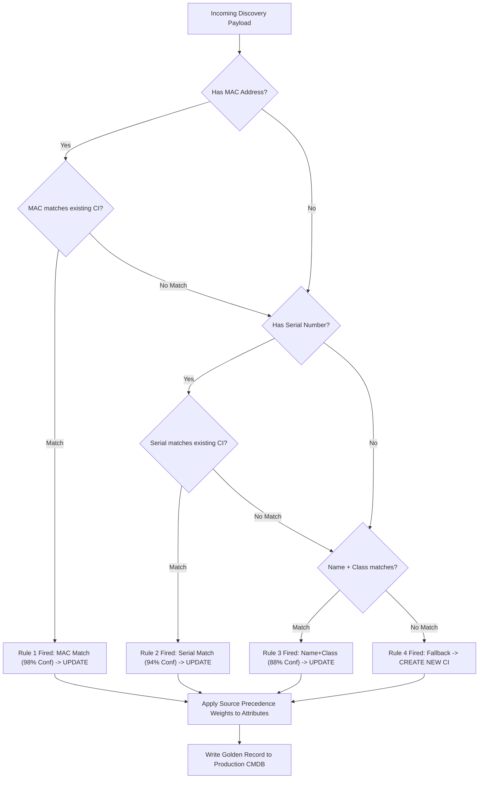
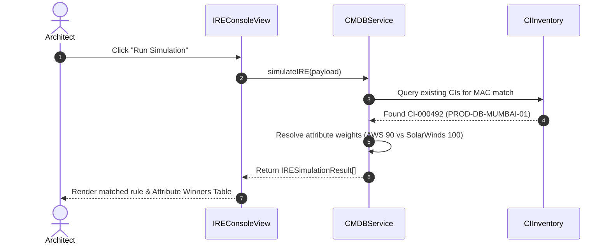

# Module 11: Identification & Reconciliation (IRE)

---

## 1. Purpose in One Paragraph
Identification and Reconciliation Engine (IRE) module-oda core goal: Multiple discovery tools (AWS, Dynatrace, K8s, SolarWinds) ore server pathi report pannumbodhu, duplicates create aagaama authoritative "Golden Record" create panradhu. Rule order (MAC &rarr; Serial &rarr; Name+Class) moolama incoming payloads-ah existing CIs kooda match panni, and conflicting attributes irundha source authority weights (e.g. SolarWinds beats AWS for IP, SCCM beats AWS for OS) moolama winner determine pannum.

---

## 2. Who Uses It (Permission Table)

| Capability | Viewer | Editor | CMDB Owner | Admin |
| :--- | :---: | :---: | :---: | :---: |
| **Inspect Reconciliation Rules** | Allowed | Allowed | Allowed | Allowed |
| **Run IRE Console Simulations** | Allowed | Allowed | Allowed | Allowed |
| **Fire Datadog Alert Webhook** | Allowed | Allowed | Allowed | Allowed |
| **Approve / Reject Review Queue**| Denied (Hidden) | Denied | Allowed | Allowed |
| **Modify Rule Precedence Order** | Denied (Hidden) | Denied | Allowed | Allowed |

---

## 3. Entry Points
- **IRE Console Route**: `/ire-console`.
- **Reconciliation Rules Route**: `/reconciliation-rules`.
- **Sidebar**: "Reconciliation (IRE)" in [Sidebar.tsx](file:///d:/zenops/components/layout/Sidebar.tsx).
- **Staging Header Link**: "IRE Simulator" button on `/staging`.

---

## 4. Preconditions & Required Data
- Populated rule hierarchy in [services/mock-data.ts#L844](file:///d:/zenops/services/mock-data.ts#L844).
- 5 seeded reconciliation rules:
  1. `REC-01`: MAC Address Exact Match (`identificationCriteria: "mac_address"`, Confidence: 98%)
  2. `REC-02`: Serial Number Hardware Match (`identificationCriteria: "serial_number"`, Confidence: 94%)
  3. `REC-03`: Composite Name + Class Match (`identificationCriteria: "name + sys_class_name"`, Confidence: 88%)
  4. `REC-04`: Network FQDN Domain Match (`identificationCriteria: "fqdn"`, Confidence: 92%)
  5. `REC-05`: Cloud Resource ID Exact Match (`identificationCriteria: "cloud_resource_id"`, Confidence: 99%)

---

## 5. Main Flow (Happy Path: Simulating Identification & Attribute Reconciliation)

| Step | Actor | Screen / Element Clicked | What System Does Behind Scenes | Data Created or Changed | What User Sees Next |
| :-: | :--- | :--- | :--- | :--- | :--- |
| **1** | Architect | Navigates to `/ire-console` | [IREConsoleView.tsx](file:///d:/zenops/components/cmdb/IREConsoleView.tsx) loads default AWS EC2 payload in JSON editor. | Pre-fills `SAMPLE_PAYLOAD_EC2`. | Split editor: JSON payload (left) and Simulation Canvas (right). |
| **2** | Architect | Clicks **Load AWS EC2** button | Resets JSON to `PROD-DB-MUMBAI-01` payload with MAC `02:42:0a:f0:00:0c`. | Sets JSON string. | Payload reflects 32-core AWS server. |
| **3** | Architect | Clicks **Run Simulation** | [IREConsoleView.tsx#L73](file:///d:/zenops/components/cmdb/IREConsoleView.tsx#L73) sets `isSimulating: true`, steps through 3 evaluation phases. | Sets simulation progress states. | Visual stepped progress animation runs: Phase 1 (Ingest) &rarr; Phase 2 (Evaluate) &rarr; Phase 3 (Resolve). |
| **4** | System | `CMDBService.simulateIRE()` | Executes Rule 1 (MAC match). Finds existing CI `CI-000492`. Computes attribute winners. | Generates `IRESimulationResult` array. | Simulation finishes; green badge announces: *"Matched 1 incoming item against active rules."* |
| **5** | Architect | Inspects Results | Renders Matched Rule card: *"Rule 1: MAC Address Exact Match (Confidence: 98%)"*, Action: `Update`. | None | Displays **Attribute Winners Table** and Resulting CI preview. |
| **6** | Architect | Clicks **Fire Datadog Alert Webhook** | Traces synthetic CPU spike (98%) on `PROD-DB-MUMBAI-01`. Correlates to `CI-000492`. | Emits alert toast. | Toast: *"Datadog Webhook Received: CPU spike correlated to CI-000492 PROD-DB-MUMBAI-01."* |

---

## 6. The 4-Tier Identification Rule Hierarchy

Enforced in [services/cmdb-service.ts#L196](file:///d:/zenops/services/cmdb-service.ts#L196):
1. **Rule 1: MAC Address Exact Match**:
   - Compares `mac_address` or `mac` against existing catalog.
   - Confidence: **98%**. Action: **Update Existing CI**.
2. **Rule 2: Serial Number Hardware Match**:
   - Evaluated if Rule 1 finds no match. Compares `serial_number`.
   - Confidence: **94%**. Action: **Update Existing CI**.
3. **Rule 3: Composite Name + Class Match**:
   - Evaluated if Rules 1 & 2 fail. Compares `name` + `sys_class_name`.
   - Confidence: **88%**. Action: **Update Existing CI**.
4. **Rule 4: Fallback Rule**:
   - If zero identifiers match existing catalog.
   - Confidence: **100%**. Action: **Create New CI**.

---

## 7. Attribute Winning Authority Matrix (Source Precedence)

When two discovery sources report conflicting attribute values for the same server, the IRE does not overwrite blindly. It resolves winners based on **Authoritative Source Weights (0-100)**:

| Attribute Category | Primary Source (Weight 100) | Secondary Source (Weight 85) | Fallback Source (Weight 70) | Rule Rationale |
| :--- | :--- | :--- | :--- | :--- |
| **IP & MAC Address** | **SolarWinds / Network NCM** (100) | **AWS CloudTrail** (85) | **Dynatrace APM** (70) | Network NCM is the authoritative gateway for Layer-2/3 interfaces. |
| **Hardware Specs (CPU/RAM)** | **CrowdStrike / SCCM** (100) | **AWS EC2 API** (80) | **Manual Entry** (50) | In-guest agents read raw kernel registers; cloud API reads nominal vCPUs. |
| **Application & Port** | **Dynatrace APM** (100) | **Kubernetes Operator** (85)| **SolarWinds** (60) | APM agents trace live socket bindings and process runtime arguments. |

---

## 8. Review Queue in `/reconciliation-rules`

When incoming data has ambiguous identifiers (e.g. matching name but differing serial number, confidence &lt; 85%), it is routed to the **Review Queue**:
- **Merge**: Operator forces merge into the selected existing CI; logs audit event.
- **Keep Separate**: System creates a distinct new CI and flags both as potential aliases.
- **Reject**: Payload discarded as invalid telemetry.

---

## 9. Error & Edge Flows

| Scenario | Trigger / Condition | What System Does | User Experience / Alert |
| :--- | :--- | :--- | :--- |
| **Invalid JSON Syntax** | Operator types malformed JSON in simulation editor. | `JSON.parse()` throws exception. | Error toast: *"Invalid JSON: Please ensure your payload is valid JSON before simulating."* Simulation aborted. |
| **Empty Items Array** | Payload has `items: []`. | Simulator detects 0 items. | Warning toast: *"Payload contains no configuration items to evaluate."* |

---

## 10. Business Rules Applied Here

| Rule Code | Rule Condition | System Enforcement | Enforcement File |
| :--- | :--- | :--- | :--- |
| **IRE-01** | Rule Priority Order | Rules evaluate strictly in sequence: MAC &rarr; Serial &rarr; Name+Class &rarr; Create. | [cmdb-service.ts#L210](file:///d:/zenops/services/cmdb-service.ts#L210) |
| **IRE-02** | Attribute Winning Precedence | Higher source weight overwrites lower source weight during property merge. | [cmdb-service.ts#L250](file:///d:/zenops/services/cmdb-service.ts#L250) |

---

## 11. Mermaid Diagrams

### 11.1 Identification Decision Tree

### 11.2 Sequence Diagram: Simulation & Attribute Winner Resolution

---

## 12. Worked Example with Real Seed Data
- **Incoming Payload**:
  - Source: `AWS CloudTrail`
  - Name: `PROD-DB-MUMBAI-01`, MAC: `02:42:0a:f0:00:0c`, CPU: `32`
- **IRE Evaluation**:
  - Matches `CI-000492` via Rule 1 (Confidence 98%).
  - Attribute Winner: CPU updated to 32 (AWS weight 90).
  - Action: **Update**. Audit entry logged: *"IRE Ingestion: Update by AWS CloudTrail"*.

---

## 13. How to Demo This Flow in 2 Minutes (Tanglish Script)

> "Innaiku namma **Identification & Reconciliation Engine (IRE)** demo paakalaam:
> 1. Enterprise-la cloud and agents ore server pathi pesumbodhu duplicate aaga koodadhu; adhaan IRE-oda work.
> 2. Screen-la namma **IRE Simulator Console** iruku. Left-la raw incoming discovery JSON editor, right-la simulation results.
> 3. Naan 'Load AWS EC2' click panni `PROD-DB-MUMBAI-01` payload load panren.
> 4. 'Run Simulation' click panna udaney, system 3 evaluation phases execute pannum: Ingest &rarr; Match &rarr; Resolve.
> 5. Notice the result: **Rule 1: Exact MAC Address Match** 98% confidence-oda hit aagi Action: `UPDATE` nu declare pannudhu.
> 6. Keezha Attribute Winners Table paatheengana, entha source-ku high weight iruko adhaan win aagum.
> 7. Last-ah 'Fire Datadog Webhook' button click panna, live observability alert synthetic-ah trigger aagi CI correlation prove aagum!"

---

## 14. Test Scenarios (Manual Acceptance Tests)
- **Scenario 1 (MAC Match Simulation)**:
  - *Given*: Payload with MAC `02:42:0a:f0:00:0c`.
  - *When*: User clicks Run Simulation.
  - *Then*: Matches `PROD-DB-MUMBAI-01` with Rule 1 (98% confidence).
- **Scenario 2 (New CI Fallback)**:
  - *Given*: Payload with unknown random MAC `99:99:99:99:99:99`.
  - *When*: User clicks Run Simulation.
  - *Then*: Triggers Rule 4 Fallback with Action: "Create".
- **Scenario 3 (Datadog Webhook Alert)**:
  - *Given*: User on `/ire-console`.
  - *When*: Clicks "Fire Datadog Alert Webhook".
  - *Then*: Toast alert confirms receipt and CI correlation.

---

## 15. Gaps & Next Steps
- **Rule Ordering UI Drag & Drop**: Current rule precedence order (1 to 4) is fixed in code; future releases will provide drag-and-drop rule priority reordering in `/reconciliation-rules`.
