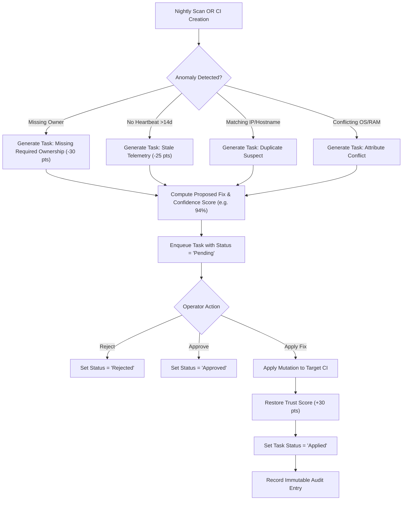
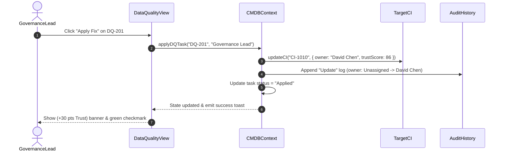

# Module 12: Automated Data Quality & Remediation

---

## 1. Purpose in One Paragraph
Automated Data Quality & Remediation (`/data-quality`) module-oda main objective: CMDB data decay and rot aaguradha prevent panradhu. Over time servers change aagum, employees resign aavaanga, cloud VMs abandon aagum. Indha module continuous-ah catalog-ah scan panni 5 anomaly categories (Missing Owner, Stale Telemetry, Duplicate Suspects, Attribute Conflicts, Orphan CIs) kandupidithu, automated proposed fixes and 1-click remediation moolama Trust Score-ah restore pannum.

---

## 2. Who Uses It (Permission Table)

| Capability | Viewer | Editor | CMDB Owner | Admin |
| :--- | :---: | :---: | :---: | :---: |
| **Browse Data Quality Tasks** | Allowed | Allowed | Allowed | Allowed |
| **Inspect Anomaly Details & Diffs**| Allowed | Allowed | Allowed | Allowed |
| **Approve Proposed Fix** | Denied (Hidden) | Denied | Allowed | Allowed |
| **Reject Proposed Fix** | Denied (Hidden) | Denied | Allowed | Allowed |
| **Apply Fix (1-Click Remediation)**| Denied (Hidden) | Denied | Allowed | Allowed |
| **Run 2 AM Staleness Sweep** | Denied (Hidden) | Denied | Allowed | Allowed |
| **Bulk Apply (>85% Confidence)** | Denied (Hidden) | Denied | Allowed | Allowed |

---

## 3. Entry Points
- **Route**: `/data-quality`.
- **Sidebar**: "Data Quality" in [Sidebar.tsx](file:///d:/zenops/components/layout/Sidebar.tsx).
- **Dashboard Section 3**: "Open Data Quality Remediation" widget category links jump directly to `/data-quality`.
- **Getting Started**: Step 4 ("Assign Technical Owners") routes directly to `/data-quality`.

---

## 4. Preconditions & Required Data
- Populated `dataQualityTasks` in [services/mock-data.ts#L902](file:///d:/zenops/services/mock-data.ts#L902).
- 5 seeded tasks:
  1. `DQ-201`: Missing Required Ownership on `CI-1010` (`staging-legacy-billing-sync`, Confidence: 94%, Severity: Critical)
  2. `DQ-202`: Stale Discovery on `CI-1010` (Confidence: 89%, Severity: High)
  3. `DQ-203`: Attribute Conflict on `CI-1004` (`aws-ec2-prod-edge-gateway-01`, Confidence: 96%, Severity: Medium)
  4. `DQ-204`: Duplicate Suspect on `CI-1011` (`qa-redis-cache-cluster-01`, Confidence: 82%, Severity: Low)
  5. `DQ-205`: Compliance Mismatch on `CI-1005` (`fw-palo-alto-core-perimeter-01`, Confidence: 91%, Status: Applied)

---

## 5. Main Flow (Happy Path: 1-Click Remediation & Trust Score Restoration)

| Step | Actor | Screen / Element Clicked | What System Does Behind Scenes | Data Created or Changed | What User Sees Next |
| :-: | :--- | :--- | :--- | :--- | :--- |
| **1** | Owner | Enters `/data-quality` | [DataQualityView.tsx](file:///d:/zenops/components/cmdb/DataQualityView.tsx) filters tasks by active tenant. | Reads 5 tasks from `CMDBContext`. | 5 category tabs + remediation tasks table render with confidence badges. |
| **2** | Owner | Clicks **Missing Owner** tab | Sets `activeTab: "missing-owner"`. | Filters table to ownership tasks. | Displays task `DQ-201` for `CI-1010` with **Score Diff: +30 pts** badge. |
| **3** | Owner | Inspects Proposed Fix | Reads recommendation: *"Assign owner to David Chen (Enterprise Architect) based on git commit history & project codeowners."* | None | Evaluates 94% confidence score. |
| **4** | Owner | Clicks **Apply Fix** | [DataQualityView.tsx#L53](file:///d:/zenops/components/cmdb/DataQualityView.tsx#L53) calls `applyDQTask("DQ-201")`. | Updates `status: "Applied"` on `DQ-201`. | Button changes to green checkmark. |
| **5** | System | CI Mutation & Score Restoration | [cmdb-context.tsx#L843](file:///d:/zenops/context/cmdb-context.tsx#L843) updates `CI-1010` with owner `David Chen`, support group `Core Infrastructure`, and resets Trust Score from 45% &rarr; **86%**. | Updates CI in `cis` state and writes immutable audit record. | Success toast: *"Remediation Applied (+30 pts Trust): Resolved Missing Ownership for staging-legacy-billing-sync."* |
| **6** | Owner | Clicks **Run 2 AM Staleness Sweep** | [DataQualityView.tsx#L41](file:///d:/zenops/components/cmdb/DataQualityView.tsx#L41) simulates nightly telemetry scan. | Sets `isSweeping: true` (1200ms). | Toast: *"2 AM Staleness Sweep Executed: Scanned all CIs across tenant. Verified 42 active heartbeats."* |

---

## 6. The 5 Anomaly Categories Explained

1. **Missing Required Ownership**:
   - *Condition*: Live Operational/In-Use CI lacking technical owner.
   - *Penalty*: -30 points from Trust Score.
   - *Remediation*: Auto-assigns owner based on Git repository commit history and CODEOWNERS files.
2. **Stale Telemetry**:
   - *Condition*: Discovered asset has not reported heartbeats for > 14 days.
   - *Penalty*: -25 points from Trust Score.
   - *Remediation*: Traces active ping probe, checks cloud console status, or flags for decommissioning.
3. **Duplicate Suspects**:
   - *Condition*: Two or more CIs share matching IP addresses or hostname substrings.
   - *Remediation*: Triggers IRE alias linking or merges duplicate records into a single Golden Record.
4. **Conflicting Data (Attribute Conflicts)**:
   - *Condition*: Two authoritative tools report differing OS kernel or RAM values.
   - *Remediation*: Applies source precedence weights (e.g. CrowdStrike sensor beats AWS API).
5. **Orphan CIs**:
   - *Condition*: Database or storage volume exists without an upstream application or VM parent link.
   - *Remediation*: Analyzes VPC peering and network traffic to link the orphan asset to its service parent.

---

## 7. Task Approval States

- **`Pending` (Amber)**: Newly raised anomaly awaiting engineer approval.
- **`Approved` (Blue)**: Governance lead approved proposed fix; pending batch execution.
- **`Applied` (Green)**: Remediation fix applied directly to CI catalog; Trust Score restored.
- **`Rejected` (Red)**: Proposed fix rejected by operator; anomaly marked as false positive.

---

## 8. Error & Edge Flows

| Scenario | Trigger / Condition | What System Does | User Experience / Alert |
| :--- | :--- | :--- | :--- |
| **Target CI Deleted** | Remediation applied on CI that was already removed. | `applyDQTask()` checks `targetCi` existence. | Error toast: *"Target Configuration Item no longer exists in CMDB catalog."* |
| **Bulk Remediation Filter** | User clicks "Bulk Apply" when 0 high-confidence tasks exist. | System finds 0 tasks with confidence &ge; 85%. | Info toast: *"No pending tasks met the 85% high-confidence threshold for auto-remediation."* |

---

## 9. Business Rules Applied Here

| Rule Code | Rule Condition | System Enforcement | Enforcement File |
| :--- | :--- | :--- | :--- |
| **DQ-01** | Live Score Restoration | Applying a Missing Ownership fix restores Trust Score from degraded level back to &ge; 86%. | [cmdb-context.tsx#L848](file:///d:/zenops/context/cmdb-context.tsx#L848) |
| **DQ-02** | High-Confidence Threshold | Bulk auto-apply strictly mandates a machine-learning confidence score &ge; 85%. | [DataQualityView.tsx#L66](file:///d:/zenops/components/cmdb/DataQualityView.tsx#L66) |

---

## 10. Inputs, Outputs & Service Contracts
- **`applyDQTask(taskId: string, actor?: string): void`**:
  - Updates target CI properties, logs audit entry, and sets task to `Applied`.
- **`approveDQTask(taskId: string, actor?: string): void`**
- **`rejectDQTask(taskId: string, actor?: string): void`**

---

## 11. Mermaid Diagrams

### 11.1 Data Quality Remediation Lifecycle

### 11.2 Sequence Diagram: 1-Click "Apply Fix" Execution

---

## 12. Worked Example with Real Seed Data
- **Anomaly**: `DQ-201` on `CI-1010` (`staging-legacy-billing-sync`).
  - Severity: `Critical`
  - Issue: `Missing Required Ownership` (Trust Score: 45%).
  - Proposed Fix: Assign to `David Chen` (Confidence: 94%).
- **Remediation Executed**:
  - `owner` updated from `Unassigned` &rarr; `David Chen (Enterprise Architect)`.
  - `supportGroup` updated to `Core Infrastructure & Cloud Ops`.
  - Trust Score restored: **45% &rarr; 86% (+41 pts)**.
  - Task `DQ-201` marked as `Applied`.

---

## 13. How to Demo This Flow in 2 Minutes (Tanglish Script)

> "Innaiku namma **Automated Data Quality & Remediation** demo paakalaam:
> 1. CMDB-la biggest challenge: Data rot aaguradhu dhaan. Idhuku ZenOps automated remediation engine provide pannudhu.
> 2. Screen-la 5 tabs iruku: All Tasks, Stale Telemetry, Missing Owner, Duplicate Suspects, and Conflicts.
> 3. Naan 'Missing Owner' tab click panren. Inga `DQ-201` task iruku for `staging-legacy-billing-sync`.
> 4. Notice the green badge: **'Score Diff: +30 pts'**. System git history analyze panni 94% confidence-oda 'David Chen'-ah owner-ah recommend pannudhu.
> 5. Naan **'Apply Fix'** button click panren.
> 6. Single click-la CI mutate aagi, owner assign aagi, Trust Score degraded 45%-la irundhu **86% healthy SLA-ku instant-ah restore aaidum**!
> 7. Top-la 'Run 2 AM Staleness Sweep' button click panna, scheduled nightly cloud VM hygiene scan live-ah trigger aagum!"

---

## 14. Test Scenarios (Manual Acceptance Tests)
- **Scenario 1 (Filter by Category Tab)**:
  - *Given*: User on `/data-quality`.
  - *When*: Clicks "Duplicates" tab.
  - *Then*: Table filters down to `DQ-204` duplicate suspect task.
- **Scenario 2 (Apply Fix Execution)**:
  - *Given*: Task `DQ-201` in Pending state.
  - *When*: User clicks Apply Fix.
  - *Then*: Status turns "Applied", target CI owner updates, and toast confirms +30 pts.
- **Scenario 3 (2 AM Sweep Simulation)**:
  - *Given*: User on `/data-quality`.
  - *When*: Clicks "Run 2 AM Staleness Sweep".
  - *Then*: Spinner runs for 1.2s and toast reports verified active heartbeats.

---

## 15. Gaps & Next Steps
- **Custom Policy Rules**: Currently, anomaly generation is tied to hardcoded rules (14d staleness, missing owner); future releases will include a visual rule builder for custom SQL-like DQ policies.
