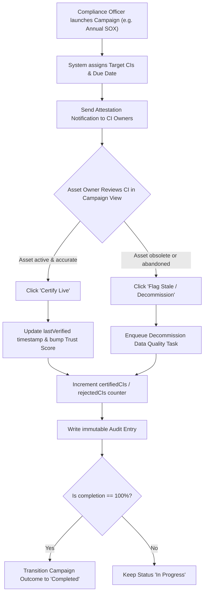
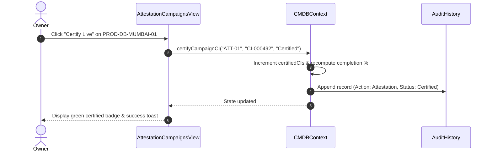

# Module 13: Governance Attestation Campaigns

---

## 1. Purpose in One Paragraph
Governance Attestation Campaigns (`/attestation-campaigns`) module-oda main goal: Automated telemetry kooda human governance and compliance sign-off-ah combine panradhu. Automated discovery oru server live-la irukunu sollalam, aana adhu innum business-ku theva-dhana, adhodha owner and cost center correct-dhana nu periodic-ah (quarterly or annual-ah) engineering leads and system owners certify pannanum. Indha module compliance campaigns create panni, "Certify Live" or "Flag Stale" decisions-ah immutable audit log-oda track pannum.

---

## 2. Who Uses It (Permission Table)

| Capability | Viewer | Editor | CMDB Owner | Admin |
| :--- | :---: | :---: | :---: | :---: |
| **Browse Active Campaigns** | Allowed | Allowed | Allowed | Allowed |
| **Inspect Campaign Scope & CIs** | Allowed | Allowed | Allowed | Allowed |
| **Certify Live Asset** | Denied (Read-only) | Allowed (For Owned CIs) | Allowed | Allowed |
| **Flag Stale / Decommission** | Denied (Read-only) | Allowed (For Owned CIs) | Allowed | Allowed |
| **Launch New Campaign** | Denied (Hidden) | Denied | Allowed | Allowed |

---

## 3. Entry Points
- **Route**: `/attestation-campaigns`.
- **Sidebar**: "Attestation Campaigns" in [Sidebar.tsx](file:///d:/zenops/components/layout/Sidebar.tsx).
- **Dashboard Metric**: Secondary metric "Attestation Completion %" links directly to `/attestation-campaigns`.
- **Getting Started**: Step 6 ("Run First Attestation Campaign") routes to this module.

---

## 4. Preconditions & Required Data
- Populated campaigns in [services/mock-data.ts#L970](file:///d:/zenops/services/mock-data.ts#L970).
- 4 seeded campaigns:
  1. `ATT-01`: Annual SOX Database Compliance (Scope: Production Databases, Completion: 93%)
  2. `ATT-02`: Production Cloud Infrastructure Hygiene (Scope: AWS & Azure Cloud Accounts, Completion: 95%)
  3. `ATT-03`: PCI-DSS Cardholder Data Environment Scope (Scope: Payment Applications & APIs, Completion: 100%)
  4. `ATT-04`: Tier 1 Mission-Critical Service Attestation (Scope: All Tier 1 Infrastructure, Completion: 83%)

---

## 5. Main Flow (Happy Path: Certifying Infrastructure Compliance)

| Step | Actor | Screen / Element Clicked | What System Does Behind Scenes | Data Created or Changed | What User Sees Next |
| :-: | :--- | :--- | :--- | :--- | :--- |
| **1** | Auditor | Enters `/attestation-campaigns` | [AttestationCampaignsView.tsx](file:///d:/zenops/components/cmdb/AttestationCampaignsView.tsx) loads active campaigns from context. | Reads 4 seeded campaigns. | Grid of campaign cards renders with progress bars and due dates. |
| **2** | Auditor | Clicks on **Annual SOX Database Compliance** (`ATT-01`) | Opens campaign detail view showing target CI verification list. | Sets `selectedCampaign: ATT-01`. | List of 14 target database CIs displays with "Certify" and "Flag Stale" buttons. |
| **3** | Auditor | Locates `CI-000492` (`PROD-DB-MUMBAI-01`) and clicks **Certify Live** (Checkmark) | [AttestationCampaignsView.tsx#L63](file:///d:/zenops/components/cmdb/AttestationCampaignsView.tsx#L63) calls `certifyCampaignCI("ATT-01", "CI-000492", "Certified")`. | Increments `certifiedCIs += 1`, recalculates `completionPercentage`. | Success toast: *"Attestation Recorded: CI CI-000492 marked as Certified."* |
| **4** | System | `certifyCampaignCI()` execution | [cmdb-context.tsx#L935](file:///d:/zenops/context/cmdb-context.tsx#L935) updates `lastVerified: now` on CI, and appends immutable audit entry (`Action: Attestation, Status: Certified`). | Audit log record appended to `auditHistory`. | Row reflects certified state with green badge. Campaign progress bar advances. |
| **5** | Auditor | Clicks **Launch Campaign** button in top header | Opens modal with form: Name, Scope, Due Date, and Owner List. | None | Campaign creation modal opens. |
| **6** | Auditor | Enters Name: *"Q1 2027 SOC2 Hygiene"*, Scope: *"Kubernetes Clusters"*, clicks **Launch** | Allocates `id: "ATT-1049"`, appends to `campaigns` array, and notifies owners. | New campaign object created. | Success toast: *"Attestation Campaign Launched"*. New card appears in grid. |

---

## 6. The Two Attestation Decisions

When an asset owner reviews a CI during an active campaign, they have two mutually exclusive choices:
1. **Certify Live**:
   - Confirms that the CI is actively utilized in production, technical specs are accurate, and ownership is correct.
   - Updates `lastVerified` timestamp to current time.
   - Increases the CI's **Freshness pillar** score in the Trust Score algorithm.
   - Appends an audit entry: `Action: Attestation, Actor: Campaign Auditor, Result: Certified`.
2. **Flag Stale / Decommission (Reject)**:
   - Signals that the CI is legacy, orphaned, or scheduled for retirement.
   - Traces dependent upstream services to assess blast radius.
   - Automatically raises a Data Quality task or opens a decommissioning Change Request (`CHG-...`).
   - Appends an audit entry: `Action: Attestation, Result: Rejected`.

---

## 7. Dynamic Completion Calculation Formula

Enforced in [cmdb-context.tsx#L920](file:///d:/zenops/context/cmdb-context.tsx#L920):
$$\text{completionPercentage} = \min\left(100, \text{round}\left(\frac{\text{certifiedCIs} + \text{rejectedCIs}}{\text{totalCIs}} \times 100\right)\right)$$

- When `completionPercentage === 100%`, the campaign outcome automatically transitions from `In Progress` &rarr; **`Completed`**.

---

## 8. Error & Edge Flows

| Scenario | Trigger / Condition | What System Does | User Experience / Alert |
| :--- | :--- | :--- | :--- |
| **Blank Campaign Name** | User submits create modal without a name. | Form handler cancels execution. | Modal remains open; input displays required validation. |
| **Already Certified CI** | User clicks certify on a CI already marked certified. | System updates timestamp; does not double-count completion. | Prevents completion percentage from exceeding 100%. |

---

## 9. Business Rules Applied Here

| Rule Code | Rule Condition | System Enforcement | Enforcement File |
| :--- | :--- | :--- | :--- |
| **ATT-01** | Attestation Audit Record | Every certified or rejected CI must append an immutable audit log entry. | [cmdb-context.tsx#L935](file:///d:/zenops/context/cmdb-context.tsx#L935) |
| **ATT-02** | Campaign Outcome Transition | When certified + rejected equals total CIs, outcome flips to `Completed`. | [cmdb-context.tsx#L929](file:///d:/zenops/context/cmdb-context.tsx#L929) |

---

## 10. Inputs, Outputs & Service Contracts
- **`certifyCampaignCI(campaignId: string, ciId: string, status: "Certified" | "Rejected"): void`**
  - Updates campaign counters, re-calculates percentage, and logs audit record.

---

## 11. Mermaid Diagrams

### 11.1 Attestation Workflow

### 11.2 Sequence Diagram: Owner Certification Flow

---

## 12. Worked Example with Real Seed Data
- **Campaign**: `ATT-01` (`Annual SOX Database Compliance`).
  - Total CIs: 14, Certified: 12, Rejected: 1 (Completion: 93%).
- **Action**:
  - Owner certifies `CI-000492` (`PROD-DB-MUMBAI-01`).
- **Result**:
  - `certifiedCIs` increases to 13.
  - Completed items = $13 + 1 = 14$ of 14.
  - `completionPercentage` reaches **100%**.
  - Campaign outcome transitions to **`Completed`**.
  - Audit log records: `AUD-ATT-1049: CI-000492 certified by Campaign Auditor`.

---

## 13. How to Demo This Flow in 2 Minutes (Tanglish Script)

> "Innaiku namma **Governance Attestation Campaigns** demo paakalaam:
> 1. Automated discovery mattum podhadhu; compliance and SOX audit-ku human owners 'indha server innum production-la live-ah iruku' nu sign-off pannanum.
> 2. Screen-la 4 active campaigns paakkalaam: Annual SOX Database Compliance, PCI Scope, and Cloud Hygiene.
> 3. Naan first campaign card open panren. Inga target CIs list iruku.
> 4. `PROD-DB-MUMBAI-01` pakkathula irukura green **'Certify Live'** checkmark click panren.
> 5. Notice the result: Certified count increase aagum, campaign completion percentage **100% (Completed)** reach aagum, and immutable audit history-la certification record aaidum.
> 6. Top-right-la '+ Launch Campaign' button moolama 30 seconds-la quarterly compliance campaign create pannalaam!"

---

## 14. Test Scenarios (Manual Acceptance Tests)
- **Scenario 1 (Certify CI)**:
  - *Given*: Campaign `ATT-01` open.
  - *When*: User clicks Certify Live on a pending CI.
  - *Then*: Certified counter increments and toast confirms certification.
- **Scenario 2 (Flag Stale)**:
  - *Given*: Campaign item open.
  - *When*: User clicks Flag Stale.
  - *Then*: Item marked as Rejected and completion percentage updates.
- **Scenario 3 (Campaign Creation)**:
  - *Given*: User on `/attestation-campaigns`.
  - *When*: Clicks Launch Campaign, enters details and submits.
  - *Then*: New campaign card appears in the grid.

---

## 15. Gaps & Next Steps
- **Automated Email Sign-off Reminders**: In production, campaign owners should receive automated weekly reminder emails with 1-click magic sign-off links.
