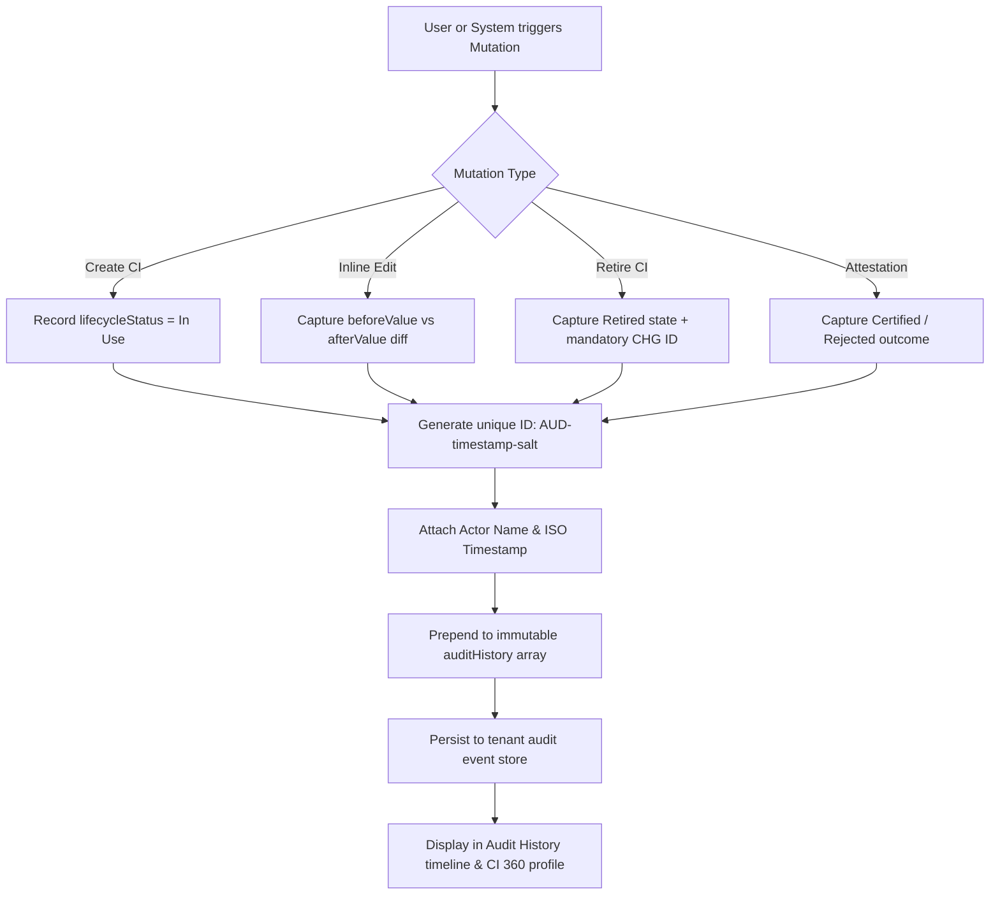
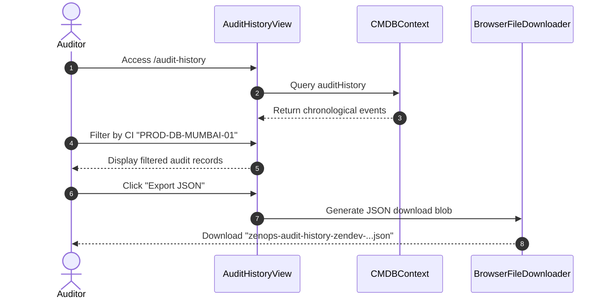

# Module 14: Tamper-Evident Immutable Audit Log

---

## 1. Purpose in One Paragraph
Immutable Audit History (`/audit-history`) module-oda primary goal: CMDB-la nadakkura ovvoru state mutation, attribute update, bulk reassignment, retirement, and compliance certification-ah tamper-evident, append-only event log-la record panradhu. Oru incident or security breach aagumbodhu "Who changed this IP, when was this database retired, and which CAB Change Record authorized it?" endra forensic question-ku irrefutable proof tharuvadhu dhaan idhodha core purpose.

---

## 2. Who Uses It (Permission Table)

| Capability | Viewer | Editor | CMDB Owner | Admin |
| :--- | :---: | :---: | :---: | :---: |
| **Search & Filter Audit Events** | Allowed | Allowed | Allowed | Allowed |
| **Inspect Before / After Diffs** | Allowed | Allowed | Allowed | Allowed |
| **Filter by Change Type (Create/Retire)**| Allowed | Allowed | Allowed | Allowed |
| **Export Audit Trail as JSON** | Allowed | Allowed | Allowed | Allowed |
| **Delete / Modify Audit Record** | **STRICTLY FORBIDDEN** (No API Exists) | **STRICTLY FORBIDDEN** | **STRICTLY FORBIDDEN** | **STRICTLY FORBIDDEN** |

---

## 3. Entry Points
- **Route**: `/audit-history`.
- **Sidebar**: "Audit History" in [Sidebar.tsx](file:///d:/zenops/components/layout/Sidebar.tsx).
- **Dashboard Section 3**: "Recent Audit Stream" ticker links to `/audit-history`.
- **CI 360 Deep Profile**: "Audit History" tab in `/cis/[id]` renders the filtered event trail for that specific asset.

---

## 4. Preconditions & Required Data
- Populated `auditHistory` array in `CMDBContext` scoped to the current tenant.
- Seed events in [services/mock-data.ts#L1021](file:///d:/zenops/services/mock-data.ts#L1021) documenting baseline modifications.

---

## 5. Main Flow (Happy Path: Forensic Audit Investigation & Export)

| Step | Actor | Screen / Element Clicked | What System Does Behind Scenes | Data Created or Changed | What User Sees Next |
| :-: | :--- | :--- | :--- | :--- | :--- |
| **1** | Auditor | Navigates to `/audit-history` | [AuditHistoryView.tsx](file:///d:/zenops/components/cmdb/AuditHistoryView.tsx) reads `auditHistory` from `CMDBContext`. | Reads event records. | Filter bar + chronological timeline table renders with actor badges and before/after diffs. |
| **2** | Auditor | Types `PROD-DB-MUMBAI-01` in Search box | Filters records where `ciName` or `ciId` matches query. | Active filter applied in memory. | Table isolates all historical events for the Mumbai database. |
| **3** | Auditor | Selects Change Type: **`Retire`** | Filters items where `changeType === "Retire"`. | Filters to retirement events. | Reveals the exact event where the CI was retired under Change Record `CHG-008912`. |
| **4** | Auditor | Inspects the Before / After Diff | Reads: `Field: lifecycleStatus, Before: In Use, After: Retired, Actor: Sarah Jenkins`. | None | Verifies authorized CAB actor and timestamp. |
| **5** | Auditor | Clicks **Export JSON** | [AuditHistoryView.tsx#L38](file:///d:/zenops/components/cmdb/AuditHistoryView.tsx#L38) serializes filtered records into a JSON download blob. | Browser downloads `zenops-audit-history-zendev-...json`. | Success toast: *"Audit Trail Exported: Downloaded 6 audit records."* |

---

## 6. Comprehensive Event Catalog: What Gets Logged by Every Module

The system enforces automatic audit logging across all operational actions in [cmdb-context.tsx#L325](file:///d:/zenops/context/cmdb-context.tsx#L325) (`logAudit`):

| Module | Operational Action | Change Type | Logged Fields | Change Record Required? |
| :--- | :--- | :---: | :--- | :---: |
| **CI Creation** (`/cis/new`) | New asset registered | `Create` | `fieldChanged: "lifecycleStatus"`, Before: `None`, After: `In Use` | Optional |
| **CI Inline Edit** (`/cis/[id]`) | Attribute changed | `Update` | Tracks `name`, `description`, `owner`, `supportGroup`, `ip_address` | Optional |
| **CI Retirement** (`CIRetireModal`) | Asset decommissioned | `Retire` | Two records: `lifecycleStatus` &rarr; `Retired`, `operationalStatus` &rarr; `Non-operational` | **MANDATORY for Prod** (`CHG-...`) |
| **Bulk Reassignment** (`/cis`) | Owner updated | `Update` | `fieldChanged: "owner"`, Before: `Unassigned`, After: New Owner | Optional |
| **Data Quality Fix** (`/data-quality`)| Remediation applied | `Update` | Restores `owner`, `supportGroup`, or `lastDiscovered` | Optional |
| **Attestation** (`/attestation-campaigns`)| Asset certified | `Attestation` | `fieldChanged: "attestationStatus"`, After: `Certified` or `Rejected` | N/A |
| **IRE Ingestion** (`/ire-console`) | Automated update | `Update` | Updates attributes based on winning source (e.g. CPU 32) | Logged as Ingestion |

---

## 7. Structure of an Immutable Audit Record

Defined in [types/cmdb.ts](file:///d:/zenops/types/cmdb.ts):
```typescript
export interface CIAuditHistory {
  id: string;              // e.g. "AUD-1710582910-412"
  ciId: string;            // e.g. "CI-000492"
  ciName: string;          // e.g. "PROD-DB-MUMBAI-01"
  fieldChanged: string;    // e.g. "lifecycleStatus"
  beforeValue: string;     // e.g. "In Use"
  afterValue: string;      // e.g. "Retired"
  changedBy: string;       // e.g. "Sarah Jenkins (Platform Eng)"
  timestamp: string;       // ISO 8601 UTC timestamp
  changeType: "Create" | "Update" | "Retire" | "Attestation";
  changeRecord?: string;   // e.g. "CHG-2024-8812"
}
```

---

## 8. Immutability & Tamper-Evidence
1. **Append-Only Event Store**: The service layer exposes no `deleteAudit` or `editAudit` functions. Records are prepended: `setAuditHistory(prev => [newRecord, ...prev])`.
2. **Guaranteed Identifiers**: Every record receives a millisecond-precision unique identifier with random salt (`AUD-${Date.now()}-${random}`).
3. **Tenant Scoping**: Audit history is segregated by tenant storage keys (`zenops_cmdb_aud`) with zero cross-tenant leakage.

---

## 9. Error & Edge Flows

| Scenario | Trigger / Condition | What System Does | User Experience / Alert |
| :--- | :--- | :--- | :--- |
| **No Matching Audit Events** | Search query matches 0 events. | Filtered array length is 0. | Clean empty state message: *"No audit history records match your search criteria."* |
| **Export with Zero Records** | User clicks export when filter yields 0 rows. | Exports empty array `[]`. | Success toast reports 0 records exported. |

---

## 10. Business Rules Applied Here

| Rule Code | Rule Condition | System Enforcement | Enforcement File |
| :--- | :--- | :--- | :--- |
| **AUD-01** | Mandatory Change Record Capture | When retiring a Production CI, the Change Record ID must be recorded on the audit entry. | [cmdb-context.tsx#L668](file:///d:/zenops/context/cmdb-context.tsx#L668) |
| **AUD-02** | Zero Mutation of Past Events | Audit history entries cannot be modified or deleted by any user role (including Admin). | [AuditHistoryView.tsx](file:///d:/zenops/components/cmdb/AuditHistoryView.tsx) |

---

## 11. Mermaid Diagrams

### 11.1 Immutable Audit Append Flowchart


### 11.2 Sequence Diagram: Investigation & Export Flow


---

## 12. Worked Example with Real Seed Data
- **Event ID**: `AUD-1004`
- **Asset**: `CI-000492` (`PROD-DB-MUMBAI-01`)
- **Field Changed**: `lifecycleStatus`
- **Before Value**: `In Use`
- **After Value**: `Retired`
- **Actor**: `Sarah Jenkins (Platform Eng)`
- **Change Record**: `CHG-2024-8812`
- **Timestamp**: `2026-11-16T10:14:22Z`

---

## 13. How to Demo This Flow in 2 Minutes (Tanglish Script)

> "Innaiku namma **Immutable Audit History** demo paakalaam:
> 1. Enterprise compliance and security auditors-ku CMDB-oda most critical screen idhu dhaan.
> 2. CMDB-la nadakkura ovvoru create, inline edit, retire, and attestation action-um tamper-evident event log-la append aagum.
> 3. Naan search bar-la `PROD-DB-MUMBAI-01` nu type panren. Instant-ah indha server-ku nadandha ella historical changes-um filter aaidum.
> 4. Change Type filter-la 'Retire' select panna, andha server entha Change Record (`CHG-2024-8812`) keezha, yaar moolama retire aachu nu clear-ah before/after diff kaatum.
> 5. Notice pannunga: inga 'Delete' or 'Edit Log' button-e kedayadhu! Absolute append-only immutability.
> 6. Top-right-la 'Export JSON' click panni complete audit trail-ah forensic analysis-kaaga download pannikalam!"

---

## 14. Test Scenarios (Manual Acceptance Tests)
- **Scenario 1 (Filter by CI ID)**:
  - *Given*: User on `/audit-history`.
  - *When*: Types `CI-000492`.
  - *Then*: Table filters down exclusively to events for `PROD-DB-MUMBAI-01`.
- **Scenario 2 (Change Type Filter)**:
  - *Given*: Filter dropdown on "All".
  - *When*: User selects "Create".
  - *Then*: Displays only initial CI creation events.
- **Scenario 3 (JSON Export)**:
  - *Given*: User clicks "Export JSON".
  - *When*: Download triggers.
  - *Then*: JSON file downloads with full event attributes.

---

## 15. Gaps & Next Steps
- **Cryptographic Merkle Tree Hash Chaining**: In future zero-trust releases, each audit record can include the SHA-256 hash of the previous record to mathematically prove zero tampering on disk.
