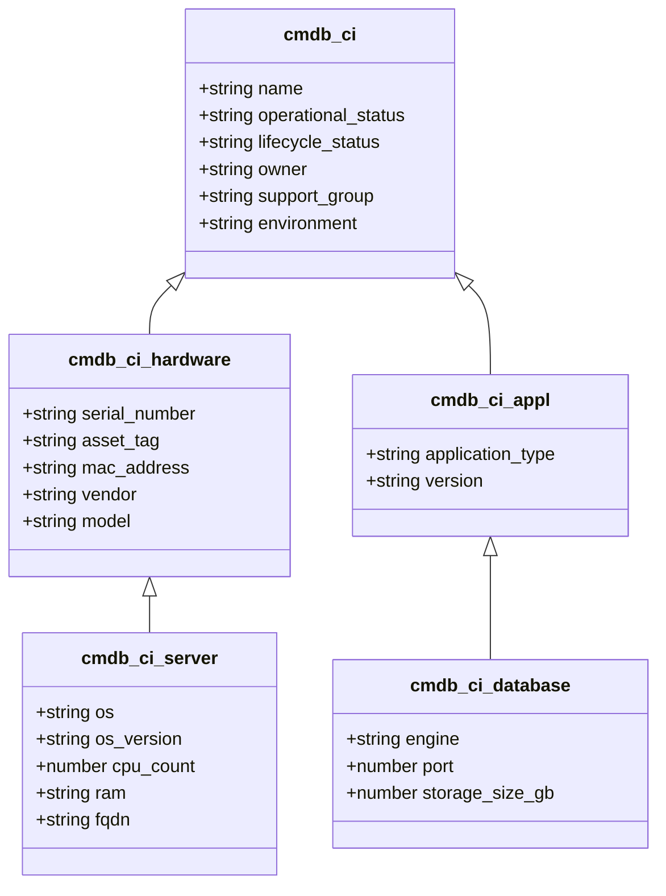

# Module 15: Platform Settings & Schema Configuration

---

## 1. Purpose in One Paragraph
Platform Settings (`/settings/*`) module-oda main objective: Enterprise administrators and CMDB owners-ku schema inheritance hierarchy, mathematical Trust Score algorithm weights, and Role-Based Access Control (RBAC) governance policies-ah customize panna centralized control center tharuvadhu. Idhu ServiceNow-compatible class schema tree, 5-pillar mathematical weight sliders with live worked calculations, and granular role permission matrices-ah manage pannum.

---

## 2. Who Uses It (Permission Table)

| Capability | Viewer | Editor | CMDB Owner | Admin |
| :--- | :---: | :---: | :---: | :---: |
| **Browse Class Hierarchy Tree** | Allowed | Allowed | Allowed | Allowed |
| **View RBAC Permission Matrix** | Allowed | Allowed | Allowed | Allowed |
| **Inspect Trust Score Calculation**| Allowed | Allowed | Allowed | Allowed |
| **Adjust Trust Score Weights** | Denied (Read-only) | Denied | Allowed | Allowed |
| **Modify Role Assignments** | Denied (Hidden) | Denied | Denied | Allowed |
| **Invite Team Members** | Denied (Hidden) | Denied | Allowed | Allowed |

---

## 3. Entry Points
- **Class Hierarchy**: `/settings/classes` (Sidebar "Schema & Classes").
- **Trust Score Weights**: `/settings/trust-score` (Sidebar "Trust Score Config").
- **Roles & Permissions**: `/settings/roles` (Sidebar "Roles & Permissions").
- **Header Settings Dropdown**: User menu in [Header.tsx](file:///d:/zenops/components/layout/Header.tsx).

---

## 4. Preconditions & Required Data
- Authenticated user with an active tenant workspace.
- Base class hierarchy structure defined in [ClassHierarchyView.tsx](file:///d:/zenops/components/cmdb/settings/ClassHierarchyView.tsx#L37).
- Default 5-pillar weights: Freshness (30), Completeness (25), Consistency (20), Relationships (15), Ownership (10).

---

## 5. Main Flow: 3 Core Settings Sub-Modules

### 5.1 Sub-Module A: ServiceNow-Compatible Class Hierarchy (`/settings/classes`)
- **Visual Inheritance Tree**: Renders recursive tree view starting from root `cmdb_ci`:
  - `cmdb_ci` &rarr; `cmdb_ci_hardware` &rarr; `cmdb_ci_server`, `cmdb_ci_network_switch`
  - `cmdb_ci` &rarr; `cmdb_ci_appl` &rarr; `cmdb_ci_database`
  - `cmdb_ci` &rarr; `cmdb_ci_cloud` &rarr; `cmdb_ci_cloud_resource`
- **Node Click**: Clicking any node opens the attribute inspector showing **Inherited Attributes** (e.g. `name`, `operational_status`, `owner` from `cmdb_ci`) and **Class-Specific Attributes** (e.g. `cpu_count`, `ram`, `disk_space` for servers).
- **Live Inventory Count**: Each node displays the real-time count of active CIs in the current tenant matching that class.

### 5.2 Sub-Module B: Trust Score Weight Editor (`/settings/trust-score`)
- **5 Sliders**: User adjusts weights for Freshness, Completeness, Consistency, Relationships, and Ownership.
- **Sum Validation**: Total sum must equal **100%**. If total &ne; 100%, the sum indicator turns red and the "Save Weights" button is disabled with error: *"Total weight sum must equal exactly 100%."*
- **Live Worked Calculation Example**: As sliders move, the interactive card calculates the projected Trust Score for `PROD-DB-MUMBAI-01` in real time:
  $$\text{Score} = \text{round}\left(\frac{95 \times \text{Freshness} + 90 \times \text{Completeness} + 92 \times \text{Consistency} + 85 \times \text{Relationships} + 100 \times \text{Ownership}}{100}\right)$$
- **Reset Defaults**: Button restores standard enterprise weights (30/25/20/15/10).

### 5.3 Sub-Module C: RBAC Roles & Permissions Matrix (`/settings/roles`)
- **Permissions Comparison**: Granular matrix comparing permissions across 4 roles:
  1. **`Viewer`**: Read-only search, filter, view 360 profiles, and export.
  2. **`Editor`**: Create/edit non-prod CIs, inline edit operational attributes.
  3. **`CMDB Owner`**: Resolve DQ tasks, approve IRE merges, certify campaigns, retire CIs.
  4. **`Admin`**: Full system administration, connector configuration, tenant settings.
- **Role Switcher Simulator**: Allows administrators to toggle current session between roles to test the UI experience.

---

## 6. Error & Edge Flows

| Scenario | Trigger / Condition | What System Does | User Experience / Alert |
| :--- | :--- | :--- | :--- |
| **Invalid Weight Sum** | Sliders adjusted such that sum &ne; 100 (e.g. 105%). | [TrustScoreSettingsView.tsx#L65](file:///d:/zenops/components/cmdb/settings/TrustScoreSettingsView.tsx#L65) disables Save button. | Red badge: *"Total: 105% (Must equal 100%)"*. Error toast shown on submit. |
| **Unauthorized Weight Edit** | Viewer navigates to `/settings/trust-score`. | Sliders rendered in disabled / read-only mode. | Sliders locked; Save button hidden for Viewer. |

---

## 7. Business Rules Applied Here

| Rule Code | Rule Condition | System Enforcement | Enforcement File |
| :--- | :--- | :--- | :--- |
| **SET-01** | Mathematical Weight Balance | Trust Score weights must sum to exactly 100 before saving. | [TrustScoreSettingsView.tsx#L33](file:///d:/zenops/components/cmdb/settings/TrustScoreSettingsView.tsx#L33) |
| **SET-02** | Inheritance Attribute Cascading | Child classes must automatically inherit all properties from `cmdb_ci`. | [ClassHierarchyView.tsx#L46](file:///d:/zenops/components/cmdb/settings/ClassHierarchyView.tsx#L46) |

---

## 8. Side Effects
- Updating Trust Score weights recalculates composite health scores across all tenant CIs on next retrieval.
- Role changes dynamically toggle UI action buttons (e.g. Create CI, Retire CI, Bulk Action bar).

---

## 9. Inputs, Outputs & Service Contracts
- **`saveTrustWeights(weights: Record<string, number>): void`**
- **`setUserRole(role: UserRole): void`**

---

## 10. Mermaid Diagrams

### 10.1 Class Inheritance Hierarchy

---

## 11. Worked Example with Real Seed Data
- **Sample CI**: `PROD-DB-MUMBAI-01` (`CI-000492`).
- **Raw Pillar Scores**: Freshness: 95, Completeness: 90, Consistency: 92, Relationships: 85, Ownership: 100.
- **Default Weights** (30/25/20/15/10):
  $$\text{Score} = \frac{(95 \times 30) + (90 \times 25) + (92 \times 20) + (85 \times 15) + (100 \times 10)}{100} = \frac{2850 + 2250 + 1840 + 1275 + 1000}{100} = \mathbf{92\%}$$
- If Admin increases **Ownership weight to 30%** and decreases Freshness to 10%:
  $$\text{Score} = \frac{(95 \times 10) + (90 \times 25) + (92 \times 20) + (85 \times 15) + (100 \times 30)}{100} = \mathbf{93\%}$$

---

## 12. How to Demo This Flow in 2 Minutes (Tanglish Script)

> "Innaiku namma **Platform Settings and Governance Configuration** demo paakalaam:
> 1. Inga 3 core settings iruku: Class Hierarchy, Trust Score Weights, and Roles Matrix.
> 2. First `/settings/classes`: Inga ServiceNow-compatible class inheritance tree paakkalaam (`cmdb_ci > cmdb_ci_hardware > cmdb_ci_server`). Oru node click panna inherited vs class-specific attributes reveal aagum.
> 3. Next `/settings/trust-score`: Inga 5 mathematical sliders iruku (Freshness 30%, Completeness 25%, Consistency 20%, Relationships 15%, Ownership 10%).
> 4. Notice the math: Total sum exact-ah 100% irukanum. Sliders-ah move pannumbodhu keezha `PROD-DB-MUMBAI-01` sample calculation live-ah update aagum!
> 5. Last-ah `/settings/roles`: Complete RBAC matrix comparing Viewer, Editor, CMDB Owner, and Admin capabilities with role testing simulator!"

---

## 13. Test Scenarios (Manual Acceptance Tests)
- **Scenario 1 (Weight Sum Validation)**:
  - *Given*: User adjusts sliders so sum = 105%.
  - *When*: User inspects Save button.
  - *Then*: Button is disabled and red total warning appears.
- **Scenario 2 (Reset Defaults)**:
  - *Given*: Sliders at custom values.
  - *When*: User clicks Reset Defaults.
  - *Then*: Weights restore to 30/25/20/15/10.
- **Scenario 3 (Class Tree Navigation)**:
  - *Given*: User on `/settings/classes`.
  - *When*: Clicks `cmdb_ci_database`.
  - *Then*: Displays inherited `cmdb_ci` fields and active engine/port fields.

---

## 14. Gaps & Next Steps
- **Custom Class Creator**: Currently, class hierarchy is read-only based on the 9 standard ITSM classes; future releases will allow admins to create new child classes directly from the UI.
