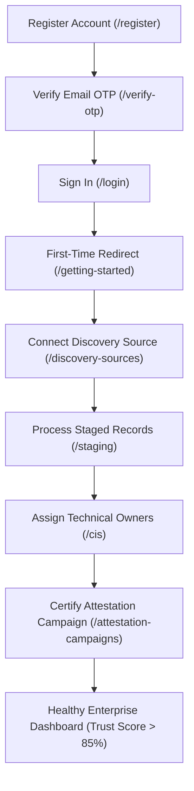
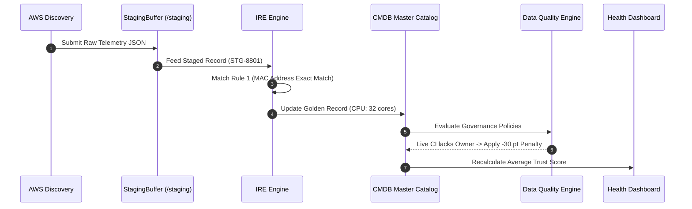
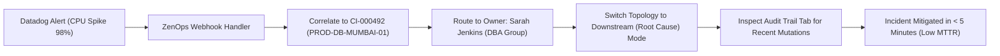
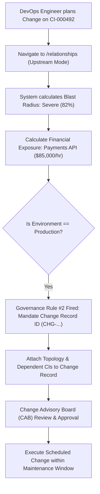

# Cross-Module End-to-End Journeys (`90-END-TO-END-FLOWS.md`)

---

## Journey A: First-Time Company Setup & Onboarding

### Description & Business Context
Oru pudhu technology startup or enterprise subsidiary ZenOps CMDB platform-ku sign up panni, initial discovery run panni, healthy production dashboard attain panra complete end-to-end flow.

### Step-by-Step Execution Table
| Step | Actor | Screen | Action | System Behind Scenes | State / Data Changes | Next Destination |
| :-: | :--- | :--- | :--- | :--- | :--- | :--- |
| **1** | Founder | `/register` | Fills Step 1 (Account credentials) & Step 2 (Workspace: "Startup AI Inc", `startup.zenops.io`) | Calls `AuthService.register()`. Stores pending user. | Creates user `USR-9001` with `emailVerified: false`. | `/verify-otp` |
| **2** | Founder | `/verify-otp` | Clicks "Use Demo Code (123456)" & submits | Calls `AuthService.verifyOtp()`. | Sets `emailVerified: true`. | `/login?banner=verified` |
| **3** | Founder | `/login` | Signs in with `founder@startup.io` | `AuthService.login()` issues `zenops_session`. Detects `onboardingCompleted: false`. | Session established. | `/getting-started` |
| **4** | Founder | `/getting-started`| Clicks "Configure Connectors" (Step 1) | Evaluates Step 1 pending. Routes to connectors. | None | `/discovery-sources` |
| **5** | Founder | `/discovery-sources`| Triggers AWS Discovery Scan | `triggerDiscoveryRun()` ingests 14 initial assets into `/staging`. | `cisDiscovered: 14`. | `/staging` |
| **6** | Founder | `/staging` | Clicks "Process All Through IRE" | Batch executes identification & source weights. | CIs promoted to master catalog. | `/cis` |
| **7** | Founder | `/cis` | Assigns Owners to Live CIs | Resolves Missing Owner flags via bulk bar. | Trust Score jumps to 90%+. | `/attestation-campaigns` |
| **8** | Founder | `/attestation-campaigns`| Certifies initial campaign | Signs off on live operational status. | Attestation reaches 100%. | `/dashboard` |

### Journey A Architecture Flowchart

---

## Journey B: The Continuous Ingestion & Data Quality Pipeline

### Description & Business Context
Incoming raw telemetry cloud connectors-la irundhu ingest aagi, staging buffer, IRE reconciliation, master CMDB catalog, trust scoring, and automated data quality remediation vazhiya travel panra pipeline.

### Step-by-Step Execution Table
| Step | Actor | Screen | Action | System Behind Scenes | State / Data Changes | Next Destination |
| :-: | :--- | :--- | :--- | :--- | :--- | :--- |
| **1** | System Daemon| Backend | Scheduled discovery scan runs on AWS | Connects via `vault://secret/aws/...` and queries EC2 instances. | Telemetry pulled. | `/staging` |
| **2** | System Buffer| `/staging` | Raw JSON lands in staging buffer | Creates `StagingDiscoveryRecord` with status `Pending`. | Record `STG-8801` created. | Buffer queue |
| **3** | IRE Engine | `/ire-console` | Evaluates Identification Hierarchy | Rule 1 (MAC match) matches existing server `PROD-DB-MUMBAI-01` (`CI-000492`). | Confidence: 98%. Action: Update. | Precedence engine |
| **4** | Precedence | Backend | Resolves Source Precedence | AWS weight (90) updates CPU attribute to 32 cores. | Updates CI property. | `/cis/CI-000492` |
| **5** | Algorithm | `/dashboard` | Trust Score recalculated | 5-pillar algorithm re-evaluates freshness (100) and completeness (98). | Trust Score updates to 96%. | Dashboard KPIs |
| **6** | Governance | `/data-quality`| Anomaly check: detects missing owner on unassigned item | Enqueues Data Quality task `DQ-201` (-30 pts penalty). | Creates task in `dataQualityTasks`. | `/data-quality` |
| **7** | Operator | `/data-quality`| Clicks "Apply Fix" | Assigns owner `David Chen`. Restores Trust Score (+30 pts). | Task marked `Applied`. | Dashboard updated |

### Journey B Sequence Diagram

---

## Journey C: High-Severity Incident Triage & Root Cause Tracing

### Description & Business Context
Datadog-la CPU spike alert varum bodhu, SRE incident responder webhook moolama CI correlate panni, downstream root cause identify panni, recently enna change aachu nu audit trail inspect panra P1 workflow.

### Step-by-Step Execution Table
| Step | Actor | Screen | Action | System Behind Scenes | State / Data Changes | Next Destination |
| :-: | :--- | :--- | :--- | :--- | :--- | :--- |
| **1** | Observability| Datadog | CPU spike (98%) on host `PROD-DB-MUMBAI-01` | Datadog dispatches automated webhook to `/api/v1/webhooks/datadog`. | Generates alert payload. | ZenOps Ingestion |
| **2** | IRE Webhook | `/ire-console` | Correlates incoming alert to CI | Resolves host to `CI-000492` (`PROD-DB-MUMBAI-01`). Links `INC-1042` (P1 Critical). | Emits alert toast. | `/cis/CI-000492` |
| **3** | Incident SRE| `/cis/CI-000492`| Opens CI 360 Profile | Inspects technical specs, Owner (`Sarah Jenkins`), and Support Group (`DBA`). | Reads routing info. | Escalation channel |
| **4** | Incident SRE| `/relationships`| Switches to **Downstream (Root Cause)** mode | Traverses graph downward from Payments API to find database & storage dependencies. | Re-orients graph direction. | Downstream canvas |
| **5** | Incident SRE| `/cis/CI-000492`| Opens **Audit Trail** tab | Checks recent events. Discovers inline edit performed 15 minutes ago. | Identifies unauthorized parameter tweak. | Rollback plan |

### Journey C Architecture Diagram

---

## Journey D: Production Change Risk & Blast Radius Analysis

### Description & Business Context
DevOps engineer oru Production database-la kernel upgrade or configuration change plan pannumbodhu, upstream blast radius calculate panni, CAB approval rule satisfy panra change risk journey.

### Step-by-Step Execution Table
| Step | Actor | Screen | Action | System Behind Scenes | State / Data Changes | Next Destination |
| :-: | :--- | :--- | :--- | :--- | :--- | :--- |
| **1** | DevOps Eng | `/cis/CI-000492`| Opens `PROD-DB-MUMBAI-01` profile | Inspects active technical configuration. | Reads current version. | Dependency tab |
| **2** | DevOps Eng | `/cis/CI-000492`| Clicks **Dependency Topology** tab | Evaluates upstream relationships. | Identifies parent: `Payments API`. | Blast radius score |
| **3** | DevOps Eng | `/relationships`| Sets mode to **Upstream (Change Impact)** | Graph traces dependencies upward to Tier 0 Business Services. | Node highlights. | Drawer |
| **4** | DevOps Eng | `/relationships`| Inspects Blast Radius Drawer | Algorithmic score: **Severe (82%)**. Downtime exposure: **$85,000 / hr**. | None | Revenue risk known |
| **5** | DevOps Eng | `/relationships`| Clicks **Attach to Change** | Links CI and 3 dependent nodes to Jira Change Record `CHG-2024-8812`. | Emits confirmation toast. | Jira Service Mgmt |
| **6** | CAB Manager | Jira / ZenOps | Reviews Change Request | Verifies that all 3 dependent services have maintenance windows scheduled. | CAB Approval granted. | Maintenance window |

### Journey D Decision Flowchart

---

## Journey E: Retiring an Enterprise Production CI

### Step-by-Step Execution Table
| Step | Actor | Screen | Action | System Behind Scenes | State / Data Changes | Next Destination |
| :-: | :--- | :--- | :--- | :--- | :--- | :--- |
| **1** | Admin | `/cis/CI-000492`| Clicks red **Retire CI** button | Evaluates `ci.environment === "Production"`. | Opens Rule #2 modal. | Modal dialog |
| **2** | Admin | Modal Dialog | Attempts to confirm without entering Change ID | `handleRetire()` detects empty `changeRecord`. Blocks action. | None | Red error message |
| **3** | Admin | Modal Dialog | Enters `CHG-008912` and reason: *"Decommissioned post-migration"* | Validates Change format. Calls `retireCI()`. | Updates CI state. | Profile reloads |
| **4** | System | `cmdb-context.tsx`| Sets `lifecycleStatus: "Retired"` & `operationalStatus: "Non-operational"` | Prepares 2 audit records. | Modifies CI in `cis`. | Audit history |
| **5** | System | `cmdb-context.tsx`| Appends immutable audit records | Logs actor `Sarah Jenkins`, Change ID `CHG-008912`. | Writes records. | Profile updated |
| **6** | Admin | `/cis/CI-000492`| Inspects updated profile | Header renders bold red `RETIRED` lozenge. Inline edit disabled. | Profile locked. | `/cis` |

---

## Journey F: Stale CI Lifecycle & Nightly Automated Sweep

### Step-by-Step Execution Table
| Step | Actor | Screen | Action | System Behind Scenes | State / Data Changes | Next Destination |
| :-: | :--- | :--- | :--- | :--- | :--- | :--- |
| **1** | Clock Daemon | Scheduled Job| 2:00 AM Nightly Cron executes | Queries all CIs where `now - lastDiscovered > 14 days`. | Detects 2 inactive VMs. | Data Quality engine |
| **2** | System | `/data-quality`| Generates Data Quality task | Creates task `DQ-202` (`Stale Discovery`) with confidence 89%. | Enqueues in `dataQualityTasks`. | Task list |
| **3** | Platform Lead| `/dashboard` | Inspects **Stale CIs** KPI tile | Metric displays 19% stale velocity. Clicks card link. | Navigates route. | `/data-quality` |
| **4** | Platform Lead| `/data-quality`| Selects Stale task & verifies | Discovers abandoned test VM in staging account. | Decides decommission. | `/cis/[id]` |
| **5** | Platform Lead| `/cis/[id]` | Retires abandoned VM | Lifecycle becomes `Retired`. Staging resources deleted. | Stale count drops. | Dashboard healthy |

---

## Journey G: Duplicate Telemetry Reconciliation & Golden Record Merge

### Step-by-Step Execution Table
| Step | Actor | Screen | Action | System Behind Scenes | State / Data Changes | Next Destination |
| :-: | :--- | :--- | :--- | :--- | :--- | :--- |
| **1** | Discovery | AWS & SCCM | Both tools ingest server with same MAC `02:42:0a:f0:00:0c` | AWS reports Name: `prod-db-mumbai-01`, SCCM reports Name: `PROD-DB-MUMBAI-01.corp`. | Staged payloads created. | `/staging` |
| **2** | IRE Engine | `/staging` | Evaluates Rule 1 (MAC Match) | Identifies duplicate candidate. Correlates to existing CI `CI-000492`. | Confidence: 98%. | Attribute weighting |
| **3** | Precedence | Backend | Resolves Source Weights | AWS wins network IP (85); SCCM wins OS version (100). | Merges attributes. | Golden Record |
| **4** | System | CMDB Catalog | Merges into single Golden Record | Updates single record; prevents creation of 2nd duplicate CI. | Duplicate count = 0. | Immutable audit log |

---

## Journey H: Quarterly Compliance Attestation Cycle

### Step-by-Step Execution Table
| Step | Actor | Screen | Action | System Behind Scenes | State / Data Changes | Next Destination |
| :-: | :--- | :--- | :--- | :--- | :--- | :--- |
| **1** | Auditor | `/attestation-campaigns` | Clicks "Launch Campaign": *"Q1 SOX Database Review"* | Initializes campaign `ATT-01` with 14 target databases. | Creates campaign record. | Campaign grid |
| **2** | CI Owner | Notification | Receives review assignment | Opens campaign view filtered to owned assets. | Prepares checklist. | Target CI list |
| **3** | CI Owner | `/attestation-campaigns` | Clicks **Certify Live** on 13 active databases | `certifyCampaignCI()` stamps `lastVerified = now`. | Increments `certifiedCIs`. | Progress bar advances |
| **4** | CI Owner | `/attestation-campaigns` | Clicks **Flag Stale** on 1 decommissioned database | Sets status `Rejected`. Enqueues decommissioning ticket. | Increments `rejectedCIs`. | 100% completion |
| **5** | System | Backend | Campaign completion reaches 100% | Transitions campaign outcome to `Completed`. | Logs final audit record. | SOX compliance passed |

---

## Journey I: Strict Multi-Tenant Data Isolation

### Step-by-Step Execution Table
| Step | Actor | Screen | Action | System Behind Scenes | State / Data Changes | Next Destination |
| :-: | :--- | :--- | :--- | :--- | :--- | :--- |
| **1** | Admin | Header | Switches Workspace to `ZenDev Software Technologies` | Context sets `activeTenant: "ZenDev Software Technologies"`. | Loads `CMP_1001_ZENDEV.json`. | 21 CIs visible |
| **2** | Admin | `/cis` | Observes inventory | Displays `CI-000492` (`PROD-DB-MUMBAI-01`). | Isolated to ZenDev. | ZenDev catalog |
| **3** | Admin | Header | Switches Workspace to `Choose My Career` | Context sets `activeTenant: "Choose My Career"`. | Loads `CMP_1009_CHOOSECY.json`. | 2 CIs visible |
| **4** | Admin | `/cis` | Observes inventory | `CI-000492` is completely invisible! Displays only ChooseCy CIs (`CI-2001`, `CI-2002`). | Zero data leakage. | ChooseCy catalog |
| **5** | Admin | `/audit-history` | Checks audit log | Displays only audit events created under `sys_domain: "choosecy.zenops.io"`. | Audits fully segregated. | Compliant multi-tenancy |

---

## Journey J: Team Invitation & Role-Limited Onboarding

### Step-by-Step Execution Table
| Step | Actor | Screen | Action | System Behind Scenes | State / Data Changes | Next Destination |
| :-: | :--- | :--- | :--- | :--- | :--- | :--- |
| **1** | Admin | `/settings/roles`| Clicks "Invite Team Member" | Enters email `auditor@partner.com`, assigns role **`Viewer`**. | Generates token `INV-9921`. | Invite link copied |
| **2** | Invitee | Browser | Opens `/accept-invite?token=INV-9921` | Pre-populates email and tenant. Prompts for password. | Validates invite token. | Set password form |
| **3** | Invitee | `/accept-invite`| Enters secure password & clicks "Join Workspace" | `AuthService.acceptInvite()` creates user with role `Viewer`. | Stores user record. | `/login?banner=verified` |
| **4** | Invitee | `/login` | Signs in as Viewer | Session established with `role: "Viewer"`. | Reads session. | `/dashboard` |
| **5** | Invitee | `/cis` | Navigates inventory table | "Create CI", "Import CSV", row edit, and retire buttons are **completely hidden**! | Read-only enforcement. | Compliant read-only UI |
