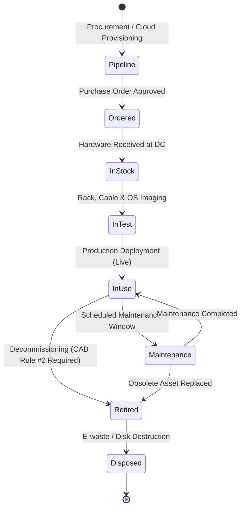
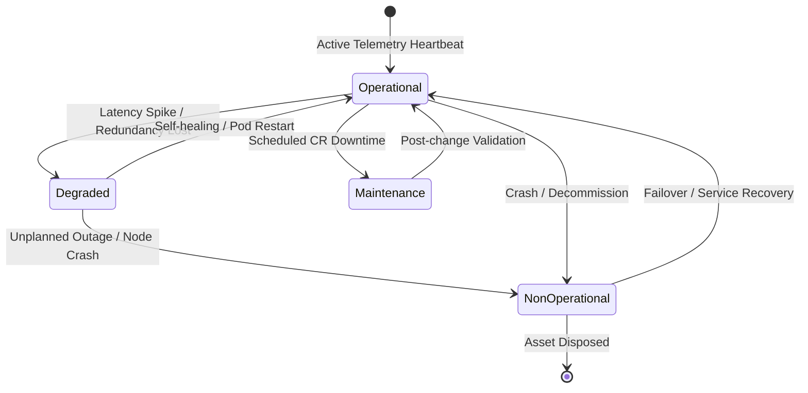
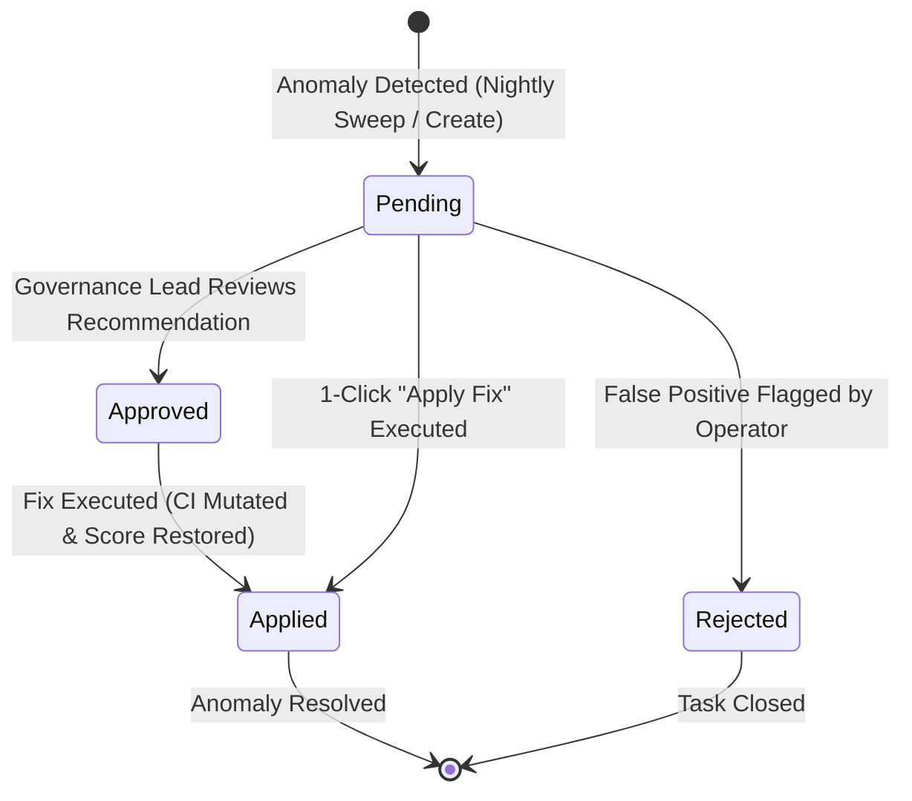
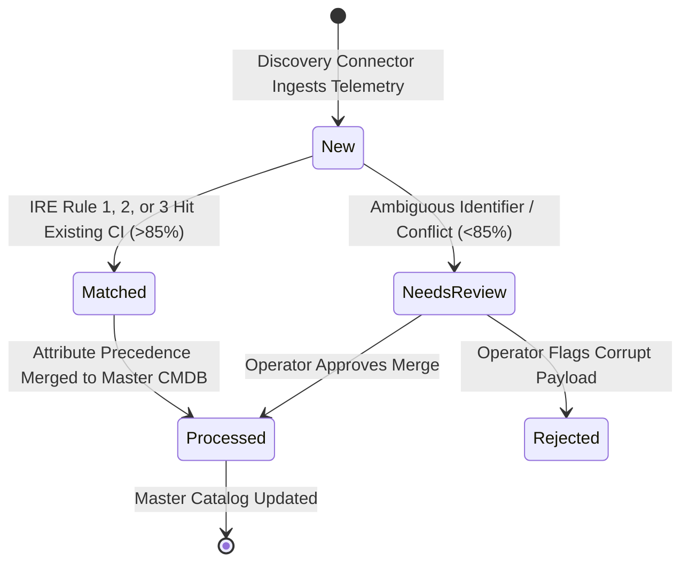
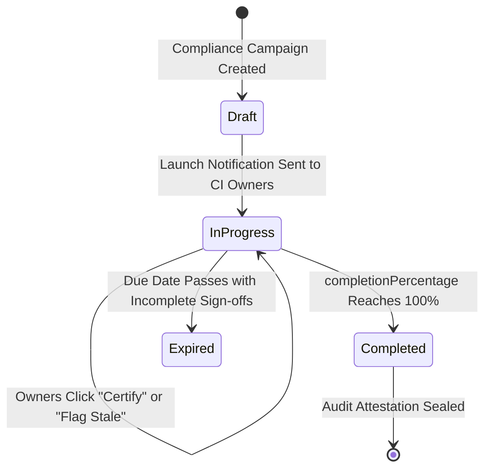
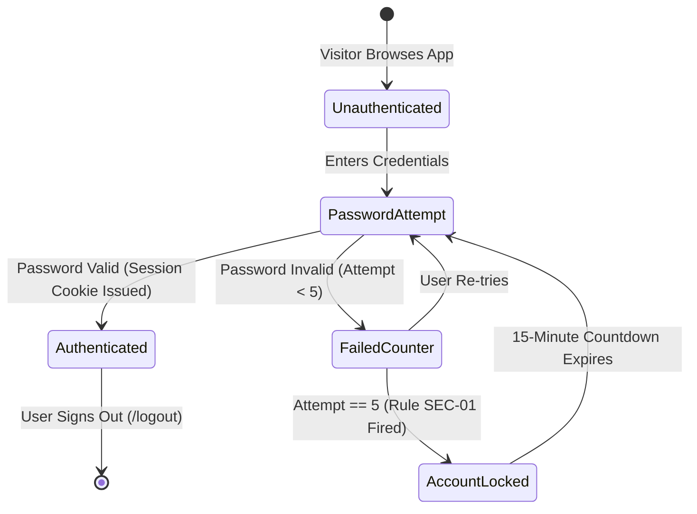

# State Machines, Lifecycle Models & Master Rules (`91-STATE-MACHINES-AND-RULES.md`)

---

## 1. CI Lifecycle State Machine (`lifecycleStatus`)

### CI Lifecycle Transition Matrix
| From State | Allowed To State | Trigger / Action | Enforced Rule | Required Actor Role |
| :--- | :--- | :--- | :--- | :--- |
| **Pipeline** | `Ordered` | PO approved | Asset tag allocated | Procurement / Admin |
| **Ordered** | `In Stock` | Physical arrival | Serial number verified | Datacenter Ops |
| **In Stock** | `In Test` | Staging deploy | Network IP assigned | Systems Engineer |
| **In Test** | `In Use` | Production cutover | **Rule #1: Must have Owner & Support Group** | Platform Eng / Admin |
| **In Use** | `Maintenance` | CAB maintenance window | Scheduled CR linked | DevOps / DBA |
| **Maintenance** | `In Use` | Service restored | Health probe OK | DevOps / DBA |
| **In Use** | `Retired` | Asset decommissioning | **Rule #2: Mandatory Change Record (`CHG-...`)** | CMDB Owner / Admin |
| **Retired** | `Disposed` | Certificate of Destruction | Disk sanitization completed | Compliance Lead |

---

## 2. Operational Status State Machine (`operationalStatus`)

---

## 3. Data Quality Task State Machine (`status`)

---

## 4. Staging Record Lifecycle

---

## 5. Attestation Campaign State Machine

---

## 6. Authentication, OTP & Lockout State Machine

---

## 7. Mathematical Trust Score Formula & Bands

The ZenOps algorithmic Trust Score evaluates 5 fundamental pillars weighted to exactly 100%:

$$\text{TrustScore} = \left(\text{Freshness} \times 0.30\right) + \left(\text{Completeness} \times 0.25\right) + \left(\text{Consistency} \times 0.20\right) + \left(\text{Relationships} \times 0.15\right) + \left(\text{Ownership} \times 0.10\right)$$

### Pillar Scoring Criteria
1. **Freshness (Weight: 30%)**:
   - `lastDiscovered` within 24 hours = 100%
   - `lastDiscovered` within 7 days = 85%
   - `lastDiscovered` within 14 days = 60%
   - `lastDiscovered` > 14 days = 20% (Stale penalty)
2. **Completeness (Weight: 25%)**:
   - Evaluates mandatory attributes: Name, Class, Environment, Criticality, IP Address, Serial/Cloud ID.
3. **Consistency (Weight: 20%)**:
   - Evaluates conflict-free identifiers across discovery feeds (e.g. matching FQDN and MAC).
4. **Relationships (Weight: 15%)**:
   - Has at least 1 upstream or downstream dependency edge = 100%. Orphan = 20%.
5. **Ownership (Weight: 10%)**:
   - Has designated Owner and Support Group = 100%. Unassigned Live CI = 0% (-30 pt penalty overall).

### Health Color Bands
| Score Range | Health Tier | Visual Lozenge | Semantic Meaning / Action Mandated |
| :---: | :---: | :---: | :--- |
| **80 – 100** | **Optimal** | Bold Green | **Production Ready**: Fully authoritative for automated Change CAB approvals. |
| **60 – 79** | **Adequate** | Amber Lozenge | **Usable with Caution**: Non-critical attributes or stale telemetry detected. |
| **0 – 59** | **Needs Attention** | Danger Red | **Untrusted / Blocked**: Missing owner or critical identifiers. Data quality tasks raised. |

### Worked Example: `CI-000492` (`PROD-DB-MUMBAI-01`)
- Freshness: $95 \times 0.30 = 28.5$
- Completeness: $98 \times 0.25 = 24.5$
- Consistency: $96 \times 0.20 = 19.2$
- Relationships: $95 \times 0.15 = 14.25$
- Ownership: $100 \times 0.10 = 10.0$
- **Total Composite Trust Score**: $28.5 + 24.5 + 19.2 + 14.25 + 10.0 = \mathbf{96.45\% \rightarrow 96\%}$ (**Optimal Tier**).

---

## 8. Master Business Rules Table

| Rule ID | Rule Name | Description | Enforced Where in Code | Visible in Screen |
| :--- | :--- | :--- | :--- | :--- |
| **RULE-01** | **Live CI Ownership Mandate** | Operational/In-Use CIs must have an assigned Owner and Support Group. Missing ownership applies a -30 pt Trust penalty and generates an automatic Data Quality task. | [CIForm.tsx#L144](file:///d:/zenops/components/cmdb/CIForm.tsx#L144), [cmdb-context.tsx#L358](file:///d:/zenops/context/cmdb-context.tsx#L358) | `/cis/new`, `/dashboard` |
| **RULE-02** | **Production Retirement CAB Safeguard** | Retiring any Production CI strictly requires an authorized Change Record (`CHG-...`) and triggers a modal previewing dependent nodes and blast radius score. | [CIRetireModal.tsx#L36](file:///d:/zenops/components/cmdb/CIRetireModal.tsx#L36), [cmdb-context.tsx#L640](file:///d:/zenops/context/cmdb-context.tsx#L640) | `/cis/[id]`, `/cis` |
| **RULE-03** | **Immutable Audit Trail** | Every state mutation (Create, Edit, Retire, Bulk Reassign, Apply Fix, Attest) appends a tamper-evident audit record with actor, timestamp, and before/after diffs. | [cmdb-context.tsx#L325](file:///d:/zenops/context/cmdb-context.tsx#L325) | `/audit-history`, `/cis/[id]` |
| **RULE-04** | **Strict Multi-Tenant Scoping** | All queries and mutations are isolated by `company_id` and `sys_domain`. Switching tenants guarantees zero cross-tenant data leakage. | [cmdb-service.ts#L66](file:///d:/zenops/services/cmdb-service.ts#L66), [cmdb-context.tsx#L164](file:///d:/zenops/context/cmdb-context.tsx#L164) | Global Header Dropdown |
| **RULE-05** | **Account Lockout Security** | 5 consecutive failed login attempts lock the user account for 15 minutes with a live countdown timer. | [services/auth-service.ts#L225](file:///d:/zenops/services/auth-service.ts#L225) | `/login` |
| **RULE-06** | **Route Protection** | Non-auth routes mandate a valid `zenops_session` cookie; unauthenticated requests redirect to `/login?next=URL`. | [middleware.ts#L36](file:///d:/zenops/middleware.ts#L36) | All Protected Routes |
| **RULE-07** | **IRE Rule Hierarchy** | Identification evaluates strictly in order: Rule 1 MAC &rarr; Rule 2 Serial &rarr; Rule 3 Name+Class &rarr; Rule 4 Fallback Create. | [cmdb-service.ts#L210](file:///d:/zenops/services/cmdb-service.ts#L210) | `/ire-console`, `/reconciliation-rules` |
| **RULE-08** | **Source Authority Precedence** | Higher source weight overwrites lower source weight during property conflict merge. | [cmdb-service.ts#L250](file:///d:/zenops/services/cmdb-service.ts#L250) | `/ire-console` |
| **RULE-09** | **Service SLA Breach Alert** | Any Business Service with a Trust Score &lt; 70% displays a red border alert and warning badge. | [BusinessServicesView.tsx#L78](file:///d:/zenops/components/cmdb/BusinessServicesView.tsx#L78) | `/services`, `/dashboard` |
| **RULE-10** | **Mathematical Weight Balance** | Trust Score sliders must sum to exactly 100% before saving is permitted. | [TrustScoreSettingsView.tsx#L33](file:///d:/zenops/components/cmdb/settings/TrustScoreSettingsView.tsx#L33) | `/settings/trust-score` |
