# Data Flow, Service Contracts & Granular RBAC (`92-DATA-FLOW-AND-ROLES.md`)

---

## 1. Granular RBAC Permissions Matrix

Verified directly from active checks in [RolesPermissionsView.tsx](file:///d:/zenops/components/cmdb/settings/RolesPermissionsView.tsx) and [cmdb-context.tsx#L158](file:///d:/zenops/context/cmdb-context.tsx#L158):

| Operational Action / Capability | Viewer (`Alex Rivera`) | Editor (`Priya Sharma`) | CMDB Owner (`David Chen`) | Admin (`Sarah Jenkins`) |
| :--- | :---: | :---: | :---: | :---: |
| **Search, Filter & Browse Inventory** | Allowed | Allowed | Allowed | Allowed |
| **Inspect CI 360 Deep Profile & Tabs** | Allowed | Allowed | Allowed | Allowed |
| **View 5-Tier Dependency Topology** | Allowed | Allowed | Allowed | Allowed |
| **Inspect Downtime Financial Risk** | Allowed | Allowed | Allowed | Allowed |
| **Export CMDB Data (JSON & CSV)** | Allowed | Allowed | Allowed | Allowed |
| **Inspect Immutable Audit History** | Allowed | Allowed | Allowed | Allowed |
| **Create & Provision Non-Prod CIs** | **Denied** (Hidden) | Allowed | Allowed | Allowed |
| **Inline Edit CI Technical Attributes** | **Denied** (Read-only) | Allowed | Allowed | Allowed |
| **Retire Non-Production CIs** | **Denied** (Hidden) | **Denied** (Hidden) | Allowed | Allowed |
| **Retire Production CIs (Requires CHG)**| **Denied** (Hidden) | **Denied** (Hidden) | Allowed | Allowed |
| **Resolve & Apply Data Quality Fixes** | **Denied** (Hidden) | **Denied** (Hidden) | Allowed | Allowed |
| **Run 2 AM Nightly Staleness Sweep** | **Denied** (Hidden) | **Denied** (Hidden) | Allowed | Allowed |
| **Execute IRE Reconciliation & Merge** | **Denied** (Hidden) | **Denied** (Hidden) | Allowed | Allowed |
| **Certify Attestation Campaigns** | **Denied** (Read-only) | **Denied** (Read-only) | Allowed | Allowed |
| **Trigger On-Demand Discovery Scan** | **Denied** (Hidden) | **Denied** (Hidden) | Allowed | Allowed |
| **Configure Discovery Connectors** | **Denied** (Hidden) | **Denied** (Hidden) | **Denied** (Hidden) | Allowed |
| **Modify Trust Score 5-Pillar Weights** | **Denied** (Locked) | **Denied** (Locked) | Allowed | Allowed |
| **Manage RBAC Roles & Team Invites** | **Denied** (Hidden) | **Denied** (Hidden) | **Denied** (Hidden) | Allowed |

---

## 2. End-to-End Data Movement Architecture

```mermaid
flowchart TD
    subgraph Ingestion ["1. External Ingestion"]
        A1["Cloud Providers (AWS, Azure)"]
        A2["Agents (Dynatrace, CrowdStrike)"]
        A3["Kubernetes Operator"]
        A4["Manual CSV Uploads"]
    end

    subgraph Buffer ["2. Buffer & Staging"]
        B1["Raw Discovery Staging (/staging)"]
    end

    subgraph Engine ["3. Identification & Rules Engine"]
        C1["IRE Precedence Rules (MAC -> Serial -> Name)"]
        C2["Source Authority Weight Matrix"]
    end

    subgraph CoreService ["4. ZenOps Service Layer"]
        D1["CMDBService (services/cmdb-service.ts)"]
        D2["AuthService (services/auth-service.ts)"]
    end

    subgraph SecurityFilter ["5. Tenant Isolation Filter"]
        E1["Company ID Scoping (CMP_1001, etc.)"]
        E2["Session RBAC Permission Check"]
    end

    subgraph Store ["6. Data Stores"]
        F1["Master CI Catalog (Local / DB)"]
        F2["Immutable Audit Event Store"]
        F3["Data Quality Task Queue"]
        F4["Attestation Campaigns"]
    end

    subgraph Consumers ["7. UI Views & Integrations"]
        G1["Health Dashboard (/dashboard)"]
        G2["High-Density CI Table (/cis)"]
        G3["Dependency Topology (/relationships)"]
        G4["Change Advisory Board (CAB) Validation"]
        G5["Incident Triage Webhooks (Datadog)"]
    end

    Ingestion --> Buffer
    Buffer --> Engine
    Engine --> CoreService
    CoreService --> SecurityFilter
    SecurityFilter --> Store
    Store --> Consumers
```



---

## 3. Service Layer Function Catalog & TypeScript Signatures

### 3.1 `CMDBService` ([services/cmdb-service.ts](file:///d:/zenops/services/cmdb-service.ts))

```typescript
// CI Retrieval & Filtering
static async fetchCIs(tenant?: string, env?: string): Promise<CIItem[]>;
static async fetchPaginatedCIs(params: CIPaginationParams): Promise<PaginatedResult<CIItem>>;
static async fetchCIById(id: string, tenant?: string): Promise<CIItem | null>;

// Business Services & Financial Exposure
static async fetchBusinessServices(tenant?: string): Promise<BusinessServiceItem[]>;

// Raw Discovery Staging Buffer
static async fetchStagingRecords(tenant?: string): Promise<StagingDiscoveryRecord[]>;

// IRE Engine Simulator
static async simulateIRE(payload: IREPayload): Promise<IRESimulationResult[]>;

// Governance, Audit & Telemetry
static async fetchRelationships(): Promise<CIRelationship[]>;
static async fetchDiscoverySources(): Promise<DiscoverySource[]>;
static async fetchReconciliationRules(): Promise<ReconciliationRule[]>;
static async fetchDataQualityTasks(tenant?: string): Promise<DataQualityTask[]>;
static async fetchAttestationCampaigns(tenant?: string): Promise<AttestationCampaign[]>;
static async fetchAuditHistory(tenant?: string): Promise<CIAuditHistory[]>;

// External API Bridge (Prepared for Backend)
static async saveCI(ci: Partial<CIItem>): Promise<CIItem | null>;
```

### 3.2 `AuthService` ([services/auth-service.ts](file:///d:/zenops/services/auth-service.ts))

```typescript
// Credentials & Session Management
static async login(credentials: LoginCredentials): Promise<AuthResponse>;
static async register(data: RegisterData): Promise<AuthResponse>;
static async verifyOtp(data: VerifyOtpData): Promise<AuthResponse>;
static async resendOtp(email: string): Promise<AuthResponse>;
static async requestPasswordReset(email: string): Promise<AuthResponse>;
static async verifyResetOtp(email: string, otp: string): Promise<AuthResponse>;
static async resetPassword(data: ResetPasswordData): Promise<AuthResponse>;
static async acceptInvite(data: AcceptInviteData): Promise<AuthResponse>;

// Session Cookie Accessors
static getSession(): AuthSession | null;
static clearSession(): void;
static getUserRole(): UserRole;
```

---

## 4. Real Backend Transition Roadmap ("What Changes When Connected")

The frontend is architected with complete clean architecture boundaries. UI views **never access mock data directly**. When connecting to an enterprise PostgreSQL / Prisma / Go microservice backend, the migration path is 100% confined to `services/*`:

| Layer / Component | Current Implementation | Real Production Backend Replacement | Effort to Switch |
| :--- | :--- | :--- | :---: |
| **API Endpoints** | In-memory arrays & JSON imports | REST / GraphQL endpoints (`/api/v1/cis`, etc.) | Low (Update `baseUrl`) |
| **Persistence** | Browser `localStorage` per tenant | PostgreSQL database with Row-Level Security (`tenant_id = ?`) | Zero UI changes |
| **Session Security** | Base64 client cookie (`zenops_session`) | HTTP-only, secure, SameSite JWT / Redis session token | Zero UI changes |
| **Password Storage** | In-memory dictionary with PBKDF2 | Argon2id / bcrypt hashed passwords in user table | Zero UI changes |
| **Email Gateway** | Console log + demo test code (`123456`) | AWS SES / SendGrid / Postmark transactional API | Zero UI changes |
| **Discovery Worker** | Client-side 1800ms timer simulation | Celery / Temporal async background worker daemon | Zero UI changes |
| **Audit Storage** | Append-only in-memory array | Immutable SQL audit table with append-only write permissions | Zero UI changes |
| **50k Virtualization** | Slice of in-memory array | SQL cursor streaming with `@tanstack/react-virtual` | Zero UI changes |
